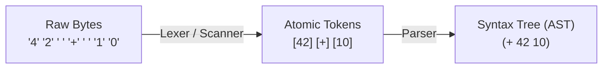

# Step 1.1: What is a Token?

Before a compiler can understand what a program means, it must read what the program says.

To your operating system and your text editor, source code is merely an unbroken stream of raw bytes.  When you write:

```text
def fib(x)
```

The machine initially sees ten individual characters:

```text
['d', 'e', 'f', ' ', 'f', 'i', 'b', '(', 'x', ')']
```

A human reading that line does not think in individual letters.  You do not see `'f'` followed by `'i'` and `'b'`.  You see a name: `fib`.  You recognise `def` as a keyword, `(` as the start of an argument list, and `x` as a parameter name.

In compiler engineering, each of these indivisible units of syntax is called a **Token**.

---

## The Atom of Syntax

An atom is an indivisible entity: something that cannot be divided into smaller pieces without destroying what it is.  In chemistry, an atom is the fundamental building block of matter.  In compiler construction, a token is the atom of syntax.

Consider the expression:

```text
42 + 10
```

* Is `4` a meaningful building block here?  No.  Neither is `2`.  Taken alone, neither digit represents the quantity being added.  Only together do they form the number `42`.
* Is `+` a token?  Yes.  It is the atomic operator for addition.
* Are the spaces tokens?  No.  They separate the atoms so the characters do not run together, but they carry no syntactic meaning of their own.

When we break the expression into its atoms, we get three tokens:
1.  Number: `42`
2.  Operator: `+`
3.  Number: `10`

---

## Why Is This the Right Building Block?

Why not feed raw characters directly into the parser?

Imagine trying to define a grammar rule for addition:

```text
expression = term + term
```

If the parser operated directly on raw characters, that rule could not look like that.  It would have to account for any number of spaces between digits, handle tabs or carriage returns, recognise comment characters, and assemble decimal points on the fly:

```text
expression = (optional spaces) (sequence of digits or characters) (optional spaces) '+' (optional spaces) ...
```

Every single grammar rule in the compiler would be buried under the bookkeeping of skipping spaces and assembling words.  The grammar would collapse under its own weight.



Notice the representation `(+ 42 10)`: in an Abstract Syntax Tree, the operator `+` becomes the root node governing its two operand children, `42` and `10`.  The flat sequence of tokens has become a hierarchical tree.

By establishing tokens as our fundamental building block, we draw a clean boundary:
* **Below the boundary (The Lexer)**: Slices a messy stream of bytes into a tidy sequence of atomic tokens, throwing away whitespace and comments.
* **Above the boundary (The Parser)**: Arranges those tokens into expressions and logic, completely oblivious to characters, spaces, or tabs.

Once the lexer runs, the rest of the compiler never thinks about raw characters again.

---

## Starting with Single-Character Tokens

Before our scanner recognises multi-character words (`def`) or numbers (`3.14159`), we will begin with the simplest tokens in the language: single-character punctuation like `+`, `*`, and `;`.

Create a file named `kaleidoscope.cpp` in your favourite editor, and type the following fifteen lines by hand:

```cpp
#include <cstdio>

int main() {
  printf("Kaleidoscope Token Inspector (Step 1)\n");
  printf("Type characters and press Enter (Ctrl+D to exit):\n\n");

  int c;
  while ((c = getchar()) != EOF) {
    if (c != '\n' && c != '\r')
      printf("Token: '%c' (ASCII %d)\n", static_cast<char>(c), c);
  }

  printf("[EOF]\n");
  return 0;
}
```

---

## Compiling and Running

Compile the code with Clang:

```bash
clang++ -Wall -Wextra kaleidoscope.cpp -o kaleidoscope
```

Run the binary:

```bash
./kaleidoscope
```

Type `+ * ;` and press Enter:

```text
Kaleidoscope Token Inspector (Step 1)
Type characters and press Enter (Ctrl+D to exit):

+ * ;
Token: '+' (ASCII 43)
Token: ' ' (ASCII 32)
Token: '*' (ASCII 42)
Token: ' ' (ASCII 32)
Token: ';' (ASCII 59)
```

Press `Ctrl+D` (or `Ctrl+Z` on Windows) to send EOF and exit.

Notice what happened: your binary consumed standard input character by character using `getchar()` and printed each character along with its ASCII code.

However, notice the output for the spaces: our naive scanner treated spaces as tokens (`ASCII 32`).  As we observed earlier, whitespace separates atoms, but is not an atom itself.

In [Step 1.2](02-skipping-whitespace.md), we will teach our scanner to discard whitespace automatically.
