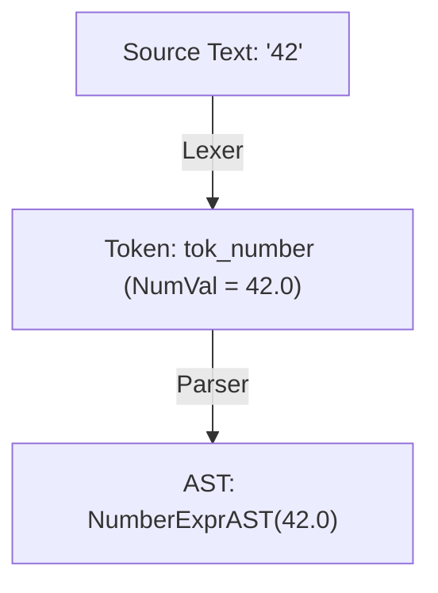

# Step 2.1: The Base AST and Numbers

Welcome to Step 2.1.  In this step, we establish our Abstract Syntax Tree (AST) foundation and parse our first language construct: numeric literals.

---

## What is an Abstract Syntax Tree?

In Section 1, our scanner converted raw characters into a stream of tokens.  However, a flat list of tokens does not tell the compiler how expressions relate to each other.

An **Abstract Syntax Tree (AST)** captures the hierarchical structure of a program in memory:



In the AST, trivia like whitespace, comments, and delimiters are gone.  Only the semantic operations and values remain.  Later stages of our compiler will traverse this tree to generate machine code.

---

## Incremental Code Changes

Open your `kaleidoscope.cpp` file from Section 1.  You will make four targeted additions.

### 1. New Header Includes

At the very top of `kaleidoscope.cpp`, include `<iostream>` (for stream printing) and `<memory>` (for `std::unique_ptr`):

```cpp
#include <cctype>
#include <cstdio>
#include <cstdlib>
#include <iostream>
#include <memory>
#include <string>
```

### 2. The Base AST Class and NumberExprAST

In C++, each AST node is represented by a class that inherits from a common base class, `ExprAST`.

To give us immediate visual confirmation that our parser works, we give `ExprAST` a virtual `print()` method.  Directly below your `gettok()` function, add our AST node hierarchy:

```cpp
//===----------------------------------------------------------------------===//
// Abstract Syntax Tree (AST)
//===----------------------------------------------------------------------===//

/// ExprAST - Base class for all expression nodes.
class ExprAST {
public:
  virtual ~ExprAST() = default;
  virtual void print(std::ostream &OS) const = 0;
};

/// NumberExprAST - Expression class for numeric literals like "1.0".
class NumberExprAST : public ExprAST {
  double Val;

public:
  explicit NumberExprAST(double Val) : Val(Val) {}

  void print(std::ostream &OS) const override {
    OS << "(Number " << Val << ")";
  }
};
```

Whenever we parse a number, we will instantiate a `NumberExprAST` node storing its value.

### 3. Parsing Numbers

Parsing is driven by a global token buffer named `CurTok`.  Whenever the parser consumes a token, it advances to the next token by calling `getNextToken()`.

Directly below `NumberExprAST`, add our initial parser functions:

```cpp
//===----------------------------------------------------------------------===//
// Parser
//===----------------------------------------------------------------------===//

static int CurTok;
static int getNextToken() { return CurTok = gettok(); }

static std::unique_ptr<ExprAST> LogError(const char *Str) {
  fprintf(stderr, "Error: %s\n", Str);
  return nullptr;
}

/// numberexpr ::= number
static std::unique_ptr<ExprAST> ParseNumberExpr() {
  auto Result = std::make_unique<NumberExprAST>(NumVal);
  getNextToken(); // consume number token
  return Result;
}

/// expression ::= numberexpr
static std::unique_ptr<ExprAST> ParseExpression() {
  if (CurTok == tok_number)
    return ParseNumberExpr();
  return LogError("expected a number");
}
```

Notice what `ParseNumberExpr()` does: it takes `NumVal` (populated by our lexer), wraps it in a `NumberExprAST`, advances the token stream with `getNextToken()`, and returns the AST pointer.

### 4. The Interactive AST REPL

Replace your old token-testing `main()` function with an interactive driver loop that parses expressions and prints their syntax trees:

```cpp
//===----------------------------------------------------------------------===//
// Interactive Driver Loop
//===----------------------------------------------------------------------===//

static void MainLoop() {
  while (true) {
    fprintf(stderr, "ready> ");
    switch (CurTok) {
    case tok_eof:
      return;
    case ';':
      getNextToken(); // ignore top-level semicolons
      break;
    default:
      if (auto AST = ParseExpression()) {
        std::cout << "Parsed AST: ";
        AST->print(std::cout);
        std::cout << "\n";
      } else {
        getNextToken(); // skip bad token for error recovery
      }
      break;
    }
  }
}

int main() {
  printf("Kaleidoscope AST Inspector (Step 2.1: Numbers)\n");
  printf("Type a number followed by ';' and press Enter (Ctrl+D to exit):\n\n");

  getNextToken(); // prime the first token
  MainLoop();

  return 0;
}
```

---

## Verifying Your Code

Before compiling, check that your `kaleidoscope.cpp` has all additions in place.

<details>
<summary>Click here to compare against the reference kaleidoscope.cpp</summary>

```cpp
#include <cctype>
#include <cstdio>
#include <cstdlib>
#include <iostream>
#include <memory>
#include <string>

//===----------------------------------------------------------------------===//
// Lexer
//===----------------------------------------------------------------------===//

enum Token {
  tok_eof = -1,

  // Commands / Keywords
  tok_def = -100,
  tok_extern = -101,

  // Primary
  tok_identifier = -200,
  tok_number = -201,
};

static std::string IdentifierStr;
static double NumVal;

static int gettok() {
  static int LastChar = ' ';

  while (isspace(LastChar))
    LastChar = getchar();

  if (isalpha(LastChar)) {
    IdentifierStr = LastChar;
    while (isalnum((LastChar = getchar())))
      IdentifierStr += LastChar;

    if (IdentifierStr == "def")
      return tok_def;
    if (IdentifierStr == "extern")
      return tok_extern;
    return tok_identifier;
  }

  if (isdigit(LastChar) || LastChar == '.') {
    std::string NumStr;
    do {
      NumStr += LastChar;
      LastChar = getchar();
    } while (isdigit(LastChar) || LastChar == '.');

    NumVal = strtod(NumStr.c_str(), nullptr);
    return tok_number;
  }

  if (LastChar == '#') {
    do
      LastChar = getchar();
    while (LastChar != EOF && LastChar != '\n' && LastChar != '\r');

    if (LastChar != EOF)
      return gettok();
  }

  if (LastChar == EOF)
    return tok_eof;

  int ThisChar = LastChar;
  LastChar = getchar();
  return ThisChar;
}

//===----------------------------------------------------------------------===//
// Abstract Syntax Tree (AST)
//===----------------------------------------------------------------------===//

/// ExprAST - Base class for all expression nodes.
class ExprAST {
public:
  virtual ~ExprAST() = default;
  virtual void print(std::ostream &OS) const = 0;
};

/// NumberExprAST - Expression class for numeric literals like "1.0".
class NumberExprAST : public ExprAST {
  double Val;

public:
  explicit NumberExprAST(double Val) : Val(Val) {}

  void print(std::ostream &OS) const override {
    OS << "(Number " << Val << ")";
  }
};

//===----------------------------------------------------------------------===//
// Parser
//===----------------------------------------------------------------------===//

static int CurTok;
static int getNextToken() { return CurTok = gettok(); }

static std::unique_ptr<ExprAST> LogError(const char *Str) {
  fprintf(stderr, "Error: %s\n", Str);
  return nullptr;
}

/// numberexpr ::= number
static std::unique_ptr<ExprAST> ParseNumberExpr() {
  auto Result = std::make_unique<NumberExprAST>(NumVal);
  getNextToken();
  return Result;
}

/// expression ::= numberexpr
static std::unique_ptr<ExprAST> ParseExpression() {
  if (CurTok == tok_number)
    return ParseNumberExpr();
  return LogError("expected a number");
}

//===----------------------------------------------------------------------===//
// Interactive Driver Loop
//===----------------------------------------------------------------------===//

static void MainLoop() {
  while (true) {
    fprintf(stderr, "ready> ");
    switch (CurTok) {
    case tok_eof:
      return;
    case ';':
      getNextToken();
      break;
    default:
      if (auto AST = ParseExpression()) {
        std::cout << "Parsed AST: ";
        AST->print(std::cout);
        std::cout << "\n";
      } else {
        getNextToken();
      }
      break;
    }
  }
}

int main() {
  printf("Kaleidoscope AST Inspector (Step 2.1: Numbers)\n");
  printf("Type a number followed by ';' and press Enter (Ctrl+D to exit):\n\n");

  getNextToken();
  MainLoop();

  return 0;
}
```
</details>

---

## Compiling and Running

Compile your code:

```bash
clang++ -Wall -Wextra kaleidoscope.cpp -o kaleidoscope
```

Run the binary:

```bash
./kaleidoscope
```

Type a few numbers followed by semicolons:

```text
Kaleidoscope AST Inspector (Step 2.1: Numbers)
Type a number followed by ';' and press Enter (Ctrl+D to exit):

ready> 42;
Parsed AST: (Number 42)
ready> 3.14159;
Parsed AST: (Number 3.14159)
ready> foo;
Error: expected a number
ready>
```

You now have a running recursive-descent parser and an AST tree printer in your terminal.

In [Step 2.2](02-parentheses.md), we will add support for parenthesised expressions like `(42)`.
