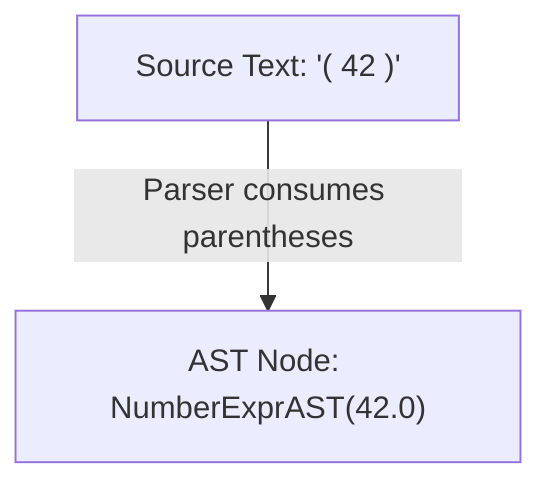

# Step 2.2: Parentheses and Grouping

In this step, we add support for parenthesised expressions, such as `(42)` or `(((3.14)))`.

---

## Why Parentheses Do Not Need an AST Node

Consider the expression `(42)`.  Why do we not create a `ParenExprAST` node?



Parentheses exist in source text to alter grouping and operator precedence.  However, once the parser constructs an in-memory tree, the tree structure itself explicitly captures that grouping.  The parentheses carry no runtime meaning and can be discarded.

The parser simply consumes the opening `'('`, recursively parses the subexpression inside, and verifies that a matching closing `')'` is present.

---

## Incremental Code Changes

Open `kaleidoscope.cpp`.  In your parser section, you will introduce a forward declaration, a parenthesis parser, and a primary expression router.

### 1. Forward Declaration and ParseParenExpr()

Because `ParseParenExpr()` will recursively call `ParseExpression()`, which in turn calls `ParsePrimary()`, we need a forward declaration.

Directly above `ParseNumberExpr()`, declare `ParseExpression()`:

```cpp
static std::unique_ptr<ExprAST> ParseExpression();
```

Directly below `ParseNumberExpr()`, add `ParseParenExpr()`:

```cpp
/// parenexpr ::= '(' expression ')'
static std::unique_ptr<ExprAST> ParseParenExpr() {
  getNextToken(); // eat '('
  auto V = ParseExpression();
  if (!V)
    return nullptr;

  if (CurTok != ')')
    return LogError("expected ')'");
  getNextToken(); // eat ')'
  return V;
}
```

Notice the error checking: if the token following the subexpression is not `')'`, we call `LogError()` and return `nullptr`.

### 2. Primary Expressions and ParsePrimary()

In compiler terminology, a **primary expression** is an indivisible leaf unit of an expression: a literal value, a variable, or a parenthesised subexpression:

```text
primary
  ::= numberexpr
  ::= parenexpr
```

Directly below `ParseParenExpr()`, add `ParsePrimary()` and update `ParseExpression()`:

```cpp
/// primary
///   ::= numberexpr
///   ::= parenexpr
static std::unique_ptr<ExprAST> ParsePrimary() {
  switch (CurTok) {
  case tok_number:
    return ParseNumberExpr();
  case '(':
    return ParseParenExpr();
  default:
    return LogError("unknown token when expecting an expression");
  }
}

/// expression ::= primary
static std::unique_ptr<ExprAST> ParseExpression() {
  return ParsePrimary();
}
```

---

## Verifying Your Code

Before compiling, check that your `kaleidoscope.cpp` has all additions in place.

<details>
<summary>Click here to compare against the reference kaleidoscope.cpp</summary>

```cpp
#include <cctype>
#include <cstdio>
#include <cstdlib>
#include <iostream>
#include <memory>
#include <string>

//===----------------------------------------------------------------------===//
// Lexer
//===----------------------------------------------------------------------===//

enum Token {
  tok_eof = -1,

  // Commands / Keywords
  tok_def = -100,
  tok_extern = -101,

  // Primary
  tok_identifier = -200,
  tok_number = -201,
};

static std::string IdentifierStr;
static double NumVal;

static int gettok() {
  static int LastChar = ' ';

  while (isspace(LastChar))
    LastChar = getchar();

  if (isalpha(LastChar)) {
    IdentifierStr = LastChar;
    while (isalnum((LastChar = getchar())))
      IdentifierStr += LastChar;

    if (IdentifierStr == "def")
      return tok_def;
    if (IdentifierStr == "extern")
      return tok_extern;
    return tok_identifier;
  }

  if (isdigit(LastChar) || LastChar == '.') {
    std::string NumStr;
    do {
      NumStr += LastChar;
      LastChar = getchar();
    } while (isdigit(LastChar) || LastChar == '.');

    NumVal = strtod(NumStr.c_str(), nullptr);
    return tok_number;
  }

  if (LastChar == '#') {
    do
      LastChar = getchar();
    while (LastChar != EOF && LastChar != '\n' && LastChar != '\r');

    if (LastChar != EOF)
      return gettok();
  }

  if (LastChar == EOF)
    return tok_eof;

  int ThisChar = LastChar;
  LastChar = getchar();
  return ThisChar;
}

//===----------------------------------------------------------------------===//
// Abstract Syntax Tree (AST)
//===----------------------------------------------------------------------===//

class ExprAST {
public:
  virtual ~ExprAST() = default;
  virtual void print(std::ostream &OS) const = 0;
};

class NumberExprAST : public ExprAST {
  double Val;

public:
  explicit NumberExprAST(double Val) : Val(Val) {}

  void print(std::ostream &OS) const override {
    OS << "(Number " << Val << ")";
  }
};

//===----------------------------------------------------------------------===//
// Parser
//===----------------------------------------------------------------------===//

static int CurTok;
static int getNextToken() { return CurTok = gettok(); }

static std::unique_ptr<ExprAST> LogError(const char *Str) {
  fprintf(stderr, "Error: %s\n", Str);
  return nullptr;
}

static std::unique_ptr<ExprAST> ParseExpression();

static std::unique_ptr<ExprAST> ParseNumberExpr() {
  auto Result = std::make_unique<NumberExprAST>(NumVal);
  getNextToken();
  return Result;
}

/// parenexpr ::= '(' expression ')'
static std::unique_ptr<ExprAST> ParseParenExpr() {
  getNextToken(); // eat '('
  auto V = ParseExpression();
  if (!V)
    return nullptr;

  if (CurTok != ')')
    return LogError("expected ')'");
  getNextToken(); // eat ')'
  return V;
}

/// primary
///   ::= numberexpr
///   ::= parenexpr
static std::unique_ptr<ExprAST> ParsePrimary() {
  switch (CurTok) {
  case tok_number:
    return ParseNumberExpr();
  case '(':
    return ParseParenExpr();
  default:
    return LogError("unknown token when expecting an expression");
  }
}

/// expression ::= primary
static std::unique_ptr<ExprAST> ParseExpression() {
  return ParsePrimary();
}

//===----------------------------------------------------------------------===//
// Interactive Driver Loop
//===----------------------------------------------------------------------===//

static void Prompt() { fprintf(stderr, "ready> "); }

static void MainLoop() {
  while (true) {
    switch (CurTok) {
    case tok_eof:
      return;
    case ';':
      Prompt();
      getNextToken();
      break;
    default:
      if (auto AST = ParseExpression()) {
        std::cout << "Parsed AST: ";
        AST->print(std::cout);
        std::cout << "\n";
      } else {
        // Skip tokens for error recovery until the next semicolon.
        while (CurTok != ';' && CurTok != tok_eof)
          getNextToken();
      }
      break;
    }
  }
}

int main() {
  printf("Kaleidoscope AST Inspector (Step 2.2: Parentheses)\n");
  printf(
      "Type expressions followed by ';' and press Enter (Ctrl+D to exit):\n\n");

  // Prime the first token.
  Prompt();
  getNextToken();
  MainLoop();

  return 0;
}
```
</details>

---

## Compiling and Running

Recompile:

```bash
clang++ -Wall -Wextra kaleidoscope.cpp -o kaleidoscope
```

Run the binary:

```bash
./kaleidoscope
```

Type nested parentheses or test missing closing brackets:

```text
Kaleidoscope AST Inspector (Step 2.2: Parentheses)
Type expressions and press Enter (Ctrl+D to exit):

ready> (42);
Parsed AST: (Number 42)
ready> (((123.45)));
Parsed AST: (Number 123.45)
ready> (42;
Error: expected ')'
ready>
```

The recursive-descent parser correctly unwinds nested grouping and catches missing parentheses.

In [Step 2.3](03-variables.md), we will add support for named variable references like `x` and `foo`.
