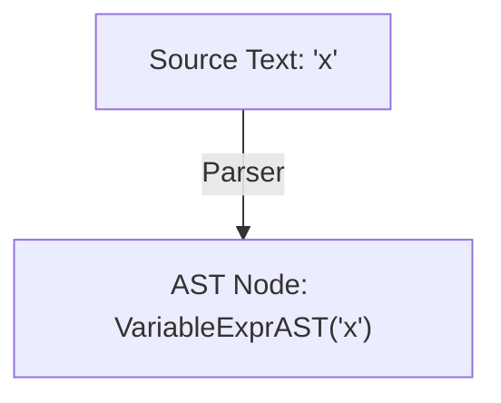

# Step 2.3: Variables

In this step, we add support for variable references, such as `x` or `total_count`.

---

## Representing Variables in the AST

When an expression references a variable name, the AST captures that identifier so later compiler stages can look up its value in an environment or symbol table:



---

## Active Authoring: Writing VariableExprAST

In Step 2.1, you wrote `NumberExprAST`:

```cpp
class NumberExprAST : public ExprAST {
  double Val;

public:
  explicit NumberExprAST(double Val) : Val(Val) {}
  void print(std::ostream &OS) const override { OS << "(Number " << Val << ")"; }
};
```

`VariableExprAST` follows the exact same structural pattern, but stores a `std::string Name` instead of a `double Val`.

Try writing `VariableExprAST` yourself directly below `NumberExprAST` in `kaleidoscope.cpp`:
* It should inherit from `ExprAST`.
* It needs a private member variable `std::string Name`.
* Its constructor should take `std::string Name`.
* Its `print()` method should output `(Var Name)`.

Type it out in your editor before expanding the fold below.

<details>
<summary>Click here to reveal the VariableExprAST class</summary>

```cpp
/// VariableExprAST - Expression class for referencing a variable, like "a".
class VariableExprAST : public ExprAST {
  std::string Name;

public:
  explicit VariableExprAST(std::string Name) : Name(std::move(Name)) {}

  void print(std::ostream &OS) const override {
    OS << "(Var " << Name << ")";
  }
};
```
</details>

---

## Incremental Code Changes: Parsing Identifiers

Now that your AST node exists, update your parser to recognise identifier tokens.

### 1. Add ParseIdentifierExpr()

In the parser section of `kaleidoscope.cpp`, directly below `ParseParenExpr()`, add `ParseIdentifierExpr()`:

```cpp
/// identifierexpr ::= identifier
static std::unique_ptr<ExprAST> ParseIdentifierExpr() {
  std::string IdName = IdentifierStr;
  getNextToken(); // eat identifier
  return std::make_unique<VariableExprAST>(IdName);
}
```

Notice what happens:
* The lexer has already stored the identifier's name in `IdentifierStr`.
* We save `IdentifierStr` in a local variable `IdName`.
* We consume the identifier token using `getNextToken()`.
* We return a `VariableExprAST` wrapping `IdName`.

### 2. Update ParsePrimary()

In `ParsePrimary()`, add a case for `tok_identifier` above `tok_number`:

```cpp
static std::unique_ptr<ExprAST> ParsePrimary() {
  switch (CurTok) {
  case tok_identifier:
    return ParseIdentifierExpr();
  case tok_number:
    return ParseNumberExpr();
  case '(':
    return ParseParenExpr();
  default:
    return LogError("unknown token when expecting an expression");
  }
}
```

---

## Verifying Your Code

Before compiling, check that your `kaleidoscope.cpp` has all additions in place.

<details>
<summary>Click here to compare against the reference kaleidoscope.cpp</summary>

```cpp
#include <cctype>
#include <cstdio>
#include <cstdlib>
#include <iostream>
#include <memory>
#include <string>

//===----------------------------------------------------------------------===//
// Lexer
//===----------------------------------------------------------------------===//

enum Token {
  tok_eof = -1,

  // Commands / Keywords
  tok_def = -100,
  tok_extern = -101,

  // Primary
  tok_identifier = -200,
  tok_number = -201,
};

static std::string IdentifierStr;
static double NumVal;

static int gettok() {
  static int LastChar = ' ';

  while (isspace(LastChar))
    LastChar = getchar();

  if (isalpha(LastChar)) {
    IdentifierStr = LastChar;
    while (isalnum((LastChar = getchar())))
      IdentifierStr += LastChar;

    if (IdentifierStr == "def")
      return tok_def;
    if (IdentifierStr == "extern")
      return tok_extern;
    return tok_identifier;
  }

  if (isdigit(LastChar) || LastChar == '.') {
    std::string NumStr;
    do {
      NumStr += LastChar;
      LastChar = getchar();
    } while (isdigit(LastChar) || LastChar == '.');

    NumVal = strtod(NumStr.c_str(), nullptr);
    return tok_number;
  }

  if (LastChar == '#') {
    do
      LastChar = getchar();
    while (LastChar != EOF && LastChar != '\n' && LastChar != '\r');

    if (LastChar != EOF)
      return gettok();
  }

  if (LastChar == EOF)
    return tok_eof;

  int ThisChar = LastChar;
  LastChar = getchar();
  return ThisChar;
}

//===----------------------------------------------------------------------===//
// Abstract Syntax Tree (AST)
//===----------------------------------------------------------------------===//

class ExprAST {
public:
  virtual ~ExprAST() = default;
  virtual void print(std::ostream &OS) const = 0;
};

class NumberExprAST : public ExprAST {
  double Val;

public:
  explicit NumberExprAST(double Val) : Val(Val) {}

  void print(std::ostream &OS) const override {
    OS << "(Number " << Val << ")";
  }
};

class VariableExprAST : public ExprAST {
  std::string Name;

public:
  explicit VariableExprAST(std::string Name) : Name(std::move(Name)) {}

  void print(std::ostream &OS) const override {
    OS << "(Var " << Name << ")";
  }
};

//===----------------------------------------------------------------------===//
// Parser
//===----------------------------------------------------------------------===//

static int CurTok;
static int getNextToken() { return CurTok = gettok(); }

static std::unique_ptr<ExprAST> LogError(const char *Str) {
  fprintf(stderr, "Error: %s\n", Str);
  return nullptr;
}

static std::unique_ptr<ExprAST> ParseExpression();

static std::unique_ptr<ExprAST> ParseNumberExpr() {
  auto Result = std::make_unique<NumberExprAST>(NumVal);
  getNextToken();
  return Result;
}

static std::unique_ptr<ExprAST> ParseParenExpr() {
  getNextToken(); // eat '('
  auto V = ParseExpression();
  if (!V)
    return nullptr;

  if (CurTok != ')')
    return LogError("expected ')'");
  getNextToken(); // eat ')'
  return V;
}

/// identifierexpr ::= identifier
static std::unique_ptr<ExprAST> ParseIdentifierExpr() {
  std::string IdName = IdentifierStr;
  getNextToken(); // eat identifier
  return std::make_unique<VariableExprAST>(IdName);
}

static std::unique_ptr<ExprAST> ParsePrimary() {
  switch (CurTok) {
  case tok_identifier:
    return ParseIdentifierExpr();
  case tok_number:
    return ParseNumberExpr();
  case '(':
    return ParseParenExpr();
  default:
    return LogError("unknown token when expecting an expression");
  }
}

static std::unique_ptr<ExprAST> ParseExpression() {
  return ParsePrimary();
}

//===----------------------------------------------------------------------===//
// Interactive Driver Loop
//===----------------------------------------------------------------------===//

static void MainLoop() {
  while (true) {
    switch (CurTok) {
    case tok_eof:
      return;
    case ';':
      fprintf(stderr, "ready> ");
      getNextToken();
      break;
    default:
      if (auto AST = ParseExpression()) {
        std::cout << "Parsed AST: ";
        AST->print(std::cout);
        std::cout << "\n";
      } else {
        getNextToken();
      }
      break;
    }
  }
}

int main() {
  printf("Kaleidoscope AST Inspector (Step 2.3: Variables)\n");
  printf(
      "Type expressions followed by ';' and press Enter (Ctrl+D to exit):\n\n");

  // Prime the first token.
  fprintf(stderr, "ready> ");
  getNextToken();
  MainLoop();

  return 0;
}
```
</details>

---

## Compiling and Running

Recompile:

```bash
clang++ -Wall -Wextra kaleidoscope.cpp -o kaleidoscope
```

Run the binary:

```bash
./kaleidoscope
```

Type variable names and parenthesised variables:

```text
Kaleidoscope AST Inspector (Step 2.3: Variables)
Type expressions and press Enter (Ctrl+D to exit):

ready> x;
Parsed AST: (Var x)
ready> (my_variable);
Parsed AST: (Var my_variable)
```

In [Step 2.4](04-function-calls.md), we will extend `ParseIdentifierExpr()` to recognise function calls like `foo(x, 10)`.
