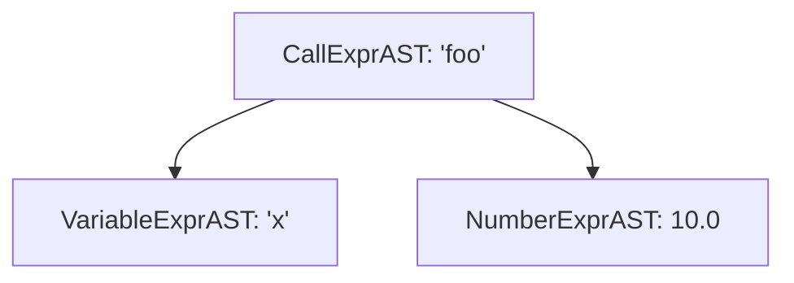

# Step 2.4: Function Calls and Active Learning Challenge

In this step, we add function call expressions like `sqrt(16)` or `add(a, b)`.

---

## Distinguishing Variables from Calls

Both variable references and function calls begin with an identifier token.  The parser distinguishes between the two by peeking at the very next token:
* If the token following the identifier is `'('`, it is a function call.
* Otherwise, it is a simple variable reference.



A function call stores two items: the name of the function being called (`Callee`), and a vector of argument expressions (`Args`).

---

## Incremental Code Changes

Open your `kaleidoscope.cpp` file.  You will make three targeted updates.

### 1. New Header Includes

At the top of `kaleidoscope.cpp`, include `<utility>` (for `std::move`) and `<vector>` (for `std::vector`):

```cpp
#include <cctype>
#include <cstdio>
#include <cstdlib>
#include <iostream>
#include <memory>
#include <string>
#include <utility>
#include <vector>
```

### 2. Defining CallExprAST

In the AST section, directly below `VariableExprAST`, add `CallExprAST`:

```cpp
/// CallExprAST - Expression class for function calls, like "foo(a, 2.0)".
class CallExprAST : public ExprAST {
  std::string Callee;
  std::vector<std::unique_ptr<ExprAST>> Args;

public:
  CallExprAST(std::string Callee, std::vector<std::unique_ptr<ExprAST>> Args)
      : Callee(std::move(Callee)), Args(std::move(Args)) {}

  void print(std::ostream &OS) const override {
    OS << "(Call " << Callee;
    for (const auto &Arg : Args) {
      OS << " ";
      Arg->print(OS);
    }
    OS << ")";
  }
};
```

Notice that `Args` stores expressions as `std::vector<std::unique_ptr<ExprAST>>`.  This allows each argument to be any valid expression, including nested function calls like `foo(bar(x))`.

### 3. Updating ParseIdentifierExpr() for Arguments

In the parser section, replace your previous `ParseIdentifierExpr()` with one that inspects whether `'('` follows:

```cpp
/// identifierexpr
///   ::= identifier
///   ::= identifier '(' expression* ')'
static std::unique_ptr<ExprAST> ParseIdentifierExpr() {
  std::string IdName = IdentifierStr;
  getNextToken(); // eat identifier

  // Simple variable reference.
  if (CurTok != '(')
    return std::make_unique<VariableExprAST>(IdName);

  // Function call.
  getNextToken(); // eat '('
  std::vector<std::unique_ptr<ExprAST>> Args;
  if (CurTok != ')') {
    while (true) {
      if (auto Arg = ParseExpression())
        Args.push_back(std::move(Arg));
      else
        return nullptr;

      if (CurTok == ')')
        break;

      if (CurTok != ',')
        return LogError("expected ')' or ',' in argument list");
      getNextToken(); // eat ','
    }
  }

  getNextToken(); // eat ')'
  return std::make_unique<CallExprAST>(IdName, std::move(Args));
}
```

Notice the argument loop:
* If the very next token is `')'`, it is a zero-argument function call like `run()`.
* Otherwise, it repeatedly parses expressions separated by commas until it reaches the closing `')'`.

---

## Verifying Your Code

Before compiling, check that your `kaleidoscope.cpp` has all additions in place.

<details>
<summary>Click here to compare against the reference kaleidoscope.cpp</summary>

```cpp
#include <cctype>
#include <cstdio>
#include <cstdlib>
#include <iostream>
#include <memory>
#include <string>
#include <utility>
#include <vector>

//===----------------------------------------------------------------------===//
// Lexer
//===----------------------------------------------------------------------===//

enum Token {
  tok_eof = -1,

  // Commands / Keywords
  tok_def = -100,
  tok_extern = -101,

  // Primary
  tok_identifier = -200,
  tok_number = -201,
};

static std::string IdentifierStr;
static double NumVal;

static int gettok() {
  static int LastChar = ' ';

  while (isspace(LastChar))
    LastChar = getchar();

  if (isalpha(LastChar)) {
    IdentifierStr = LastChar;
    while (isalnum((LastChar = getchar())))
      IdentifierStr += LastChar;

    if (IdentifierStr == "def")
      return tok_def;
    if (IdentifierStr == "extern")
      return tok_extern;
    return tok_identifier;
  }

  if (isdigit(LastChar) || LastChar == '.') {
    std::string NumStr;
    do {
      NumStr += LastChar;
      LastChar = getchar();
    } while (isdigit(LastChar) || LastChar == '.');

    NumVal = strtod(NumStr.c_str(), nullptr);
    return tok_number;
  }

  if (LastChar == '#') {
    do
      LastChar = getchar();
    while (LastChar != EOF && LastChar != '\n' && LastChar != '\r');

    if (LastChar != EOF)
      return gettok();
  }

  if (LastChar == EOF)
    return tok_eof;

  int ThisChar = LastChar;
  LastChar = getchar();
  return ThisChar;
}

//===----------------------------------------------------------------------===//
// Abstract Syntax Tree (AST)
//===----------------------------------------------------------------------===//

class ExprAST {
public:
  virtual ~ExprAST() = default;
  virtual void print(std::ostream &OS) const = 0;
};

class NumberExprAST : public ExprAST {
  double Val;

public:
  explicit NumberExprAST(double Val) : Val(Val) {}

  void print(std::ostream &OS) const override {
    OS << "(Number " << Val << ")";
  }
};

class VariableExprAST : public ExprAST {
  std::string Name;

public:
  explicit VariableExprAST(std::string Name) : Name(std::move(Name)) {}

  void print(std::ostream &OS) const override { OS << "(Var " << Name << ")"; }
};

class CallExprAST : public ExprAST {
  std::string Callee;
  std::vector<std::unique_ptr<ExprAST>> Args;

public:
  CallExprAST(std::string Callee, std::vector<std::unique_ptr<ExprAST>> Args)
      : Callee(std::move(Callee)), Args(std::move(Args)) {}

  void print(std::ostream &OS) const override {
    OS << "(Call " << Callee;
    for (const auto &Arg : Args) {
      OS << " ";
      Arg->print(OS);
    }
    OS << ")";
  }
};

//===----------------------------------------------------------------------===//
// Parser
//===----------------------------------------------------------------------===//

static int CurTok;
static int getNextToken() { return CurTok = gettok(); }

static std::unique_ptr<ExprAST> LogError(const char *Str) {
  fprintf(stderr, "Error: %s\n", Str);
  return nullptr;
}

static std::unique_ptr<ExprAST> ParseExpression();

static std::unique_ptr<ExprAST> ParseNumberExpr() {
  auto Result = std::make_unique<NumberExprAST>(NumVal);
  getNextToken();
  return Result;
}

static std::unique_ptr<ExprAST> ParseParenExpr() {
  getNextToken(); // eat '('
  auto V = ParseExpression();
  if (!V)
    return nullptr;

  if (CurTok != ')')
    return LogError("expected ')'");
  getNextToken(); // eat ')'
  return V;
}

static std::unique_ptr<ExprAST> ParseIdentifierExpr() {
  std::string IdName = IdentifierStr;
  getNextToken(); // eat identifier

  if (CurTok != '(')
    return std::make_unique<VariableExprAST>(IdName);

  getNextToken(); // eat '('
  std::vector<std::unique_ptr<ExprAST>> Args;
  if (CurTok != ')') {
    while (true) {
      if (auto Arg = ParseExpression())
        Args.push_back(std::move(Arg));
      else
        return nullptr;

      if (CurTok == ')')
        break;

      if (CurTok != ',')
        return LogError("expected ')' or ',' in argument list");
      getNextToken(); // eat ','
    }
  }

  getNextToken(); // eat ')'
  return std::make_unique<CallExprAST>(IdName, std::move(Args));
}

static std::unique_ptr<ExprAST> ParsePrimary() {
  switch (CurTok) {
  case tok_identifier:
    return ParseIdentifierExpr();
  case tok_number:
    return ParseNumberExpr();
  case '(':
    return ParseParenExpr();
  default:
    return LogError("unknown token when expecting an expression");
  }
}

static std::unique_ptr<ExprAST> ParseExpression() { return ParsePrimary(); }

//===----------------------------------------------------------------------===//
// Interactive Driver Loop
//===----------------------------------------------------------------------===//

static void Prompt() { fprintf(stderr, "ready> "); }

static void MainLoop() {
  while (true) {
    switch (CurTok) {
    case tok_eof:
      return;
    case ';':
      Prompt();
      getNextToken();
      break;
    default:
      if (auto AST = ParseExpression()) {
        std::cout << "Parsed AST: ";
        AST->print(std::cout);
        std::cout << "\n";
      } else {
        getNextToken();
      }
      break;
    }
  }
}

int main() {
  printf("Kaleidoscope AST Inspector (Step 2.4: Function Calls)\n");
  printf(
      "Type expressions followed by ';' and press Enter (Ctrl+D to exit):\n\n");

  // Prime the first token.
  Prompt();
  getNextToken();
  MainLoop();

  return 0;
}
```
</details>

---

## Compiling and Running

Recompile:

```bash
clang++ -Wall -Wextra kaleidoscope.cpp -o kaleidoscope
```

Run the binary:

```bash
./kaleidoscope
```

Type function calls with zero, one, or multiple arguments:

```text
Kaleidoscope AST Inspector (Step 2.4: Function Calls)
Type expressions and press Enter (Ctrl+D to exit):

ready> foo(x, 10);
Parsed AST: (Call foo (Var x) (Number 10))
ready> sqrt(16);
Parsed AST: (Call sqrt (Number 16))
ready> run();
Parsed AST: (Call run)
```

---

## Active Learning Challenge: Indented Tree Printing

S-expressions are compact, but nested trees are often clearer as an indented hierarchy.

### The Challenge

Update the `print()` method on `ExprAST` to accept an optional `int Indent = 0` parameter:

```cpp
virtual void print(std::ostream &OS, int Indent = 0) const = 0;
```

Update each AST class so child nodes are printed on new lines indented by two spaces per level.  When you type `foo(x, (42));`, your binary should print:

```text
Call: foo
  Var: x
  Number: 42
```

Give this a try in your editor before expanding the solution fold below.

<details>
<summary>Click here to reveal the solution</summary>

Here are the required changes:

1.  Update `ExprAST`:
```cpp
class ExprAST {
public:
  virtual ~ExprAST() = default;
  virtual void print(std::ostream &OS, int Indent = 0) const = 0;
};
```

2.  Update `NumberExprAST`:
```cpp
  void print(std::ostream &OS, int Indent = 0) const override {
    OS << std::string(Indent, ' ') << "Number: " << Val << "\n";
  }
```

3.  Update `VariableExprAST`:
```cpp
  void print(std::ostream &OS, int Indent = 0) const override {
    OS << std::string(Indent, ' ') << "Var: " << Name << "\n";
  }
```

4.  Update `CallExprAST`:
```cpp
  void print(std::ostream &OS, int Indent = 0) const override {
    OS << std::string(Indent, ' ') << "Call: " << Callee << "\n";
    for (const auto &Arg : Args)
      Arg->print(OS, Indent + 2);
  }
```
</details>

---

## Next Steps

Congratulations!  You have created a complete Abstract Syntax Tree and recursive-descent parser for primary expressions.

In [Section 3: Operator Precedence and The Calculator](../03-operators-eval/README.md), we will implement operator precedence climbing to parse expressions like `1 + 2 * 3` and evaluate mathematical results directly in C++.
