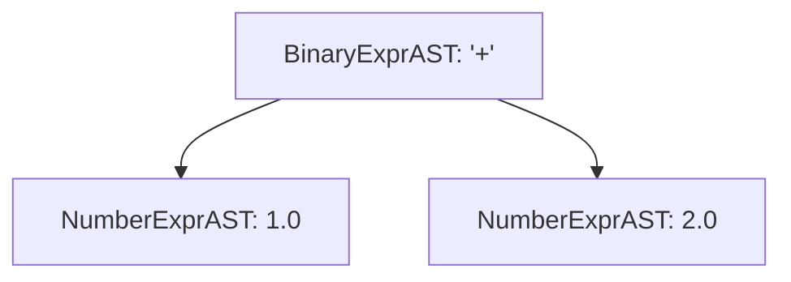
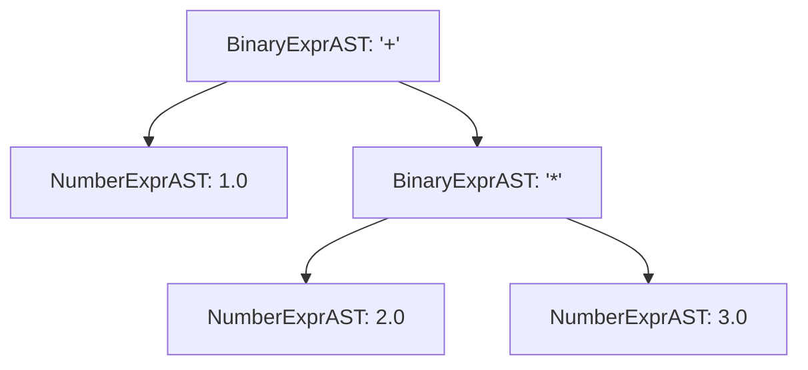

# Step 3.1: The Binary AST Node

Welcome to Step 3.1.  In this step, we create an AST node to represent binary expressions like `a + b` or `x * 2.0`.

---

## Representing Binary Expressions

A binary expression consists of three components:
1.  An operator character (`Op`), such as `'+'` or `'*'`.
2.  A left-hand side expression (`LHS`).
3.  A right-hand side expression (`RHS`).



Because `LHS` and `RHS` are themselves `std::unique_ptr<ExprAST>`, they can hold any expression, including nested binary expressions.  This recursive definition allows the compiler to represent trees of arbitrary depth:



---

## Active Authoring: Writing BinaryExprAST

You have already written three AST classes (`NumberExprAST`, `VariableExprAST`, and `CallExprAST`).  Using the same pattern, write `BinaryExprAST` yourself in `kaleidoscope.cpp`.

Place it directly below `VariableExprAST`:
* Inherit from `ExprAST`.
* Store three private members: `char Op;` and `std::unique_ptr<ExprAST> LHS, RHS;`.
* Write a constructor taking `(char Op, std::unique_ptr<ExprAST> LHS, std::unique_ptr<ExprAST> RHS)`.
* Implement `print(std::ostream &OS)` to format the node as `(Op LHS RHS)`.

Type it out in your editor before expanding the reference fold below.

<details>
<summary>Click here to reveal the BinaryExprAST class</summary>

```cpp
/// BinaryExprAST - Expression class for binary operators like "a + b".
class BinaryExprAST : public ExprAST {
  char Op;
  std::unique_ptr<ExprAST> LHS, RHS;

public:
  BinaryExprAST(char Op, std::unique_ptr<ExprAST> LHS,
                std::unique_ptr<ExprAST> RHS)
      : Op(Op), LHS(std::move(LHS)), RHS(std::move(RHS)) {}

  void print(std::ostream &OS) const override {
    OS << "(" << Op << " ";
    LHS->print(OS);
    OS << " ";
    RHS->print(OS);
    OS << ")";
  }
};
```
</details>

---

## Verifying Your Code

Before compiling, check that your `kaleidoscope.cpp` has `BinaryExprAST` in place.

<details>
<summary>Click here to compare against the reference kaleidoscope.cpp</summary>

```cpp
#include <cctype>
#include <cstdio>
#include <cstdlib>
#include <iostream>
#include <memory>
#include <string>
#include <utility>
#include <vector>

//===----------------------------------------------------------------------===//
// Lexer
//===----------------------------------------------------------------------===//

enum Token {
  tok_eof = -1,

  // Commands / Keywords
  tok_def = -100,
  tok_extern = -101,

  // Primary
  tok_identifier = -200,
  tok_number = -201,
};

static std::string IdentifierStr;
static double NumVal;

static int gettok() {
  static int LastChar = ' ';

  while (isspace(LastChar))
    LastChar = getchar();

  if (isalpha(LastChar)) {
    IdentifierStr = LastChar;
    while (isalnum((LastChar = getchar())))
      IdentifierStr += LastChar;

    if (IdentifierStr == "def")
      return tok_def;
    if (IdentifierStr == "extern")
      return tok_extern;
    return tok_identifier;
  }

  if (isdigit(LastChar) || LastChar == '.') {
    std::string NumStr;
    do {
      NumStr += LastChar;
      LastChar = getchar();
    } while (isdigit(LastChar) || LastChar == '.');

    NumVal = strtod(NumStr.c_str(), nullptr);
    return tok_number;
  }

  if (LastChar == '#') {
    do
      LastChar = getchar();
    while (LastChar != EOF && LastChar != '\n' && LastChar != '\r');

    if (LastChar != EOF)
      return gettok();
  }

  if (LastChar == EOF)
    return tok_eof;

  int ThisChar = LastChar;
  LastChar = getchar();
  return ThisChar;
}

//===----------------------------------------------------------------------===//
// Abstract Syntax Tree (AST)
//===----------------------------------------------------------------------===//

class ExprAST {
public:
  virtual ~ExprAST() = default;
  virtual void print(std::ostream &OS) const = 0;
};

class NumberExprAST : public ExprAST {
  double Val;

public:
  explicit NumberExprAST(double Val) : Val(Val) {}

  void print(std::ostream &OS) const override {
    OS << "(Number " << Val << ")";
  }
};

class VariableExprAST : public ExprAST {
  std::string Name;

public:
  explicit VariableExprAST(std::string Name) : Name(std::move(Name)) {}

  void print(std::ostream &OS) const override { OS << "(Var " << Name << ")"; }
};

class BinaryExprAST : public ExprAST {
  char Op;
  std::unique_ptr<ExprAST> LHS, RHS;

public:
  BinaryExprAST(char Op, std::unique_ptr<ExprAST> LHS,
                std::unique_ptr<ExprAST> RHS)
      : Op(Op), LHS(std::move(LHS)), RHS(std::move(RHS)) {}

  void print(std::ostream &OS) const override {
    OS << "(" << Op << " ";
    LHS->print(OS);
    OS << " ";
    RHS->print(OS);
    OS << ")";
  }
};

class CallExprAST : public ExprAST {
  std::string Callee;
  std::vector<std::unique_ptr<ExprAST>> Args;

public:
  CallExprAST(std::string Callee, std::vector<std::unique_ptr<ExprAST>> Args)
      : Callee(std::move(Callee)), Args(std::move(Args)) {}

  void print(std::ostream &OS) const override {
    OS << "(Call " << Callee;
    for (const auto &Arg : Args) {
      OS << " ";
      Arg->print(OS);
    }
    OS << ")";
  }
};

//===----------------------------------------------------------------------===//
// Parser
//===----------------------------------------------------------------------===//

static int CurTok;
static int getNextToken() { return CurTok = gettok(); }

static std::unique_ptr<ExprAST> LogError(const char *Str) {
  fprintf(stderr, "Error: %s\n", Str);
  return nullptr;
}

static std::unique_ptr<ExprAST> ParseExpression();

static std::unique_ptr<ExprAST> ParseNumberExpr() {
  auto Result = std::make_unique<NumberExprAST>(NumVal);
  getNextToken();
  return Result;
}

static std::unique_ptr<ExprAST> ParseParenExpr() {
  getNextToken(); // eat '('
  auto V = ParseExpression();
  if (!V)
    return nullptr;

  if (CurTok != ')')
    return LogError("expected ')'");
  getNextToken(); // eat ')'
  return V;
}

static std::unique_ptr<ExprAST> ParseIdentifierExpr() {
  std::string IdName = IdentifierStr;
  getNextToken(); // eat identifier

  if (CurTok != '(')
    return std::make_unique<VariableExprAST>(IdName);

  getNextToken(); // eat '('
  std::vector<std::unique_ptr<ExprAST>> Args;
  if (CurTok != ')') {
    while (true) {
      if (auto Arg = ParseExpression())
        Args.push_back(std::move(Arg));
      else
        return nullptr;

      if (CurTok == ')')
        break;

      if (CurTok != ',')
        return LogError("expected ')' or ',' in argument list");
      getNextToken(); // eat ','
    }
  }

  getNextToken(); // eat ')'
  return std::make_unique<CallExprAST>(IdName, std::move(Args));
}

static std::unique_ptr<ExprAST> ParsePrimary() {
  switch (CurTok) {
  case tok_identifier:
    return ParseIdentifierExpr();
  case tok_number:
    return ParseNumberExpr();
  case '(':
    return ParseParenExpr();
  default:
    return LogError("unknown token when expecting an expression");
  }
}

static std::unique_ptr<ExprAST> ParseExpression() { return ParsePrimary(); }

//===----------------------------------------------------------------------===//
// Interactive Driver Loop
//===----------------------------------------------------------------------===//

static void MainLoop() {
  while (true) {
    fprintf(stderr, "ready> ");
    switch (CurTok) {
    case tok_eof:
      return;
    case ';':
      getNextToken();
      break;
    default:
      if (auto AST = ParseExpression()) {
        std::cout << "Parsed AST: ";
        AST->print(std::cout);
        std::cout << "\n";
      } else {
        getNextToken();
      }
      break;
    }
  }
}

int main() {
  printf("Kaleidoscope AST Inspector (Step 2.4: Function Calls)\n");
  printf("Type expressions and press Enter (Ctrl+D to exit):\n\n");

  getNextToken();
  MainLoop();

  return 0;
}
```
</details>

---

## Compiling and Running

Compile your code:

```bash
clang++ -Wall -Wextra kaleidoscope.cpp -o kaleidoscope
```

In [Step 3.2](02-precedence-table.md), we will set up an operator precedence table to determine which operators bind first.
