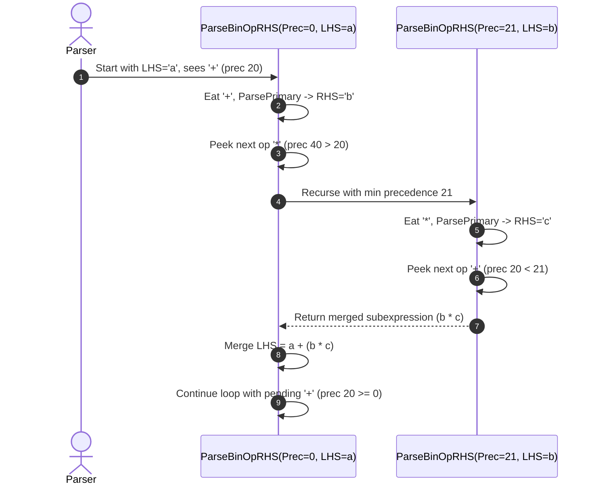

# Step 3.3: Precedence Climbing

In this step, we implement the core parsing algorithm: **Operator Precedence Climbing**.

---

## How Precedence Climbing Works

Consider parsing `a + b * c + d`:



1.  The parser reads the leading primary expression, `a`.
2.  It inspects `+` (precedence 20), which is greater than or equal to the starting baseline precedence `0`.  It consumes `+` and parses primary `b`.
3.  Next, it looks ahead at `*` (precedence 40).  Because 40 is strictly greater than 20, the right-hand side `b` binds more tightly to `*` than `a` binds to `+`.
4.  The parser recursively calls itself with minimum precedence 21 (`TokPrec + 1`) to parse `b * c` first.
5.  When the recursive call inspects the second `+` (precedence 20), 20 is less than 21.  The recursive call returns `(b * c)` back to the outer caller.
6.  The outer caller merges `a + (b * c)` and continues its loop with the pending `+` operator.

---

## Incremental Code Changes

Open `kaleidoscope.cpp`.  In your parser section, you will add `ParseBinOpRHS()` and update `ParseExpression()`.

### 1. The ParseBinOpRHS() Function

Directly above `ParseExpression()`, add the precedence climbing loop:

```cpp
/// binoprhs
///   ::= ('+' primary)*
static std::unique_ptr<ExprAST> ParseBinOpRHS(int ExprPrec,
                                              std::unique_ptr<ExprAST> LHS) {
  while (true) {
    int TokPrec = GetTokPrecedence();

    // If this binary operator binds at least as tightly as the current operator,
    // consume it; otherwise we are done.
    if (TokPrec < ExprPrec)
      return LHS;

    int BinOp = CurTok;
    getNextToken(); // eat binary operator

    auto RHS = ParsePrimary();
    if (!RHS)
      return nullptr;

    // If BinOp binds less tightly with RHS than the operator after RHS, let
    // the pending operator take RHS as its LHS.
    int NextPrec = GetTokPrecedence();
    if (TokPrec < NextPrec) {
      RHS = ParseBinOpRHS(TokPrec + 1, std::move(RHS));
      if (!RHS)
        return nullptr;
    }

    // Merge LHS/RHS into a binary expression node.
    LHS = std::make_unique<BinaryExprAST>(static_cast<char>(BinOp),
                                          std::move(LHS), std::move(RHS));
  }
}
```

Notice the termination condition: when `GetTokPrecedence()` returns `-1` (for tokens like `;` or `\n`), `TokPrec < ExprPrec` is immediately true, returning `LHS` to the caller.

### 2. Updating ParseExpression()

Replace your old stub `ParseExpression()` with one that kicks off precedence climbing with a baseline precedence of `0`:

```cpp
/// expression
///   ::= primary binoprhs
static std::unique_ptr<ExprAST> ParseExpression() {
  auto LHS = ParsePrimary();
  if (!LHS)
    return nullptr;

  return ParseBinOpRHS(0, std::move(LHS));
}
```

---

## Verifying Your Code

Before compiling, check that your `kaleidoscope.cpp` has all additions in place.

<details>
<summary>Click here to compare against the reference kaleidoscope.cpp</summary>

```cpp
#include <cctype>
#include <cstdio>
#include <cstdlib>
#include <iostream>
#include <map>
#include <memory>
#include <string>
#include <utility>
#include <vector>

//===----------------------------------------------------------------------===//
// Lexer
//===----------------------------------------------------------------------===//

enum Token {
  tok_eof = -1,

  // Commands / Keywords
  tok_def = -100,
  tok_extern = -101,

  // Primary
  tok_identifier = -200,
  tok_number = -201,
};

static std::string IdentifierStr;
static double NumVal;

static int gettok() {
  static int LastChar = ' ';

  while (isspace(LastChar))
    LastChar = getchar();

  if (isalpha(LastChar)) {
    IdentifierStr = LastChar;
    while (isalnum((LastChar = getchar())))
      IdentifierStr += LastChar;

    if (IdentifierStr == "def")
      return tok_def;
    if (IdentifierStr == "extern")
      return tok_extern;
    return tok_identifier;
  }

  if (isdigit(LastChar) || LastChar == '.') {
    std::string NumStr;
    do {
      NumStr += LastChar;
      LastChar = getchar();
    } while (isdigit(LastChar) || LastChar == '.');

    NumVal = strtod(NumStr.c_str(), nullptr);
    return tok_number;
  }

  if (LastChar == '#') {
    do
      LastChar = getchar();
    while (LastChar != EOF && LastChar != '\n' && LastChar != '\r');

    if (LastChar != EOF)
      return gettok();
  }

  if (LastChar == EOF)
    return tok_eof;

  int ThisChar = LastChar;
  LastChar = getchar();
  return ThisChar;
}

//===----------------------------------------------------------------------===//
// Abstract Syntax Tree (AST)
//===----------------------------------------------------------------------===//

class ExprAST {
public:
  virtual ~ExprAST() = default;
  virtual void print(std::ostream &OS) const = 0;
};

class NumberExprAST : public ExprAST {
  double Val;

public:
  explicit NumberExprAST(double Val) : Val(Val) {}

  void print(std::ostream &OS) const override {
    OS << "(Number " << Val << ")";
  }
};

class VariableExprAST : public ExprAST {
  std::string Name;

public:
  explicit VariableExprAST(std::string Name) : Name(std::move(Name)) {}

  void print(std::ostream &OS) const override { OS << "(Var " << Name << ")"; }
};

class BinaryExprAST : public ExprAST {
  char Op;
  std::unique_ptr<ExprAST> LHS, RHS;

public:
  BinaryExprAST(char Op, std::unique_ptr<ExprAST> LHS,
                std::unique_ptr<ExprAST> RHS)
      : Op(Op), LHS(std::move(LHS)), RHS(std::move(RHS)) {}

  void print(std::ostream &OS) const override {
    OS << "(" << Op << " ";
    LHS->print(OS);
    OS << " ";
    RHS->print(OS);
    OS << ")";
  }
};

class CallExprAST : public ExprAST {
  std::string Callee;
  std::vector<std::unique_ptr<ExprAST>> Args;

public:
  CallExprAST(std::string Callee, std::vector<std::unique_ptr<ExprAST>> Args)
      : Callee(std::move(Callee)), Args(std::move(Args)) {}

  void print(std::ostream &OS) const override {
    OS << "(Call " << Callee;
    for (const auto &Arg : Args) {
      OS << " ";
      Arg->print(OS);
    }
    OS << ")";
  }
};

//===----------------------------------------------------------------------===//
// Parser
//===----------------------------------------------------------------------===//

static int CurTok;
static int getNextToken() { return CurTok = gettok(); }

static std::map<char, int> BinopPrecedence;

static int GetTokPrecedence() {
  if (!isascii(CurTok))
    return -1;

  int TokPrec = BinopPrecedence[static_cast<char>(CurTok)];
  if (TokPrec <= 0)
    return -1;
  return TokPrec;
}

static std::unique_ptr<ExprAST> LogError(const char *Str) {
  fprintf(stderr, "Error: %s\n", Str);
  return nullptr;
}

static std::unique_ptr<ExprAST> ParseExpression();

static std::unique_ptr<ExprAST> ParseNumberExpr() {
  auto Result = std::make_unique<NumberExprAST>(NumVal);
  getNextToken();
  return Result;
}

static std::unique_ptr<ExprAST> ParseParenExpr() {
  getNextToken(); // eat '('
  auto V = ParseExpression();
  if (!V)
    return nullptr;

  if (CurTok != ')')
    return LogError("expected ')'");
  getNextToken(); // eat ')'
  return V;
}

static std::unique_ptr<ExprAST> ParseIdentifierExpr() {
  std::string IdName = IdentifierStr;
  getNextToken(); // eat identifier

  if (CurTok != '(')
    return std::make_unique<VariableExprAST>(IdName);

  getNextToken(); // eat '('
  std::vector<std::unique_ptr<ExprAST>> Args;
  if (CurTok != ')') {
    while (true) {
      if (auto Arg = ParseExpression())
        Args.push_back(std::move(Arg));
      else
        return nullptr;

      if (CurTok == ')')
        break;

      if (CurTok != ',')
        return LogError("expected ')' or ',' in argument list");
      getNextToken(); // eat ','
    }
  }

  getNextToken(); // eat ')'
  return std::make_unique<CallExprAST>(IdName, std::move(Args));
}

static std::unique_ptr<ExprAST> ParsePrimary() {
  switch (CurTok) {
  case tok_identifier:
    return ParseIdentifierExpr();
  case tok_number:
    return ParseNumberExpr();
  case '(':
    return ParseParenExpr();
  default:
    return LogError("unknown token when expecting an expression");
  }
}

/// binoprhs
///   ::= ('+' primary)*
static std::unique_ptr<ExprAST> ParseBinOpRHS(int ExprPrec,
                                              std::unique_ptr<ExprAST> LHS) {
  while (true) {
    int TokPrec = GetTokPrecedence();

    if (TokPrec < ExprPrec)
      return LHS;

    int BinOp = CurTok;
    getNextToken();

    auto RHS = ParsePrimary();
    if (!RHS)
      return nullptr;

    int NextPrec = GetTokPrecedence();
    if (TokPrec < NextPrec) {
      RHS = ParseBinOpRHS(TokPrec + 1, std::move(RHS));
      if (!RHS)
        return nullptr;
    }

    LHS = std::make_unique<BinaryExprAST>(static_cast<char>(BinOp),
                                          std::move(LHS), std::move(RHS));
  }
}

/// expression
///   ::= primary binoprhs
static std::unique_ptr<ExprAST> ParseExpression() {
  auto LHS = ParsePrimary();
  if (!LHS)
    return nullptr;

  return ParseBinOpRHS(0, std::move(LHS));
}

//===----------------------------------------------------------------------===//
// Interactive Driver Loop
//===----------------------------------------------------------------------===//

static void MainLoop() {
  while (true) {
    fprintf(stderr, "ready> ");
    switch (CurTok) {
    case tok_eof:
      return;
    case ';':
      getNextToken();
      break;
    default:
      if (auto AST = ParseExpression()) {
        std::cout << "Parsed AST: ";
        AST->print(std::cout);
        std::cout << "\n";
      } else {
        getNextToken();
      }
      break;
    }
  }
}

int main() {
  BinopPrecedence['<'] = 10;
  BinopPrecedence['+'] = 20;
  BinopPrecedence['-'] = 20;
  BinopPrecedence['*'] = 40;
  BinopPrecedence['/'] = 40;

  printf("Kaleidoscope AST Inspector (Step 3.3: Precedence Climbing)\n");
  printf("Type math expressions followed by ';' and press Enter (Ctrl+D to exit):\n\n");

  getNextToken();
  MainLoop();

  return 0;
}
```
</details>

---

## Compiling and Running

Recompile:

```bash
clang++ -Wall -Wextra kaleidoscope.cpp -o kaleidoscope
```

Run the binary:

```bash
./kaleidoscope
```

Type mathematical expressions with mixed operators and parentheses:

```text
Kaleidoscope AST Inspector (Step 3.3: Precedence Climbing)
Type math expressions followed by ';' and press Enter (Ctrl+D to exit):

ready> 1 + 2 * 3;
Parsed AST: (+ 1 (* 2 3))
ready> (1 + 2) * 3;
Parsed AST: (* (+ 1 2) 3)
ready> 10 - 4 - 2;
Parsed AST: (- (- 10 4) 2)
```

Look closely at `1 + 2 * 3`.  The tree is `(+ 1 (* 2 3))`.  Multiplication was grouped as the right child of addition, preserving standard arithmetic order of operations.

In [Step 3.4](04-immediate-eval.md), we will add direct mathematical evaluation to our AST, turning our parser into an interactive calculator in pure C++.
