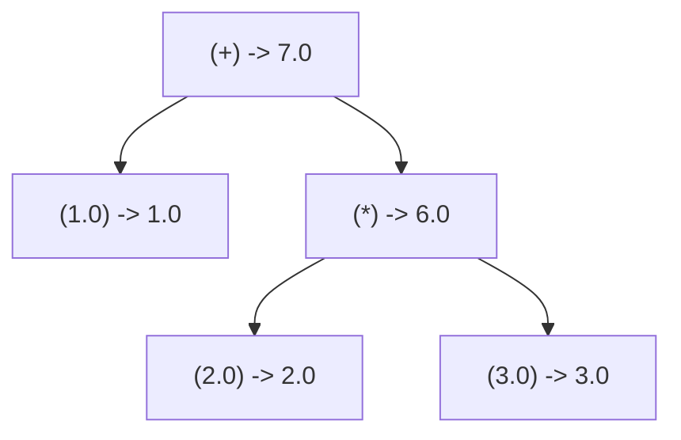

# Step 3.4: Immediate Evaluation and Milestone 1 Review

In this step, we add direct mathematical evaluation to our AST, turning our parser into an interactive calculator in pure C++.

---

## Evaluating the AST

An Abstract Syntax Tree is not just for printing; it can be evaluated directly.  In compiler engineering, executing code by traversing an AST is called a **tree-walking interpreter**.

Evaluation happens bottom-up:



Leaves (such as `1.0`, `2.0`, and `3.0`) evaluate immediately to their literal numeric values.  Internal nodes (like `*` and `+`) recursively evaluate their children and apply the arithmetic operator.

---

## Incremental Code Changes

Open `kaleidoscope.cpp`.  You will add an `eval()` method to your AST class hierarchy and update your driver loop.

### 1. Adding eval() to ExprAST

In the AST section, add a pure virtual `eval()` method to `ExprAST`:

```cpp
class ExprAST {
public:
  virtual ~ExprAST() = default;
  virtual void print(std::ostream &OS) const = 0;
  virtual double eval() const = 0;
};
```

### 2. Implementing eval() on AST Nodes

Add `eval()` implementations to each concrete AST class:

* In `NumberExprAST`, `eval()` simply returns its stored value:
```cpp
  double eval() const override { return Val; }
```

* In `VariableExprAST` and `CallExprAST`, runtime values require symbol tables and machine code generation (which we will introduce with LLVM in Sections 4 and 5).  For now, return `0.0`:
```cpp
  double eval() const override {
    fprintf(stderr, "Error: variables require LLVM compilation\n");
    return 0.0;
  }
```

* In `BinaryExprAST`, implement the recursive evaluation switch:
```cpp
  double eval() const override {
    double Left = LHS->eval();
    double Right = RHS->eval();
    switch (Op) {
    case '+':
      return Left + Right;
    case '-':
      return Left - Right;
    case '*':
      return Left * Right;
    case '/':
      if (Right == 0.0) {
        fprintf(stderr, "Warning: division by zero!\n");
        return 0.0;
      }
      return Left / Right;
    case '<':
      return Left < Right ? 1.0 : 0.0;
    default:
      fprintf(stderr, "Error: unknown binary operator: %c\n", Op);
      return 0.0;
    }
  }
```

### 3. Updating the REPL Driver

In `MainLoop()`, print the evaluated result immediately after the AST:

```cpp
      if (auto AST = ParseExpression()) {
        std::cout << "Parsed AST: ";
        AST->print(std::cout);
        std::cout << "\n";
        std::cout << "Evaluated:  " << AST->eval() << "\n";
      } else {
        getNextToken();
      }
```

---

## Verifying Your Code

Before compiling, check that your `kaleidoscope.cpp` has all additions in place.

<details>
<summary>Click here to compare against the reference kaleidoscope.cpp</summary>

```cpp
#include <cctype>
#include <cstdio>
#include <cstdlib>
#include <iostream>
#include <map>
#include <memory>
#include <string>
#include <utility>
#include <vector>

//===----------------------------------------------------------------------===//
// Lexer
//===----------------------------------------------------------------------===//

enum Token {
  tok_eof = -1,

  // Commands / Keywords
  tok_def = -100,
  tok_extern = -101,

  // Primary
  tok_identifier = -200,
  tok_number = -201,
};

static std::string IdentifierStr;
static double NumVal;

static int gettok() {
  static int LastChar = ' ';

  while (isspace(LastChar))
    LastChar = getchar();

  if (isalpha(LastChar) || LastChar == '_') {
    IdentifierStr = LastChar;
    while (isalnum((LastChar = getchar())) || LastChar == '_')
      IdentifierStr += LastChar;

    if (IdentifierStr == "def")
      return tok_def;
    if (IdentifierStr == "extern")
      return tok_extern;
    return tok_identifier;
  }

  if (isdigit(LastChar) || LastChar == '.') {
    std::string NumStr;
    do {
      NumStr += LastChar;
      LastChar = getchar();
    } while (isdigit(LastChar) || LastChar == '.');

    NumVal = strtod(NumStr.c_str(), nullptr);
    return tok_number;
  }

  if (LastChar == '#') {
    do
      LastChar = getchar();
    while (LastChar != EOF && LastChar != '\n' && LastChar != '\r');

    if (LastChar != EOF)
      return gettok();
  }

  if (LastChar == EOF)
    return tok_eof;

  int ThisChar = LastChar;
  LastChar = getchar();
  return ThisChar;
}

//===----------------------------------------------------------------------===//
// Abstract Syntax Tree (AST)
//===----------------------------------------------------------------------===//

class ExprAST {
public:
  virtual ~ExprAST() = default;
  virtual void print(std::ostream &OS) const = 0;
  virtual double eval() const = 0;
};

class NumberExprAST : public ExprAST {
  double Val;

public:
  explicit NumberExprAST(double Val) : Val(Val) {}

  void print(std::ostream &OS) const override { OS << Val; }

  double eval() const override { return Val; }
};

class VariableExprAST : public ExprAST {
  std::string Name;

public:
  explicit VariableExprAST(std::string Name) : Name(std::move(Name)) {}

  void print(std::ostream &OS) const override { OS << Name; }

  double eval() const override {
    fprintf(stderr, "Error: variables require LLVM compilation: %s\n",
            Name.c_str());
    return 0.0;
  }
};

class BinaryExprAST : public ExprAST {
  char Op;
  std::unique_ptr<ExprAST> LHS, RHS;

public:
  BinaryExprAST(char Op, std::unique_ptr<ExprAST> LHS,
                std::unique_ptr<ExprAST> RHS)
      : Op(Op), LHS(std::move(LHS)), RHS(std::move(RHS)) {}

  void print(std::ostream &OS) const override {
    OS << "(" << Op << " ";
    LHS->print(OS);
    OS << " ";
    RHS->print(OS);
    OS << ")";
  }

  double eval() const override {
    double Left = LHS->eval();
    double Right = RHS->eval();
    switch (Op) {
    case '+':
      return Left + Right;
    case '-':
      return Left - Right;
    case '*':
      return Left * Right;
    case '/':
      if (Right == 0.0) {
        fprintf(stderr, "Warning: division by zero!\n");
        return 0.0;
      }
      return Left / Right;
    case '<':
      return Left < Right ? 1.0 : 0.0;
    default:
      fprintf(stderr, "Error: unknown binary operator: %c\n", Op);
      return 0.0;
    }
  }
};

class CallExprAST : public ExprAST {
  std::string Callee;
  std::vector<std::unique_ptr<ExprAST>> Args;

public:
  CallExprAST(std::string Callee, std::vector<std::unique_ptr<ExprAST>> Args)
      : Callee(std::move(Callee)), Args(std::move(Args)) {}

  void print(std::ostream &OS) const override {
    OS << "(" << Callee;
    for (const auto &Arg : Args) {
      OS << " ";
      Arg->print(OS);
    }
    OS << ")";
  }

  double eval() const override {
    fprintf(stderr, "Error: function calls require LLVM JIT compilation\n");
    return 0.0;
  }
};

//===----------------------------------------------------------------------===//
// Parser
//===----------------------------------------------------------------------===//

static int CurTok;
static int getNextToken() { return CurTok = gettok(); }

static std::map<char, int> BinopPrecedence;

static int GetTokPrecedence() {
  if (!isascii(CurTok))
    return -1;

  int TokPrec = BinopPrecedence[static_cast<char>(CurTok)];
  if (TokPrec <= 0)
    return -1;
  return TokPrec;
}

static std::unique_ptr<ExprAST> LogError(const char *Str) {
  fprintf(stderr, "Error: %s\n", Str);
  return nullptr;
}

static std::unique_ptr<ExprAST> ParseExpression();

static std::unique_ptr<ExprAST> ParseNumberExpr() {
  auto Result = std::make_unique<NumberExprAST>(NumVal);
  getNextToken();
  return Result;
}

static std::unique_ptr<ExprAST> ParseParenExpr() {
  getNextToken(); // eat '('
  auto V = ParseExpression();
  if (!V)
    return nullptr;

  if (CurTok != ')')
    return LogError("expected ')'");
  getNextToken(); // eat ')'
  return V;
}

static std::unique_ptr<ExprAST> ParseIdentifierExpr() {
  std::string IdName = IdentifierStr;
  getNextToken(); // eat identifier

  if (CurTok != '(')
    return std::make_unique<VariableExprAST>(IdName);

  getNextToken(); // eat '('
  std::vector<std::unique_ptr<ExprAST>> Args;
  if (CurTok != ')') {
    while (true) {
      if (auto Arg = ParseExpression())
        Args.push_back(std::move(Arg));
      else
        return nullptr;

      if (CurTok == ')')
        break;

      if (CurTok != ',')
        return LogError("expected ')' or ',' in argument list");
      getNextToken(); // eat ','
    }
  }

  getNextToken(); // eat ')'
  return std::make_unique<CallExprAST>(IdName, std::move(Args));
}

static std::unique_ptr<ExprAST> ParsePrimary() {
  switch (CurTok) {
  case tok_identifier:
    return ParseIdentifierExpr();
  case tok_number:
    return ParseNumberExpr();
  case '(':
    return ParseParenExpr();
  default:
    return LogError("unknown token when expecting an expression");
  }
}

static std::unique_ptr<ExprAST> ParseBinOpRHS(int ExprPrec,
                                              std::unique_ptr<ExprAST> LHS) {
  while (true) {
    int TokPrec = GetTokPrecedence();

    if (TokPrec < ExprPrec)
      return LHS;

    int BinOp = CurTok;
    getNextToken();

    auto RHS = ParsePrimary();
    if (!RHS)
      return nullptr;

    int NextPrec = GetTokPrecedence();
    if (TokPrec < NextPrec) {
      RHS = ParseBinOpRHS(TokPrec + 1, std::move(RHS));
      if (!RHS)
        return nullptr;
    }

    LHS = std::make_unique<BinaryExprAST>(static_cast<char>(BinOp),
                                          std::move(LHS), std::move(RHS));
  }
}

static std::unique_ptr<ExprAST> ParseExpression() {
  auto LHS = ParsePrimary();
  if (!LHS)
    return nullptr;

  return ParseBinOpRHS(0, std::move(LHS));
}

//===----------------------------------------------------------------------===//
// Interactive Driver Loop
//===----------------------------------------------------------------------===//

static void MainLoop() {
  while (true) {
    fprintf(stderr, "ready> ");
    switch (CurTok) {
    case tok_eof:
      return;
    case ';':
      getNextToken();
      break;
    default:
      if (auto AST = ParseExpression()) {
        std::cout << "Parsed AST: ";
        AST->print(std::cout);
        std::cout << "\n";
        std::cout << "Evaluated:  " << AST->eval() << "\n";
      } else {
        getNextToken();
      }
      break;
    }
  }
}

int main() {
  BinopPrecedence['<'] = 10;
  BinopPrecedence['+'] = 20;
  BinopPrecedence['-'] = 20;
  BinopPrecedence['*'] = 40;
  BinopPrecedence['/'] = 40;

  printf("Kaleidoscope Calculator (Step 3.4: Immediate Evaluation)\n");
  printf("Type math expressions followed by ';' and press Enter (Ctrl+D to exit):\n\n");

  getNextToken();
  MainLoop();

  return 0;
}
```
</details>

---

## Compiling and Running

Recompile:

```bash
clang++ -Wall -Wextra kaleidoscope.cpp -o kaleidoscope
```

Run the binary:

```bash
./kaleidoscope
```

Type complex mathematical expressions:

```text
Kaleidoscope Calculator (Step 3.4: Immediate Evaluation)
Type math expressions followed by ';' and press Enter (Ctrl+D to exit):

ready> 4 + 5 * 2;
Parsed AST: (+ 4 (* 5 2))
Evaluated:  14
ready> (4 + 5) * 2;
Parsed AST: (* (+ 4 5) 2)
Evaluated:  18
ready> 10 / 2 - 3;
Parsed AST: (- (/ 10 2) 3)
Evaluated:  2
ready> 3 < 5;
Parsed AST: (< 3 5)
Evaluated:  1
```

---

## Milestone 1 Retrospective: A Pure C++ Compiler Frontend

Congratulations!  You have reached **Milestone 1**.

In just three sections, you built a complete, working compiler frontend from scratch:
1.  **Lexer**: Converts raw characters into typed tokens, buffering input and discarding trivia.
2.  **AST**: A memory-safe object hierarchy representing numbers, variables, function calls, and binary expressions.
3.  **Parser**: A recursive-descent parser with operator precedence climbing that handles operator binding and nested grouping.
4.  **Interpreter**: Direct AST tree-walking evaluation in native C++.

Notice your `kaleidoscope.cpp` file: it is roughly 250 lines of clean, readable C++.

### Looking Ahead to Section 4: Architectural Refactoring

In [Section 4: Generating LLVM IR](../04-llvm-ir/README.md), our goal shifts from interpreting trees in C++ to generating native LLVM Intermediate Representation.

Before introducing LLVM's types, modules, and builders, we will take a brief architectural step in [Step 4.1](../04-llvm-ir/01-llvm-setup.md): modularising our codebase by extracting our lexer, AST, and parser into clean header files under `include/`.  This keeps our frontend independent and lets `kaleidoscope.cpp` focus purely on LLVM code generation.
