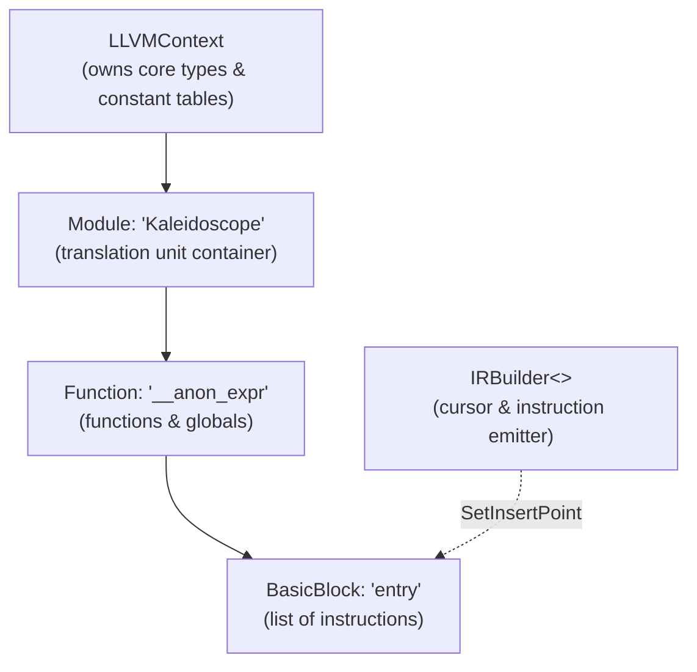

# Step 4.1: LLVM Setup and Constant IR

Welcome to Step 4.1.  In this step, we connect our code to the LLVM infrastructure and generate our very first LLVM IR instruction: a floating-point constant.

---

## Core LLVM Data Structures

To generate LLVM IR, we use three primary objects:

1.  `llvm::LLVMContext`: An opaque container that owns core LLVM data structures, such as constant tables and type caches.
2.  `llvm::Module`: The top-level container for functions and global variables.  In LLVM, a module represents a single translation unit.
3.  `llvm::IRBuilder<>`: A helper class that makes it easy to generate LLVM instructions and append them to basic blocks.



> [!NOTE]
> **LLVMContext Ownership and Thread Safety**:
> `llvm::LLVMContext` is an opaque class that owns core LLVM data structures, including type uniquing tables and constant pools.  It is strictly single-threaded.  In a production multi-threaded compiler, each compilation worker thread must create its own distinct `LLVMContext` instance to prevent data races.

---

## Incremental Code Changes

Open `kaleidoscope.cpp`.  You will include the LLVM headers, declare global LLVM state, and add `codegen()` to your AST.

### 1. Include LLVM Headers

At the top of `kaleidoscope.cpp`, include the core LLVM headers:

```cpp
#include "llvm/ADT/APFloat.h"
#include "llvm/IR/BasicBlock.h"
#include "llvm/IR/Constants.h"
#include "llvm/IR/DerivedTypes.h"
#include "llvm/IR/Function.h"
#include "llvm/IR/IRBuilder.h"
#include "llvm/IR/LLVMContext.h"
#include "llvm/IR/Module.h"
#include "llvm/IR/Type.h"
```

### 2. LLVM State and Initialisation

Directly below your lexer section and above the AST classes, declare the core LLVM objects and an initialisation helper:

```cpp
//===----------------------------------------------------------------------===//
// LLVM State
//===----------------------------------------------------------------------===//

static std::unique_ptr<llvm::LLVMContext> TheContext;
static std::unique_ptr<llvm::Module> TheModule;
static std::unique_ptr<llvm::IRBuilder<>> Builder;

static void InitializeModule() {
  TheContext = std::make_unique<llvm::LLVMContext>();
  TheModule = std::make_unique<llvm::Module>("Kaleidoscope", *TheContext);
  Builder = std::make_unique<llvm::IRBuilder<>>(*TheContext);
}
```

### 3. Adding codegen() to ExprAST and NumberExprAST

In your AST section, replace `eval()` on `ExprAST` with a virtual `codegen()` method returning an `llvm::Value *`:

```cpp
class ExprAST {
public:
  virtual ~ExprAST() = default;
  virtual llvm::Value *codegen() = 0;
};
```

Implement `NumberExprAST::codegen()`.  In LLVM, floating-point constants are represented by `ConstantFP` wrapping an `APFloat` (Arbitrary Precision Float):

```cpp
class NumberExprAST : public ExprAST {
  double Val;

public:
  explicit NumberExprAST(double Val) : Val(Val) {}

  llvm::Value *codegen() override {
    return llvm::ConstantFP::get(*TheContext, llvm::APFloat(Val));
  }
};
```

### 4. Updating the Driver to Emit IR

In your driver section, wrap top-level numbers in an anonymous function (`__anon_expr`) and print the module to standard error:

```cpp
static void HandleNumber() {
  if (auto AST = ParseNumberExpr()) {
    // Create an anonymous function wrapper: double ()
    auto *FnType =
        llvm::FunctionType::get(llvm::Type::getDoubleTy(*TheContext), false);
    auto *Fn = llvm::Function::Create(FnType, llvm::Function::ExternalLinkage,
                                      "__anon_expr", TheModule.get());
    auto *BB = llvm::BasicBlock::Create(*TheContext, "entry", Fn);
    Builder->SetInsertPoint(BB);

    if (auto *RetVal = AST->codegen()) {
      Builder->CreateRet(RetVal);
      TheModule->print(llvm::errs(), nullptr);
    }

    Fn->eraseFromParent();
  }
}
```

In `main()`, call `InitializeModule()` before starting the REPL.

---

## Verifying Your Code

Before compiling, check that your `kaleidoscope.cpp` has all additions in place.

<details>
<summary>Click here to compare against the reference kaleidoscope.cpp</summary>

```cpp
#include "llvm/ADT/APFloat.h"
#include "llvm/IR/BasicBlock.h"
#include "llvm/IR/Constants.h"
#include "llvm/IR/DerivedTypes.h"
#include "llvm/IR/Function.h"
#include "llvm/IR/IRBuilder.h"
#include "llvm/IR/LLVMContext.h"
#include "llvm/IR/Module.h"
#include "llvm/IR/Type.h"
#include <cctype>
#include <cstdio>
#include <cstdlib>
#include <iostream>
#include <memory>
#include <string>

//===----------------------------------------------------------------------===//
// Lexer
//===----------------------------------------------------------------------===//

enum Token {
  tok_eof = -1,

  // Commands / Keywords
  tok_def = -100,
  tok_extern = -101,

  // Primary
  tok_identifier = -200,
  tok_number = -201,
};

static std::string IdentifierStr;
static double NumVal;

static int gettok() {
  static int LastChar = ' ';

  while (isspace(LastChar))
    LastChar = getchar();

  if (isdigit(LastChar) || LastChar == '.') {
    std::string NumStr;
    do {
      NumStr += LastChar;
      LastChar = getchar();
    } while (isdigit(LastChar) || LastChar == '.');

    NumVal = strtod(NumStr.c_str(), nullptr);
    return tok_number;
  }

  if (LastChar == EOF)
    return tok_eof;

  int ThisChar = LastChar;
  LastChar = getchar();
  return ThisChar;
}

//===----------------------------------------------------------------------===//
// LLVM State
//===----------------------------------------------------------------------===//

static std::unique_ptr<llvm::LLVMContext> TheContext;
static std::unique_ptr<llvm::Module> TheModule;
static std::unique_ptr<llvm::IRBuilder<>> Builder;

static void InitializeModule() {
  TheContext = std::make_unique<llvm::LLVMContext>();
  TheModule = std::make_unique<llvm::Module>("Kaleidoscope", *TheContext);
  Builder = std::make_unique<llvm::IRBuilder<>>(*TheContext);
}

//===----------------------------------------------------------------------===//
// AST
//===----------------------------------------------------------------------===//

class ExprAST {
public:
  virtual ~ExprAST() = default;
  virtual llvm::Value *codegen() = 0;
};

class NumberExprAST : public ExprAST {
  double Val;

public:
  explicit NumberExprAST(double Val) : Val(Val) {}

  llvm::Value *codegen() override {
    return llvm::ConstantFP::get(*TheContext, llvm::APFloat(Val));
  }
};

//===----------------------------------------------------------------------===//
// Parser & Driver
//===----------------------------------------------------------------------===//

static int CurTok;
static int getNextToken() { return CurTok = gettok(); }

static std::unique_ptr<ExprAST> ParseNumberExpr() {
  auto Result = std::make_unique<NumberExprAST>(NumVal);
  getNextToken();
  return Result;
}

static void HandleNumber() {
  if (auto AST = ParseNumberExpr()) {
    auto *FnType =
        llvm::FunctionType::get(llvm::Type::getDoubleTy(*TheContext), false);
    auto *Fn = llvm::Function::Create(FnType, llvm::Function::ExternalLinkage,
                                      "__anon_expr", TheModule.get());
    auto *BB = llvm::BasicBlock::Create(*TheContext, "entry", Fn);
    Builder->SetInsertPoint(BB);

    if (auto *RetVal = AST->codegen()) {
      Builder->CreateRet(RetVal);
      TheModule->print(llvm::errs(), nullptr);
    }

    Fn->eraseFromParent();
  }
}

static void MainLoop() {
  while (true) {
    fprintf(stderr, "ready> ");
    switch (CurTok) {
    case tok_eof:
      return;
    case ';':
      getNextToken();
      break;
    case tok_number:
      HandleNumber();
      break;
    default:
      getNextToken();
      break;
    }
  }
}

int main() {
  InitializeModule();

  printf("Kaleidoscope LLVM IR Generator (Step 4.1: Numbers)\n");
  printf("Type a number followed by ';' and press Enter (Ctrl+D to exit):\n\n");

  getNextToken();
  MainLoop();

  return 0;
}
```
</details>

---

## Compiling and Running

Compile linking against LLVM core:

```bash
clang++ -Wall -Wextra kaleidoscope.cpp $(llvm-config --cxxflags --ldflags --system-libs --libs core) -o kaleidoscope
```

Run the binary:

```bash
./kaleidoscope
```

Type a number:

```text
Kaleidoscope LLVM IR Generator (Step 4.1: Numbers)
Type a number followed by ';' and press Enter (Ctrl+D to exit):

ready> 42;
; ModuleID = 'Kaleidoscope'
source_filename = "Kaleidoscope"

define double @__anon_expr() {
entry:
  ret double 4.200000e+01
}
```

You just generated real, valid LLVM Intermediate Representation from your own AST.

In [Step 4.2](02-binary-ir.md), we will generate floating-point math instructions for addition, subtraction, multiplication, and division.
