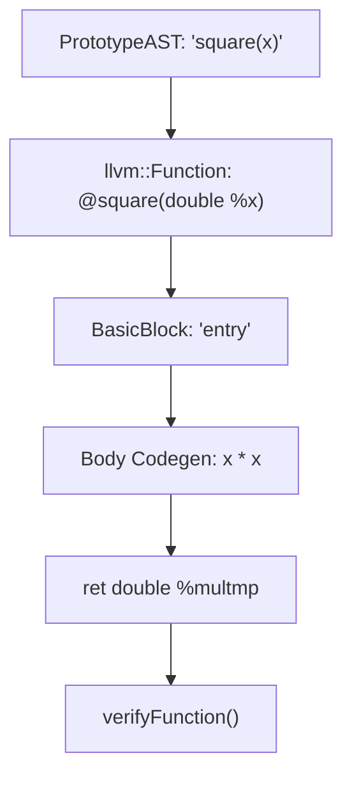

# Step 4.3: Function Definitions

In this step, we add support for defining functions like `def square(x) x * x;`.

---

## Function Prototypes and Function Bodies

A function definition in Kaleidoscope consists of two pieces:
1.  **Prototype**: The function name and argument names (`PrototypeAST`).  In LLVM, this defines an `llvm::Function` signature.
2.  **Body**: An expression that implements the function (`FunctionAST`).  In LLVM, this generates basic blocks and instructions ending with a return instruction (`ret`).



> [!NOTE]
> **Symbol Table Management**:
> `NamedValues` acts as our function-local symbol table.  Before generating code for the function body, we clear `NamedValues` and record each function argument.  In Section 9, when we introduce local variables, we will extend this to support nested lexical scoping and variable shadowing.

> [!TIP]
> **Catching Malformed IR with verifyFunction**:
> Notice `llvm::verifyFunction(*TheFunction)`.  LLVM provides a built-in consistency checker that runs sanity checks on generated IR, catching missing block terminators, operand type mismatches, and malformed SSA definitions.  Always verify functions before returning them!

---

## Incremental Code Changes

Open `kaleidoscope.cpp`.  You will make four targeted updates.

### 1. Include Verifier Header and Declare Symbol Table

At the top of `kaleidoscope.cpp`, include `llvm/IR/Verifier.h`:

```cpp
#include "llvm/IR/Verifier.h"
```

In the LLVM state section, declare `NamedValues`:

```cpp
static std::map<std::string, llvm::Value *> NamedValues;
```

### 2. VariableExprAST Codegen

In the AST section, implement `VariableExprAST::codegen()` to read from `NamedValues`:

```cpp
class VariableExprAST : public ExprAST {
  std::string Name;

public:
  explicit VariableExprAST(std::string Name) : Name(std::move(Name)) {}

  llvm::Value *codegen() override {
    llvm::Value *V = NamedValues[Name];
    if (!V) {
      fprintf(stderr, "Error: unknown variable name: %s\n", Name.c_str());
      return nullptr;
    }
    return V;
  }
};
```

### 3. PrototypeAST and FunctionAST

Directly below `BinaryExprAST`, declare and implement `PrototypeAST` and `FunctionAST`:

```cpp
class PrototypeAST {
  std::string Name;
  std::vector<std::string> Args;

public:
  PrototypeAST(std::string Name, std::vector<std::string> Args)
      : Name(std::move(Name)), Args(std::move(Args)) {}

  const std::string &getName() const { return Name; }
  llvm::Function *codegen();
};

class FunctionAST {
  std::unique_ptr<PrototypeAST> Proto;
  std::unique_ptr<ExprAST> Body;

public:
  FunctionAST(std::unique_ptr<PrototypeAST> Proto,
              std::unique_ptr<ExprAST> Body)
      : Proto(std::move(Proto)), Body(std::move(Body)) {}

  llvm::Function *codegen();
};

llvm::Function *PrototypeAST::codegen() {
  std::vector<llvm::Type *> Doubles(Args.size(),
                                    llvm::Type::getDoubleTy(*TheContext));
  auto *FT = llvm::FunctionType::get(llvm::Type::getDoubleTy(*TheContext),
                                     Doubles, false);
  auto *F = llvm::Function::Create(FT, llvm::Function::ExternalLinkage, Name,
                                   TheModule.get());

  unsigned Idx = 0;
  for (auto &Arg : F->args())
    Arg.setName(Args[Idx++]);

  return F;
}

llvm::Function *FunctionAST::codegen() {
  auto *TheFunction = TheModule->getFunction(Proto->getName());
  if (!TheFunction)
    TheFunction = Proto->codegen();
  if (!TheFunction)
    return nullptr;

  auto *BB = llvm::BasicBlock::Create(*TheContext, "entry", TheFunction);
  Builder->SetInsertPoint(BB);

  NamedValues.clear();
  for (auto &Arg : TheFunction->args())
    NamedValues[std::string(Arg.getName())] = &Arg;

  if (auto *RetVal = Body->codegen()) {
    Builder->CreateRet(RetVal);
    llvm::verifyFunction(*TheFunction);
    return TheFunction;
  }

  // Error generating body: erase incomplete function.
  TheFunction->eraseFromParent();
  return nullptr;
}
```

### 4. Parsing Prototypes and Definitions

In your parser section, add parsing functions for prototypes and definitions:

```cpp
/// prototype ::= id '(' id* ')'
static std::unique_ptr<PrototypeAST> ParsePrototype() {
  if (CurTok != tok_identifier)
    return nullptr;

  std::string FnName = IdentifierStr;
  getNextToken();

  if (CurTok != '(')
    return nullptr;

  std::vector<std::string> ArgNames;
  while (getNextToken() == tok_identifier)
    ArgNames.push_back(IdentifierStr);
  if (CurTok != ')')
    return nullptr;

  getNextToken(); // eat ')'
  return std::make_unique<PrototypeAST>(FnName, std::move(ArgNames));
}

/// definition ::= 'def' prototype expression
static std::unique_ptr<FunctionAST> ParseDefinition() {
  getNextToken(); // eat 'def'
  auto Proto = ParsePrototype();
  if (!Proto)
    return nullptr;

  if (auto E = ParseExpression())
    return std::make_unique<FunctionAST>(std::move(Proto), std::move(E));
  return nullptr;
}

static void HandleDefinition() {
  if (auto FnAST = ParseDefinition()) {
    if (auto *FnIR = FnAST->codegen()) {
      fprintf(stderr, "Read function definition:\n");
      FnIR->print(llvm::errs());
      fprintf(stderr, "\n");
    }
  } else {
    getNextToken();
  }
}
```

In `MainLoop()`, add a handler for `case tok_def: HandleDefinition(); break;`.

---

## Verifying Your Code

Before compiling, check that your `kaleidoscope.cpp` has all additions in place.

<details>
<summary>Click here to compare against the reference kaleidoscope.cpp</summary>

```cpp
#include "llvm/ADT/APFloat.h"
#include "llvm/IR/BasicBlock.h"
#include "llvm/IR/Constants.h"
#include "llvm/IR/DerivedTypes.h"
#include "llvm/IR/Function.h"
#include "llvm/IR/IRBuilder.h"
#include "llvm/IR/LLVMContext.h"
#include "llvm/IR/Module.h"
#include "llvm/IR/Type.h"
#include "llvm/IR/Verifier.h"
#include <cctype>
#include <cstdio>
#include <cstdlib>
#include <iostream>
#include <map>
#include <memory>
#include <string>
#include <utility>
#include <vector>

//===----------------------------------------------------------------------===//
// Lexer
//===----------------------------------------------------------------------===//

enum Token {
  tok_eof = -1,

  // Commands / Keywords
  tok_def = -100,
  tok_extern = -101,

  // Primary
  tok_identifier = -200,
  tok_number = -201,
};

static std::string IdentifierStr;
static double NumVal;

static int gettok() {
  static int LastChar = ' ';

  while (isspace(LastChar))
    LastChar = getchar();

  if (isalpha(LastChar) || LastChar == '_') {
    IdentifierStr = LastChar;
    while (isalnum((LastChar = getchar())) || LastChar == '_')
      IdentifierStr += LastChar;

    if (IdentifierStr == "def")
      return tok_def;
    if (IdentifierStr == "extern")
      return tok_extern;
    return tok_identifier;
  }

  if (isdigit(LastChar) || LastChar == '.') {
    std::string NumStr;
    do {
      NumStr += LastChar;
      LastChar = getchar();
    } while (isdigit(LastChar) || LastChar == '.');

    NumVal = strtod(NumStr.c_str(), nullptr);
    return tok_number;
  }

  if (LastChar == '#') {
    do
      LastChar = getchar();
    while (LastChar != EOF && LastChar != '\n' && LastChar != '\r');

    if (LastChar != EOF)
      return gettok();
  }

  if (LastChar == EOF)
    return tok_eof;

  int ThisChar = LastChar;
  LastChar = getchar();
  return ThisChar;
}

//===----------------------------------------------------------------------===//
// LLVM State
//===----------------------------------------------------------------------===//

static std::unique_ptr<llvm::LLVMContext> TheContext;
static std::unique_ptr<llvm::Module> TheModule;
static std::unique_ptr<llvm::IRBuilder<>> Builder;
static std::map<std::string, llvm::Value *> NamedValues;

static void InitializeModule() {
  TheContext = std::make_unique<llvm::LLVMContext>();
  TheModule = std::make_unique<llvm::Module>("Kaleidoscope", *TheContext);
  Builder = std::make_unique<llvm::IRBuilder<>>(*TheContext);
}

//===----------------------------------------------------------------------===//
// AST
//===----------------------------------------------------------------------===//

class ExprAST {
public:
  virtual ~ExprAST() = default;
  virtual llvm::Value *codegen() = 0;
};

class NumberExprAST : public ExprAST {
  double Val;

public:
  explicit NumberExprAST(double Val) : Val(Val) {}

  llvm::Value *codegen() override {
    return llvm::ConstantFP::get(*TheContext, llvm::APFloat(Val));
  }
};

class VariableExprAST : public ExprAST {
  std::string Name;

public:
  explicit VariableExprAST(std::string Name) : Name(std::move(Name)) {}

  llvm::Value *codegen() override {
    llvm::Value *V = NamedValues[Name];
    if (!V) {
      fprintf(stderr, "Error: unknown variable name: %s\n", Name.c_str());
      return nullptr;
    }
    return V;
  }
};

class BinaryExprAST : public ExprAST {
  char Op;
  std::unique_ptr<ExprAST> LHS, RHS;

public:
  BinaryExprAST(char Op, std::unique_ptr<ExprAST> LHS,
                std::unique_ptr<ExprAST> RHS)
      : Op(Op), LHS(std::move(LHS)), RHS(std::move(RHS)) {}

  llvm::Value *codegen() override {
    llvm::Value *L = LHS->codegen();
    llvm::Value *R = RHS->codegen();
    if (!L || !R)
      return nullptr;

    switch (Op) {
    case '+':
      return Builder->CreateFAdd(L, R, "addtmp");
    case '-':
      return Builder->CreateFSub(L, R, "subtmp");
    case '*':
      return Builder->CreateFMul(L, R, "multmp");
    case '/':
      return Builder->CreateFDiv(L, R, "divtmp");
    case '<':
      L = Builder->CreateFCmpULT(L, R, "cmptmp");
      return Builder->CreateUIToFP(L, llvm::Type::getDoubleTy(*TheContext),
                                   "booltmp");
    default:
      fprintf(stderr, "invalid binary operator: %c\n", Op);
      return nullptr;
    }
  }
};

class PrototypeAST {
  std::string Name;
  std::vector<std::string> Args;

public:
  PrototypeAST(std::string Name, std::vector<std::string> Args)
      : Name(std::move(Name)), Args(std::move(Args)) {}

  const std::string &getName() const { return Name; }
  llvm::Function *codegen();
};

class FunctionAST {
  std::unique_ptr<PrototypeAST> Proto;
  std::unique_ptr<ExprAST> Body;

public:
  FunctionAST(std::unique_ptr<PrototypeAST> Proto,
              std::unique_ptr<ExprAST> Body)
      : Proto(std::move(Proto)), Body(std::move(Body)) {}

  llvm::Function *codegen();
};

llvm::Function *PrototypeAST::codegen() {
  std::vector<llvm::Type *> Doubles(Args.size(),
                                    llvm::Type::getDoubleTy(*TheContext));
  auto *FT = llvm::FunctionType::get(llvm::Type::getDoubleTy(*TheContext),
                                     Doubles, false);
  auto *F = llvm::Function::Create(FT, llvm::Function::ExternalLinkage, Name,
                                   TheModule.get());

  unsigned Idx = 0;
  for (auto &Arg : F->args())
    Arg.setName(Args[Idx++]);

  return F;
}

llvm::Function *FunctionAST::codegen() {
  auto *TheFunction = TheModule->getFunction(Proto->getName());
  if (!TheFunction)
    TheFunction = Proto->codegen();
  if (!TheFunction)
    return nullptr;

  auto *BB = llvm::BasicBlock::Create(*TheContext, "entry", TheFunction);
  Builder->SetInsertPoint(BB);

  NamedValues.clear();
  for (auto &Arg : TheFunction->args())
    NamedValues[std::string(Arg.getName())] = &Arg;

  if (auto *RetVal = Body->codegen()) {
    Builder->CreateRet(RetVal);
    llvm::verifyFunction(*TheFunction);
    return TheFunction;
  }

  TheFunction->eraseFromParent();
  return nullptr;
}

//===----------------------------------------------------------------------===//
// Parser
//===----------------------------------------------------------------------===//

static int CurTok;
static int getNextToken() { return CurTok = gettok(); }

static std::map<char, int> BinopPrecedence;

static int GetTokPrecedence() {
  if (!isascii(CurTok))
    return -1;

  int TokPrec = BinopPrecedence[static_cast<char>(CurTok)];
  if (TokPrec <= 0)
    return -1;
  return TokPrec;
}

static std::unique_ptr<ExprAST> ParseExpression();

static std::unique_ptr<ExprAST> ParseNumberExpr() {
  auto Result = std::make_unique<NumberExprAST>(NumVal);
  getNextToken();
  return Result;
}

static std::unique_ptr<ExprAST> ParseIdentifierExpr() {
  std::string IdName = IdentifierStr;
  getNextToken();
  return std::make_unique<VariableExprAST>(IdName);
}

static std::unique_ptr<ExprAST> ParsePrimary() {
  switch (CurTok) {
  case tok_identifier:
    return ParseIdentifierExpr();
  case tok_number:
    return ParseNumberExpr();
  default:
    return nullptr;
  }
}

static std::unique_ptr<ExprAST> ParseBinOpRHS(int ExprPrec,
                                              std::unique_ptr<ExprAST> LHS) {
  while (true) {
    int TokPrec = GetTokPrecedence();

    if (TokPrec < ExprPrec)
      return LHS;

    int BinOp = CurTok;
    getNextToken();

    auto RHS = ParsePrimary();
    if (!RHS)
      return nullptr;

    int NextPrec = GetTokPrecedence();
    if (TokPrec < NextPrec) {
      RHS = ParseBinOpRHS(TokPrec + 1, std::move(RHS));
      if (!RHS)
        return nullptr;
    }

    LHS = std::make_unique<BinaryExprAST>(static_cast<char>(BinOp),
                                          std::move(LHS), std::move(RHS));
  }
}

static std::unique_ptr<ExprAST> ParseExpression() {
  auto LHS = ParsePrimary();
  if (!LHS)
    return nullptr;

  return ParseBinOpRHS(0, std::move(LHS));
}

static std::unique_ptr<PrototypeAST> ParsePrototype() {
  if (CurTok != tok_identifier)
    return nullptr;

  std::string FnName = IdentifierStr;
  getNextToken();

  if (CurTok != '(')
    return nullptr;

  std::vector<std::string> ArgNames;
  while (getNextToken() == tok_identifier)
    ArgNames.push_back(IdentifierStr);
  if (CurTok != ')')
    return nullptr;

  getNextToken();
  return std::make_unique<PrototypeAST>(FnName, std::move(ArgNames));
}

static std::unique_ptr<FunctionAST> ParseDefinition() {
  getNextToken();
  auto Proto = ParsePrototype();
  if (!Proto)
    return nullptr;

  if (auto E = ParseExpression())
    return std::make_unique<FunctionAST>(std::move(Proto), std::move(E));
  return nullptr;
}

//===----------------------------------------------------------------------===//
// Driver Loop
//===----------------------------------------------------------------------===//

static void HandleDefinition() {
  if (auto FnAST = ParseDefinition()) {
    if (auto *FnIR = FnAST->codegen()) {
      fprintf(stderr, "Read function definition:\n");
      FnIR->print(llvm::errs());
      fprintf(stderr, "\n");
    }
  } else {
    getNextToken();
  }
}

static void HandleTopLevelExpression() {
  if (auto AST = ParseExpression()) {
    auto *FnType =
        llvm::FunctionType::get(llvm::Type::getDoubleTy(*TheContext), false);
    auto *Fn = llvm::Function::Create(FnType, llvm::Function::ExternalLinkage,
                                      "__anon_expr", TheModule.get());
    auto *BB = llvm::BasicBlock::Create(*TheContext, "entry", Fn);
    Builder->SetInsertPoint(BB);

    if (auto *RetVal = AST->codegen()) {
      Builder->CreateRet(RetVal);
      TheModule->print(llvm::errs(), nullptr);
    }

    Fn->eraseFromParent();
  } else {
    getNextToken();
  }
}

static void MainLoop() {
  while (true) {
    fprintf(stderr, "ready> ");
    switch (CurTok) {
    case tok_eof:
      return;
    case ';':
      getNextToken();
      break;
    case tok_def:
      HandleDefinition();
      break;
    default:
      HandleTopLevelExpression();
      break;
    }
  }
}

int main() {
  InitializeModule();

  BinopPrecedence['<'] = 10;
  BinopPrecedence['+'] = 20;
  BinopPrecedence['-'] = 20;
  BinopPrecedence['*'] = 40;
  BinopPrecedence['/'] = 40;

  printf("Kaleidoscope LLVM IR Generator (Step 4.3: Functions)\n");
  printf("Type definitions followed by ';' and press Enter (Ctrl+D to exit):\n\n");

  getNextToken();
  MainLoop();

  return 0;
}
```
</details>

---

## Compiling and Running

Compile:

```bash
clang++ -Wall -Wextra kaleidoscope.cpp $(llvm-config --cxxflags --ldflags --system-libs --libs core) -o kaleidoscope
```

Run the binary:

```bash
./kaleidoscope
```

Define a mathematical function with parameters:

```text
Kaleidoscope LLVM IR Generator (Step 4.3: Functions)
Type definitions followed by ';' and press Enter (Ctrl+D to exit):

ready> def square(x) x * x;
Read function definition:
define double @square(double %x) {
entry:
  %multmp = fmul double %x, %x
  ret double %multmp
}
```

Notice that because `x` is a dynamic runtime parameter, LLVM generated real runtime instructions: `%multmp = fmul double %x, %x`!

In [Step 4.4](04-calls-and-extern.md), we will add function calls and support declaring external C library functions with `extern`.
