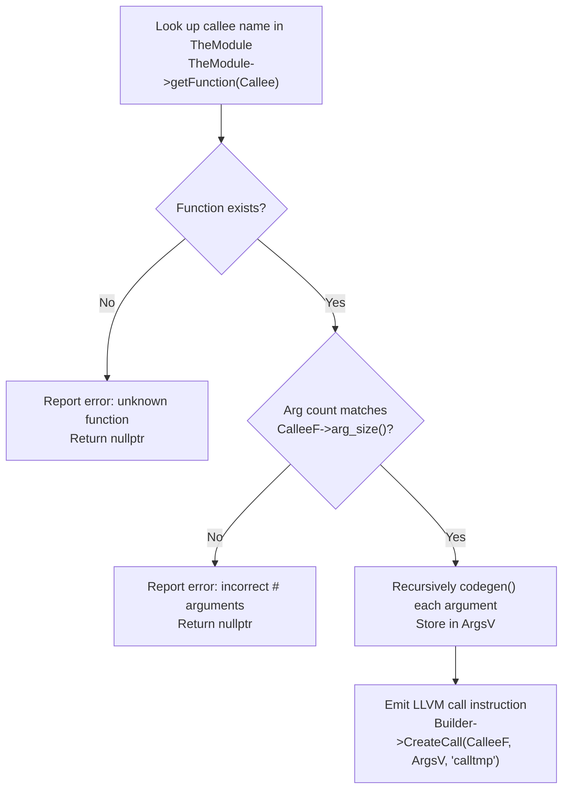

# Step 4.4: Function Calls, Externs, and Active Learning Challenge

In this final step of Section 4, we add support for calling functions from IR and declaring external C standard library functions with `extern`.

---

## Function Call Code Generation

When calling a function, `CallExprAST` needs to perform several checks and actions:



> [!NOTE]
> **External Declarations in LLVM IR**:
> In LLVM, an external function declaration is simply an `llvm::Function` without any basic blocks attached.  It specifies the function name, calling convention, argument types, and return type.  This provides LLVM with the complete type signature needed to type-check and generate valid calling instructions without needing the function implementation at compile time.

> [!TIP]
> **Linking Standard C Library Functions**:
> You can declare standard C functions like `extern sin(x);` or `extern cos(x);` directly in Kaleidoscope.  Because standard C library functions use C linkage (`double sin(double)`), LLVM can generate calls to them immediately, and the host process can resolve them dynamically at runtime.

---

## Incremental Code Changes

Open `kaleidoscope.cpp` to add function calls and external declarations.

### 1. Active Authoring: Implement CallExprAST::codegen()

Try implementing `CallExprAST::codegen()` yourself first before checking the code below:

1. Look up the callee function in `TheModule` using `TheModule->getFunction(Callee)`.  If not found, print an error to `stderr` and return `nullptr`.
2. Check whether `CalleeF->arg_size()` equals `Args.size()`.  If it does not match, print an error and return `nullptr`.
3. Create a `std::vector<llvm::Value *>` and recursively evaluate each argument expression with `Args[i]->codegen()`.  If any argument fails, return `nullptr`.
4. Call `Builder->CreateCall(CalleeF, ArgsV, "calltmp")` and return the resulting `llvm::Value *`.

<details>
<summary>Click here to reveal the CallExprAST::codegen() implementation</summary>

```cpp
class CallExprAST : public ExprAST {
  std::string Callee;
  std::vector<std::unique_ptr<ExprAST>> Args;

public:
  CallExprAST(std::string Callee, std::vector<std::unique_ptr<ExprAST>> Args)
      : Callee(std::move(Callee)), Args(std::move(Args)) {}

  llvm::Value *codegen() override {
    llvm::Function *CalleeF = TheModule->getFunction(Callee);
    if (!CalleeF) {
      fprintf(stderr, "Error: unknown function referenced: %s\n",
              Callee.c_str());
      return nullptr;
    }

    if (CalleeF->arg_size() != Args.size()) {
      fprintf(stderr, "Error: incorrect # arguments passed\n");
      return nullptr;
    }

    std::vector<llvm::Value *> ArgsV;
    for (unsigned i = 0, e = Args.size(); i != e; ++i) {
      ArgsV.push_back(Args[i]->codegen());
      if (!ArgsV.back())
        return nullptr;
    }

    return Builder->CreateCall(CalleeF, ArgsV, "calltmp");
  }
};
```
</details>

### 2. Add Parser and Driver Support for 'extern'

External function declarations are parsed as prototypes without a function body:

```cpp
/// external ::= 'extern' prototype
static std::unique_ptr<PrototypeAST> ParseExtern() {
  getNextToken(); // eat 'extern'
  return ParsePrototype();
}

static void HandleExtern() {
  if (auto ProtoAST = ParseExtern()) {
    if (auto *FnIR = ProtoAST->codegen()) {
      fprintf(stderr, "Read extern:\n");
      FnIR->print(llvm::errs());
      fprintf(stderr, "\n");
    }
  } else {
    getNextToken();
  }
}
```

In `MainLoop()`, add a `case tok_extern:` branch to call `HandleExtern()`:

```cpp
    case tok_extern:
      HandleExtern();
      break;
```

---

## Verifying Your Code

Before compiling, verify your complete `kaleidoscope.cpp` implementation against the reference file.

<details>
<summary>Click here to compare against the reference kaleidoscope.cpp</summary>

```cpp
#include "llvm/ADT/APFloat.h"
#include "llvm/IR/BasicBlock.h"
#include "llvm/IR/Constants.h"
#include "llvm/IR/DerivedTypes.h"
#include "llvm/IR/Function.h"
#include "llvm/IR/IRBuilder.h"
#include "llvm/IR/LLVMContext.h"
#include "llvm/IR/Module.h"
#include "llvm/IR/Type.h"
#include "llvm/IR/Verifier.h"
#include <cctype>
#include <cstdio>
#include <cstdlib>
#include <iostream>
#include <map>
#include <memory>
#include <string>
#include <utility>
#include <vector>

//===----------------------------------------------------------------------===//
// Lexer
//===----------------------------------------------------------------------===//

enum Token {
  tok_eof = -1,

  // Commands / Keywords
  tok_def = -100,
  tok_extern = -101,

  // Primary
  tok_identifier = -200,
  tok_number = -201,
};

static std::string IdentifierStr;
static double NumVal;

static int gettok() {
  static int LastChar = ' ';

  while (isspace(LastChar))
    LastChar = getchar();

  if (isalpha(LastChar)) {
    IdentifierStr = LastChar;
    while (isalnum((LastChar = getchar())))
      IdentifierStr += LastChar;

    if (IdentifierStr == "def")
      return tok_def;
    if (IdentifierStr == "extern")
      return tok_extern;
    return tok_identifier;
  }

  if (isdigit(LastChar) || LastChar == '.') {
    std::string NumStr;
    do {
      NumStr += LastChar;
      LastChar = getchar();
    } while (isdigit(LastChar) || LastChar == '.');

    NumVal = strtod(NumStr.c_str(), nullptr);
    return tok_number;
  }

  if (LastChar == '#') {
    do
      LastChar = getchar();
    while (LastChar != EOF && LastChar != '\n' && LastChar != '\r');

    if (LastChar != EOF)
      return gettok();
  }

  if (LastChar == EOF)
    return tok_eof;

  int ThisChar = LastChar;
  LastChar = getchar();
  return ThisChar;
}

//===----------------------------------------------------------------------===//
// LLVM State
//===----------------------------------------------------------------------===//

static std::unique_ptr<llvm::LLVMContext> TheContext;
static std::unique_ptr<llvm::Module> TheModule;
static std::unique_ptr<llvm::IRBuilder<>> Builder;
static std::map<std::string, llvm::Value *> NamedValues;

static void InitializeModule() {
  TheContext = std::make_unique<llvm::LLVMContext>();
  TheModule = std::make_unique<llvm::Module>("Kaleidoscope", *TheContext);
  Builder = std::make_unique<llvm::IRBuilder<>>(*TheContext);
}

//===----------------------------------------------------------------------===//
// AST
//===----------------------------------------------------------------------===//

class ExprAST {
public:
  virtual ~ExprAST() = default;
  virtual llvm::Value *codegen() = 0;
};

class NumberExprAST : public ExprAST {
  double Val;

public:
  explicit NumberExprAST(double Val) : Val(Val) {}

  llvm::Value *codegen() override {
    return llvm::ConstantFP::get(*TheContext, llvm::APFloat(Val));
  }
};

class VariableExprAST : public ExprAST {
  std::string Name;

public:
  explicit VariableExprAST(std::string Name) : Name(std::move(Name)) {}

  llvm::Value *codegen() override {
    llvm::Value *V = NamedValues[Name];
    if (!V) {
      fprintf(stderr, "Error: unknown variable name: %s\n", Name.c_str());
      return nullptr;
    }
    return V;
  }
};

class BinaryExprAST : public ExprAST {
  char Op;
  std::unique_ptr<ExprAST> LHS, RHS;

public:
  BinaryExprAST(char Op, std::unique_ptr<ExprAST> LHS,
                std::unique_ptr<ExprAST> RHS)
      : Op(Op), LHS(std::move(LHS)), RHS(std::move(RHS)) {}

  llvm::Value *codegen() override {
    llvm::Value *L = LHS->codegen();
    llvm::Value *R = RHS->codegen();
    if (!L || !R)
      return nullptr;

    switch (Op) {
    case '+':
      return Builder->CreateFAdd(L, R, "addtmp");
    case '-':
      return Builder->CreateFSub(L, R, "subtmp");
    case '*':
      return Builder->CreateFMul(L, R, "multmp");
    case '/':
      return Builder->CreateFDiv(L, R, "divtmp");
    case '<':
      L = Builder->CreateFCmpULT(L, R, "cmptmp");
      return Builder->CreateUIToFP(L, llvm::Type::getDoubleTy(*TheContext),
                                   "booltmp");
    default:
      fprintf(stderr, "invalid binary operator: %c\n", Op);
      return nullptr;
    }
  }
};

class CallExprAST : public ExprAST {
  std::string Callee;
  std::vector<std::unique_ptr<ExprAST>> Args;

public:
  CallExprAST(std::string Callee, std::vector<std::unique_ptr<ExprAST>> Args)
      : Callee(std::move(Callee)), Args(std::move(Args)) {}

  llvm::Value *codegen() override {
    llvm::Function *CalleeF = TheModule->getFunction(Callee);
    if (!CalleeF) {
      fprintf(stderr, "Error: unknown function referenced: %s\n",
              Callee.c_str());
      return nullptr;
    }

    if (CalleeF->arg_size() != Args.size()) {
      fprintf(stderr, "Error: incorrect # arguments passed\n");
      return nullptr;
    }

    std::vector<llvm::Value *> ArgsV;
    for (unsigned i = 0, e = Args.size(); i != e; ++i) {
      ArgsV.push_back(Args[i]->codegen());
      if (!ArgsV.back())
        return nullptr;
    }

    return Builder->CreateCall(CalleeF, ArgsV, "calltmp");
  }
};

class PrototypeAST {
  std::string Name;
  std::vector<std::string> Args;

public:
  PrototypeAST(std::string Name, std::vector<std::string> Args)
      : Name(std::move(Name)), Args(std::move(Args)) {}

  const std::string &getName() const { return Name; }
  llvm::Function *codegen();
};

class FunctionAST {
  std::unique_ptr<PrototypeAST> Proto;
  std::unique_ptr<ExprAST> Body;

public:
  FunctionAST(std::unique_ptr<PrototypeAST> Proto,
              std::unique_ptr<ExprAST> Body)
      : Proto(std::move(Proto)), Body(std::move(Body)) {}

  llvm::Function *codegen();
};

llvm::Function *PrototypeAST::codegen() {
  std::vector<llvm::Type *> Doubles(Args.size(),
                                    llvm::Type::getDoubleTy(*TheContext));
  auto *FT = llvm::FunctionType::get(llvm::Type::getDoubleTy(*TheContext),
                                     Doubles, false);
  auto *F = llvm::Function::Create(FT, llvm::Function::ExternalLinkage, Name,
                                   TheModule.get());

  unsigned Idx = 0;
  for (auto &Arg : F->args())
    Arg.setName(Args[Idx++]);

  return F;
}

llvm::Function *FunctionAST::codegen() {
  auto *TheFunction = TheModule->getFunction(Proto->getName());
  if (!TheFunction)
    TheFunction = Proto->codegen();
  if (!TheFunction)
    return nullptr;

  auto *BB = llvm::BasicBlock::Create(*TheContext, "entry", TheFunction);
  Builder->SetInsertPoint(BB);

  NamedValues.clear();
  for (auto &Arg : TheFunction->args())
    NamedValues[std::string(Arg.getName())] = &Arg;

  if (auto *RetVal = Body->codegen()) {
    Builder->CreateRet(RetVal);
    llvm::verifyFunction(*TheFunction);
    return TheFunction;
  }

  TheFunction->eraseFromParent();
  return nullptr;
}

//===----------------------------------------------------------------------===//
// Parser
//===----------------------------------------------------------------------===//

static int CurTok;
static int getNextToken() { return CurTok = gettok(); }

static std::map<char, int> BinopPrecedence;

static int GetTokPrecedence() {
  if (!isascii(CurTok))
    return -1;

  int TokPrec = BinopPrecedence[static_cast<char>(CurTok)];
  if (TokPrec <= 0)
    return -1;
  return TokPrec;
}

static std::unique_ptr<ExprAST> ParseExpression();

static std::unique_ptr<ExprAST> ParseNumberExpr() {
  auto Result = std::make_unique<NumberExprAST>(NumVal);
  getNextToken();
  return Result;
}

static std::unique_ptr<ExprAST> ParseParenExpr() {
  getNextToken(); // eat '('
  auto V = ParseExpression();
  if (!V)
    return nullptr;

  if (CurTok != ')') {
    fprintf(stderr, "Error: expected ')'\n");
    return nullptr;
  }
  getNextToken(); // eat ')'
  return V;
}

static std::unique_ptr<ExprAST> ParseIdentifierExpr() {
  std::string IdName = IdentifierStr;
  getNextToken(); // eat identifier

  if (CurTok != '(')
    return std::make_unique<VariableExprAST>(IdName);

  getNextToken(); // eat '('
  std::vector<std::unique_ptr<ExprAST>> Args;
  if (CurTok != ')') {
    while (true) {
      if (auto Arg = ParseExpression())
        Args.push_back(std::move(Arg));
      else
        return nullptr;

      if (CurTok == ')')
        break;

      if (CurTok != ',') {
        fprintf(stderr, "Error: expected ')' or ',' in argument list\n");
        return nullptr;
      }
      getNextToken();
    }
  }

  getNextToken(); // eat ')'
  return std::make_unique<CallExprAST>(IdName, std::move(Args));
}

static std::unique_ptr<ExprAST> ParsePrimary() {
  switch (CurTok) {
  case tok_identifier:
    return ParseIdentifierExpr();
  case tok_number:
    return ParseNumberExpr();
  case '(':
    return ParseParenExpr();
  default:
    fprintf(stderr, "Error: unknown token when expecting an expression\n");
    return nullptr;
  }
}

static std::unique_ptr<ExprAST> ParseBinOpRHS(int ExprPrec,
                                              std::unique_ptr<ExprAST> LHS) {
  while (true) {
    int TokPrec = GetTokPrecedence();

    if (TokPrec < ExprPrec)
      return LHS;

    int BinOp = CurTok;
    getNextToken();

    auto RHS = ParsePrimary();
    if (!RHS)
      return nullptr;

    int NextPrec = GetTokPrecedence();
    if (TokPrec < NextPrec) {
      RHS = ParseBinOpRHS(TokPrec + 1, std::move(RHS));
      if (!RHS)
        return nullptr;
    }

    LHS = std::make_unique<BinaryExprAST>(static_cast<char>(BinOp),
                                          std::move(LHS), std::move(RHS));
  }
}

static std::unique_ptr<ExprAST> ParseExpression() {
  auto LHS = ParsePrimary();
  if (!LHS)
    return nullptr;

  return ParseBinOpRHS(0, std::move(LHS));
}

static std::unique_ptr<PrototypeAST> ParsePrototype() {
  if (CurTok != tok_identifier) {
    fprintf(stderr, "Error: expected function name in prototype\n");
    return nullptr;
  }

  std::string FnName = IdentifierStr;
  getNextToken();

  if (CurTok != '(') {
    fprintf(stderr, "Error: expected '(' in prototype\n");
    return nullptr;
  }

  std::vector<std::string> ArgNames;
  while (getNextToken() == tok_identifier)
    ArgNames.push_back(IdentifierStr);

  if (CurTok != ')') {
    fprintf(stderr, "Error: expected ')' in prototype\n");
    return nullptr;
  }

  getNextToken(); // eat ')'
  return std::make_unique<PrototypeAST>(FnName, std::move(ArgNames));
}

static std::unique_ptr<FunctionAST> ParseDefinition() {
  getNextToken(); // eat 'def'
  auto Proto = ParsePrototype();
  if (!Proto)
    return nullptr;

  if (auto E = ParseExpression())
    return std::make_unique<FunctionAST>(std::move(Proto), std::move(E));
  return nullptr;
}

static std::unique_ptr<PrototypeAST> ParseExtern() {
  getNextToken(); // eat 'extern'
  return ParsePrototype();
}

static std::unique_ptr<FunctionAST> ParseTopLevelExpr() {
  if (auto E = ParseExpression()) {
    auto Proto = std::make_unique<PrototypeAST>("__anon_expr",
                                                std::vector<std::string>());
    return std::make_unique<FunctionAST>(std::move(Proto), std::move(E));
  }
  return nullptr;
}

//===----------------------------------------------------------------------===//
// Driver
//===----------------------------------------------------------------------===//

static void HandleDefinition() {
  if (auto FnAST = ParseDefinition()) {
    if (auto *FnIR = FnAST->codegen()) {
      fprintf(stderr, "Read function definition:\n");
      FnIR->print(llvm::errs());
      fprintf(stderr, "\n");
    }
  } else {
    getNextToken();
  }
}

static void HandleExtern() {
  if (auto ProtoAST = ParseExtern()) {
    if (auto *FnIR = ProtoAST->codegen()) {
      fprintf(stderr, "Read extern:\n");
      FnIR->print(llvm::errs());
      fprintf(stderr, "\n");
    }
  } else {
    getNextToken();
  }
}

static void HandleTopLevelExpression() {
  if (auto FnAST = ParseTopLevelExpr()) {
    if (auto *FnIR = FnAST->codegen()) {
      fprintf(stderr, "Read top-level expression:\n");
      FnIR->print(llvm::errs());
      fprintf(stderr, "\n");
      FnIR->eraseFromParent();
    }
  } else {
    getNextToken();
  }
}

static void MainLoop() {
  while (true) {
    fprintf(stderr, "ready> ");
    switch (CurTok) {
    case tok_eof:
      return;
    case ';':
      getNextToken();
      break;
    case tok_def:
      HandleDefinition();
      break;
    case tok_extern:
      HandleExtern();
      break;
    default:
      HandleTopLevelExpression();
      break;
    }
  }
}

int main() {
  BinopPrecedence['<'] = 10;
  BinopPrecedence['+'] = 20;
  BinopPrecedence['-'] = 20;
  BinopPrecedence['*'] = 40;
  BinopPrecedence['/'] = 40;

  InitializeModule();

  printf("Kaleidoscope LLVM IR Generator (Step 4.4: Complete Codegen)\n");
  printf("Type definitions, externs, or expressions followed by ';' and press "
         "Enter (Ctrl+D to exit):\n\n");

  getNextToken();
  MainLoop();

  return 0;
}
```
</details>

---

## Compiling and Running

Compile your updated compiler using `clang++`:

```bash
clang++ -Wall -Wextra kaleidoscope.cpp $(llvm-config --cxxflags --ldflags --system-libs --libs core) -o kaleidoscope
```

Run the binary:

```bash
./kaleidoscope
```

Declare an external C library function and call it:

```text
Kaleidoscope LLVM IR Generator (Step 4.4: Complete Codegen)
Type definitions, externs, or expressions followed by ';' and press Enter (Ctrl+D to exit):

ready> extern sin(x);
Read extern:
declare double @sin(double)

ready> sin(1.0);
Read top-level expression:
define double @__anon_expr() {
entry:
  %calltmp = call double @sin(double 1.000000e+00)
  ret double %calltmp
}
```

Your compiler has successfully declared an external function signature and emitted a valid LLVM `call` instruction targeting it.

---

## Active Learning Challenge: Calling User-Defined Functions

Test your understanding of function calls and IR emission by having functions invoke one another.

### The Challenge

Define a function `add(a b) a + b;`, and then define a second function `double_add(x) add(x, x);`.

Inspect the resulting LLVM IR to verify that `double_add` emits a `call double @add(...)` instruction.

<details>
<summary>Click here to reveal the output</summary>

```text
ready> def add(a b) a + b;
Read function definition:
define double @add(double %a, double %b) {
entry:
  %addtmp = fadd double %a, %b
  ret double %addtmp
}

ready> def double_add(x) add(x, x);
Read function definition:
define double @double_add(double %x) {
entry:
  %calltmp = call double @add(double %x, double %x)
  ret double %calltmp
}
```
</details>

---

## Next Steps

You can now translate expressions, function definitions, and library calls into validated LLVM Intermediate Representation.

In [Section 5: The JIT (Executing Native Machine Code)](../05-jit/README.md), we will add an On-Request Compilation (ORC) JIT engine to compile this IR directly into executable machine code in memory.
