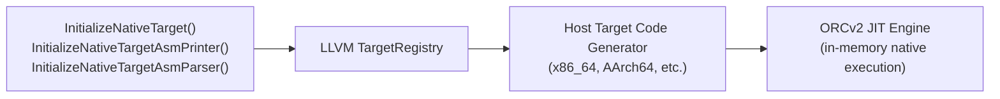

# Step 5.1: Native Target Initialisation

Welcome to Step 5.1.  Before LLVM can generate executable machine code, it must initialise the code generator and assembly parser for your specific computer architecture (such as x86-64 or AArch64).

---

## Target Registration in LLVM

LLVM uses a modular, plugin-style architecture to support dozens of targets:



> [!NOTE]
> **LLVM Target Registry Architecture**:
> LLVM supports dozens of target architectures, from embedded microcontrollers to supercomputers.  To avoid compiling every architecture backend into every tool, LLVM uses a modular `TargetRegistry`.  Calling `llvm::InitializeNativeTarget()` registers only the backend corresponding to the computer running your compiler.

LLVM provides three initialisation helpers for the current host machine:

- `llvm::InitializeNativeTarget()`: Initialises the target machine code generator for the host CPU.
- `llvm::InitializeNativeTargetAsmPrinter()`: Initialises the target assembly and machine code emitter.
- `llvm::InitializeNativeTargetAsmParser()`: Initialises the target assembly parser.

---

## Incremental Code Changes

Open `kaleidoscope.cpp` to initialise the native target machine.

### 1. Include Target Selection Header

Add `llvm/Support/TargetSelect.h` to your includes at the top of `kaleidoscope.cpp`:

```cpp
#include "llvm/Support/TargetSelect.h"
```

### 2. Initialise Targets in main()

Call the target initialisation helpers at the very beginning of `main()`:

```cpp
int main() {
  llvm::InitializeNativeTarget();
  llvm::InitializeNativeTargetAsmPrinter();
  llvm::InitializeNativeTargetAsmParser();

  BinopPrecedence['<'] = 10;
  BinopPrecedence['+'] = 20;
  BinopPrecedence['-'] = 20;
  BinopPrecedence['*'] = 40;
  BinopPrecedence['/'] = 40;

  InitializeModule();

  // (Remainder of your main function)
```

---

## Compiling and Running

Compile your compiler, linking against both the LLVM `core` and `native` components:

```bash
clang++ -Wall -Wextra kaleidoscope.cpp $(llvm-config --cxxflags --ldflags --system-libs --libs core native) -o kaleidoscope
```

Run the binary:

```bash
./kaleidoscope
```

The binary starts immediately, with the native code generator for your host architecture registered and ready for execution.

In [Step 5.2](02-jit-engine.md), we will introduce the JIT execution engine itself.
