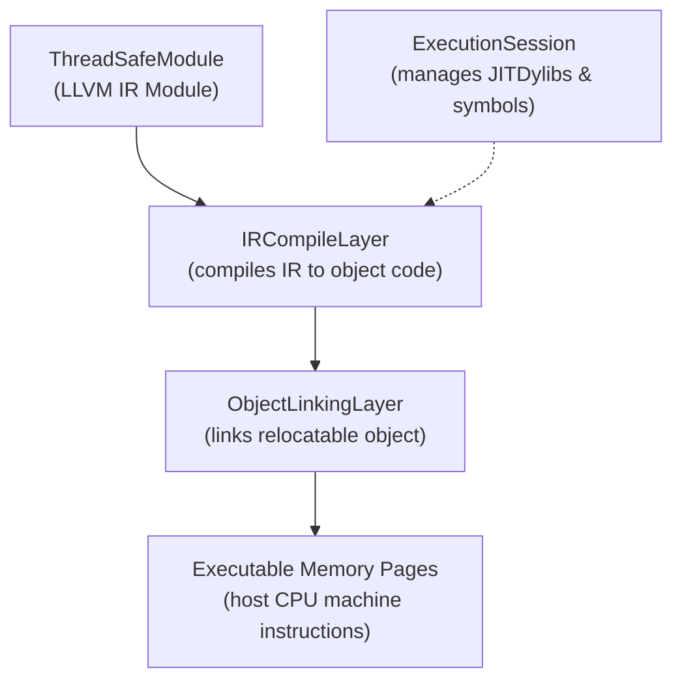

# Step 5.2: The JIT Engine

In this step, we introduce `KaleidoscopeJIT`, an On-Request Compilation (ORCv2) JIT class designed for this tutorial.

---

## How the ORCv2 JIT Works

LLVM's ORCv2 (On-Request Compilation) library is a layered framework for building custom JIT compilers:



The JIT manages in-memory compilation and dynamic linking:

1.  **Module compilation**: When you add an LLVM IR module to the JIT via `addModule()`, the `IRCompileLayer` compiles the IR into relocatable machine code in memory.
2.  **Symbol lookup**: When you call `lookup("my_func")`, the JIT resolves the address of the compiled function in executable memory.
3.  **Process symbol resolution**: If a function was declared as `extern` (like `sin` or `cos`), the JIT automatically searches the symbol table of the running host process.

> [!IMPORTANT]
> **Host Symbol Resolution and Dynamic Linking**:
> When JIT-compiled code calls functions in the host binary or the standard C library, the JIT must look up those symbols in the host process.  `KaleidoscopeJIT` configures a `DynamicLibrarySearchGenerator` for the host process so that external functions like `sin` and `cos` are resolved automatically without requiring manual symbol registration.

> [!NOTE]
> **The Importance of Target DataLayout**:
> Why must we call `TheModule->setDataLayout(TheJIT->getDataLayout())`?  LLVM's code generator and optimisation passes depend critically on knowing the host target's pointer size, integer alignment, and structure padding.  The `DataLayout` string encapsulates this contract between the IR and the target architecture.

The complete JIT class definition is provided in [include/KaleidoscopeJIT.h](../include/KaleidoscopeJIT.h).

---

## Incremental Code Changes

Open `kaleidoscope.cpp` to integrate the JIT engine.

### 1. Include the JIT Header

Include `KaleidoscopeJIT.h` alongside your other includes:

```cpp
#include "KaleidoscopeJIT.h"
```

### 2. Declare Global JIT State

Near your other global state declarations, add the JIT pointer and the LLVM `ExitOnError` helper:

```cpp
static std::unique_ptr<llvm::orc::KaleidoscopeJIT> TheJIT;
static llvm::ExitOnError ExitOnErr;
```

### 3. Configure Data Layout in Module Initialisation

Update `InitializeModule()` to also set the module's target data layout from `TheJIT`:

```cpp
static void InitializeModuleAndManagers() {
  TheContext = std::make_unique<llvm::LLVMContext>();
  TheModule = std::make_unique<llvm::Module>("KaleidoscopeJIT", *TheContext);
  TheModule->setDataLayout(TheJIT->getDataLayout());
  Builder = std::make_unique<llvm::IRBuilder<>>(*TheContext);
}
```

### 4. Create the JIT in main()

In `main()`, instantiate the JIT after registering the native targets:

```cpp
int main() {
  llvm::InitializeNativeTarget();
  llvm::InitializeNativeTargetAsmPrinter();
  llvm::InitializeNativeTargetAsmParser();

  TheJIT = ExitOnErr(llvm::orc::KaleidoscopeJIT::Create());
  InitializeModuleAndManagers();

  BinopPrecedence['<'] = 10;
  BinopPrecedence['+'] = 20;
  BinopPrecedence['-'] = 20;
  BinopPrecedence['*'] = 40;
  BinopPrecedence['/'] = 40;

  // (Remainder of your main function)
```

---

## Compiling and Running

Compile your updated compiler, adding `-Iinclude` and linking against `orcjit`:

```bash
clang++ -Iinclude -Wall -Wextra kaleidoscope.cpp $(llvm-config --cxxflags --ldflags --system-libs --libs core orcjit native) -o kaleidoscope
```

Run the binary:

```bash
./kaleidoscope
```

The JIT execution session starts cleanly, configuring the target data layout for your host CPU.

In [Step 5.3](03-executing-expressions.md), we will execute anonymous top-level expressions and print their results live in your terminal.
