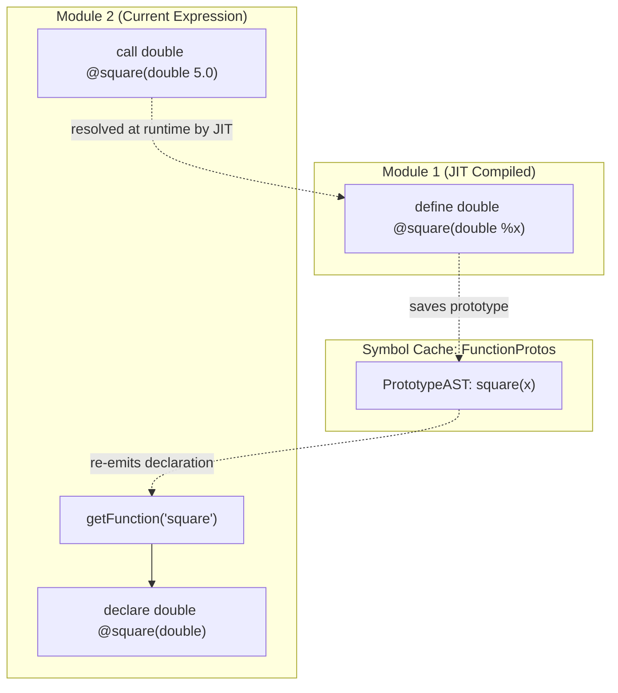

# Step 5.4: Functions and Library Calls in the JIT

In this step, we enable calling user-defined functions and external C standard library functions from the JIT REPL.

---

## Cross-Module Declarations in the JIT

When a function definition like `def square(x) x * x;` is entered, its module is immediately compiled and added to the JIT.  A new module is then opened for subsequent commands.

When a later command calls `square(5.0);`, the new module does not contain the declaration of `square`.  Without a prototype, LLVM cannot verify the call signature.

To solve this, we maintain an AST symbol cache of known prototypes:



> [!NOTE]
> **Module Isolation and SSA Scope**:
> Why can't the new module reuse the `llvm::Function *` pointer from the previous module?  In LLVM, every `llvm::Function` belongs strictly to a single `llvm::Module`.  LLVM IR is strongly typed and self-contained per module: any symbol referenced by an instruction inside a module must either be defined or declared within that exact same module.  `getFunction()` emits an external declaration into the current module on demand.

> [!TIP]
> **Re-evaluating or Redefining Functions**:
> In an interactive session, users often want to redefine functions with new equations.  By keeping `FunctionProtos` up to date, the compiler can re-emit updated declarations and allow the ORC JIT to resolve symbols dynamically.

---

## Incremental Code Changes

Open `kaleidoscope.cpp` to add cross-module prototype resolution.

### 1. Declare FunctionProtos and getFunction()

Add the prototype cache and lookup helper above your AST definitions:

```cpp
static std::map<std::string, std::unique_ptr<PrototypeAST>> FunctionProtos;

llvm::Function *getFunction(std::string Name) {
  // First, check if the function is already declared in the current module:
  if (auto *F = TheModule->getFunction(Name))
    return F;

  // Otherwise, re-declare the prototype from our symbol cache:
  auto FI = FunctionProtos.find(Name);
  if (FI != FunctionProtos.end())
    return FI->second->codegen();

  return nullptr;
}
```

### 2. Update CallExprAST and FunctionAST Codegen

In `CallExprAST::codegen()`, replace `TheModule->getFunction(Callee)` with `getFunction(Callee)`:

```cpp
    llvm::Function *CalleeF = getFunction(Callee);
    if (!CalleeF) {
      fprintf(stderr, "Error: unknown function referenced: %s\n",
              Callee.c_str());
      return nullptr;
    }
```

In `FunctionAST::codegen()`, register the prototype in `FunctionProtos` before generating the function body:

```cpp
llvm::Function *FunctionAST::codegen() {
  auto &P = *Proto;
  FunctionProtos[Proto->getName()] = std::move(Proto);
  auto *TheFunction = getFunction(P.getName());
  if (!TheFunction)
    return nullptr;

  auto *BB = llvm::BasicBlock::Create(*TheContext, "entry", TheFunction);
  Builder->SetInsertPoint(BB);

  NamedValues.clear();
  for (auto &Arg : TheFunction->args())
    NamedValues[std::string(Arg.getName())] = &Arg;

  if (auto *RetVal = Body->codegen()) {
    Builder->CreateRet(RetVal);
    llvm::verifyFunction(*TheFunction);
    return TheFunction;
  }

  TheFunction->eraseFromParent();
  return nullptr;
}
```

### 3. Update Function and Extern Handlers

In `HandleDefinition()`, compile the function and transfer the module to `TheJIT`:

```cpp
static void HandleDefinition() {
  if (auto FnAST = ParseDefinition()) {
    if (auto *FnIR = FnAST->codegen()) {
      fprintf(stderr, "Compiled function definition:\n");
      FnIR->print(llvm::errs());
      fprintf(stderr, "\n");
      ExitOnErr(TheJIT->addModule(
          llvm::orc::ThreadSafeModule(std::move(TheModule), std::move(TheContext))));
      InitializeModuleAndManagers();
    }
  } else {
    getNextToken();
  }
}
```

In `HandleExtern()`, register the prototype in `FunctionProtos`:

```cpp
static void HandleExtern() {
  if (auto ProtoAST = ParseExtern()) {
    if (auto *FnIR = ProtoAST->codegen()) {
      fprintf(stderr, "Registered extern:\n");
      FnIR->print(llvm::errs());
      fprintf(stderr, "\n");
      FunctionProtos[ProtoAST->getName()] = std::move(ProtoAST);
    }
  } else {
    getNextToken();
  }
}
```

---

## Verifying Your Code

Before compiling, compare your `kaleidoscope.cpp` with the complete reference file.

<details>
<summary>Click here to compare against the reference kaleidoscope.cpp</summary>

```cpp
#include "KaleidoscopeJIT.h"
#include "llvm/ADT/APFloat.h"
#include "llvm/IR/BasicBlock.h"
#include "llvm/IR/Constants.h"
#include "llvm/IR/DerivedTypes.h"
#include "llvm/IR/Function.h"
#include "llvm/IR/IRBuilder.h"
#include "llvm/IR/LLVMContext.h"
#include "llvm/IR/Module.h"
#include "llvm/IR/Type.h"
#include "llvm/IR/Verifier.h"
#include "llvm/Support/TargetSelect.h"
#include <cctype>
#include <cstdio>
#include <cstdlib>
#include <iostream>
#include <map>
#include <memory>
#include <string>
#include <utility>
#include <vector>

//===----------------------------------------------------------------------===//
// Lexer
//===----------------------------------------------------------------------===//

enum Token {
  tok_eof = -1,

  // Commands / Keywords
  tok_def = -100,
  tok_extern = -101,

  // Primary
  tok_identifier = -200,
  tok_number = -201,
};

static std::string IdentifierStr;
static double NumVal;

static int gettok() {
  static int LastChar = ' ';

  while (isspace(LastChar))
    LastChar = getchar();

  if (isalpha(LastChar) || LastChar == '_') {
    IdentifierStr = LastChar;
    while (isalnum((LastChar = getchar())) || LastChar == '_')
      IdentifierStr += LastChar;

    if (IdentifierStr == "def")
      return tok_def;
    if (IdentifierStr == "extern")
      return tok_extern;
    return tok_identifier;
  }

  if (isdigit(LastChar) || LastChar == '.') {
    std::string NumStr;
    do {
      NumStr += LastChar;
      LastChar = getchar();
    } while (isdigit(LastChar) || LastChar == '.');

    NumVal = strtod(NumStr.c_str(), nullptr);
    return tok_number;
  }

  if (LastChar == '#') {
    do
      LastChar = getchar();
    while (LastChar != EOF && LastChar != '\n' && LastChar != '\r');

    if (LastChar != EOF)
      return gettok();
  }

  if (LastChar == EOF)
    return tok_eof;

  int ThisChar = LastChar;
  LastChar = getchar();
  return ThisChar;
}

//===----------------------------------------------------------------------===//
// AST Forward Declarations
//===----------------------------------------------------------------------===//

class ExprAST;
class PrototypeAST;
class FunctionAST;

//===----------------------------------------------------------------------===//
// LLVM and JIT State
//===----------------------------------------------------------------------===//

static std::unique_ptr<llvm::LLVMContext> TheContext;
static std::unique_ptr<llvm::Module> TheModule;
static std::unique_ptr<llvm::IRBuilder<>> Builder;
static std::map<std::string, llvm::Value *> NamedValues;
static std::map<std::string, std::unique_ptr<PrototypeAST>> FunctionProtos;
static std::unique_ptr<llvm::orc::KaleidoscopeJIT> TheJIT;
static llvm::ExitOnError ExitOnErr;

static void InitializeModuleAndManagers() {
  TheContext = std::make_unique<llvm::LLVMContext>();
  TheModule = std::make_unique<llvm::Module>("KaleidoscopeJIT", *TheContext);
  TheModule->setDataLayout(TheJIT->getDataLayout());
  Builder = std::make_unique<llvm::IRBuilder<>>(*TheContext);
}

llvm::Function *getFunction(std::string Name);

//===----------------------------------------------------------------------===//
// AST
//===----------------------------------------------------------------------===//

class ExprAST {
public:
  virtual ~ExprAST() = default;
  virtual llvm::Value *codegen() = 0;
};

class NumberExprAST : public ExprAST {
  double Val;

public:
  explicit NumberExprAST(double Val) : Val(Val) {}

  llvm::Value *codegen() override {
    return llvm::ConstantFP::get(*TheContext, llvm::APFloat(Val));
  }
};

class VariableExprAST : public ExprAST {
  std::string Name;

public:
  explicit VariableExprAST(std::string Name) : Name(std::move(Name)) {}

  llvm::Value *codegen() override {
    llvm::Value *V = NamedValues[Name];
    if (!V) {
      fprintf(stderr, "Error: unknown variable name: %s\n", Name.c_str());
      return nullptr;
    }
    return V;
  }
};

class BinaryExprAST : public ExprAST {
  char Op;
  std::unique_ptr<ExprAST> LHS, RHS;

public:
  BinaryExprAST(char Op, std::unique_ptr<ExprAST> LHS,
                std::unique_ptr<ExprAST> RHS)
      : Op(Op), LHS(std::move(LHS)), RHS(std::move(RHS)) {}

  llvm::Value *codegen() override {
    llvm::Value *L = LHS->codegen();
    llvm::Value *R = RHS->codegen();
    if (!L || !R)
      return nullptr;

    switch (Op) {
    case '+':
      return Builder->CreateFAdd(L, R, "addtmp");
    case '-':
      return Builder->CreateFSub(L, R, "subtmp");
    case '*':
      return Builder->CreateFMul(L, R, "multmp");
    case '/':
      return Builder->CreateFDiv(L, R, "divtmp");
    case '<':
      L = Builder->CreateFCmpULT(L, R, "cmptmp");
      return Builder->CreateUIToFP(L, llvm::Type::getDoubleTy(*TheContext),
                                   "booltmp");
    default:
      fprintf(stderr, "invalid binary operator: %c\n", Op);
      return nullptr;
    }
  }
};

class CallExprAST : public ExprAST {
  std::string Callee;
  std::vector<std::unique_ptr<ExprAST>> Args;

public:
  CallExprAST(std::string Callee, std::vector<std::unique_ptr<ExprAST>> Args)
      : Callee(std::move(Callee)), Args(std::move(Args)) {}

  llvm::Value *codegen() override {
    llvm::Function *CalleeF = getFunction(Callee);
    if (!CalleeF) {
      fprintf(stderr, "Error: unknown function referenced: %s\n",
              Callee.c_str());
      return nullptr;
    }

    if (CalleeF->arg_size() != Args.size()) {
      fprintf(stderr, "Error: incorrect # arguments passed\n");
      return nullptr;
    }

    std::vector<llvm::Value *> ArgsV;
    for (unsigned i = 0, e = Args.size(); i != e; ++i) {
      ArgsV.push_back(Args[i]->codegen());
      if (!ArgsV.back())
        return nullptr;
    }

    return Builder->CreateCall(CalleeF, ArgsV, "calltmp");
  }
};

class PrototypeAST {
  std::string Name;
  std::vector<std::string> Args;

public:
  PrototypeAST(std::string Name, std::vector<std::string> Args)
      : Name(std::move(Name)), Args(std::move(Args)) {}

  const std::string &getName() const { return Name; }
  llvm::Function *codegen();
};

class FunctionAST {
  std::unique_ptr<PrototypeAST> Proto;
  std::unique_ptr<ExprAST> Body;

public:
  FunctionAST(std::unique_ptr<PrototypeAST> Proto,
              std::unique_ptr<ExprAST> Body)
      : Proto(std::move(Proto)), Body(std::move(Body)) {}

  llvm::Function *codegen();
};

llvm::Function *PrototypeAST::codegen() {
  std::vector<llvm::Type *> Doubles(Args.size(),
                                    llvm::Type::getDoubleTy(*TheContext));
  auto *FT = llvm::FunctionType::get(llvm::Type::getDoubleTy(*TheContext),
                                     Doubles, false);
  auto *F = llvm::Function::Create(FT, llvm::Function::ExternalLinkage, Name,
                                   TheModule.get());

  unsigned Idx = 0;
  for (auto &Arg : F->args())
    Arg.setName(Args[Idx++]);

  return F;
}

llvm::Function *FunctionAST::codegen() {
  auto &P = *Proto;
  FunctionProtos[Proto->getName()] = std::move(Proto);
  auto *TheFunction = getFunction(P.getName());
  if (!TheFunction)
    return nullptr;

  auto *BB = llvm::BasicBlock::Create(*TheContext, "entry", TheFunction);
  Builder->SetInsertPoint(BB);

  NamedValues.clear();
  for (auto &Arg : TheFunction->args())
    NamedValues[std::string(Arg.getName())] = &Arg;

  if (auto *RetVal = Body->codegen()) {
    Builder->CreateRet(RetVal);
    llvm::verifyFunction(*TheFunction);
    return TheFunction;
  }

  TheFunction->eraseFromParent();
  return nullptr;
}

//===----------------------------------------------------------------------===//
// Parser
//===----------------------------------------------------------------------===//

static int CurTok;
static int getNextToken() { return CurTok = gettok(); }

static std::map<char, int> BinopPrecedence;

static int GetTokPrecedence() {
  if (!isascii(CurTok))
    return -1;

  int TokPrec = BinopPrecedence[static_cast<char>(CurTok)];
  if (TokPrec <= 0)
    return -1;
  return TokPrec;
}

static std::unique_ptr<ExprAST> ParseExpression();

static std::unique_ptr<ExprAST> ParseNumberExpr() {
  auto Result = std::make_unique<NumberExprAST>(NumVal);
  getNextToken();
  return Result;
}

static std::unique_ptr<ExprAST> ParseParenExpr() {
  getNextToken(); // eat '('
  auto V = ParseExpression();
  if (!V)
    return nullptr;

  if (CurTok != ')') {
    fprintf(stderr, "Error: expected ')'\n");
    return nullptr;
  }
  getNextToken(); // eat ')'
  return V;
}

static std::unique_ptr<ExprAST> ParseIdentifierExpr() {
  std::string IdName = IdentifierStr;
  getNextToken(); // eat identifier

  if (CurTok != '(')
    return std::make_unique<VariableExprAST>(IdName);

  getNextToken(); // eat '('
  std::vector<std::unique_ptr<ExprAST>> Args;
  if (CurTok != ')') {
    while (true) {
      if (auto Arg = ParseExpression())
        Args.push_back(std::move(Arg));
      else
        return nullptr;

      if (CurTok == ')')
        break;

      if (CurTok != ',') {
        fprintf(stderr, "Error: expected ')' or ',' in argument list\n");
        return nullptr;
      }
      getNextToken();
    }
  }

  getNextToken(); // eat ')'
  return std::make_unique<CallExprAST>(IdName, std::move(Args));
}

static std::unique_ptr<ExprAST> ParsePrimary() {
  switch (CurTok) {
  case tok_identifier:
    return ParseIdentifierExpr();
  case tok_number:
    return ParseNumberExpr();
  case '(':
    return ParseParenExpr();
  default:
    fprintf(stderr, "Error: unknown token when expecting an expression\n");
    return nullptr;
  }
}

static std::unique_ptr<ExprAST> ParseBinOpRHS(int ExprPrec,
                                              std::unique_ptr<ExprAST> LHS) {
  while (true) {
    int TokPrec = GetTokPrecedence();

    if (TokPrec < ExprPrec)
      return LHS;

    int BinOp = CurTok;
    getNextToken();

    auto RHS = ParsePrimary();
    if (!RHS)
      return nullptr;

    int NextPrec = GetTokPrecedence();
    if (TokPrec < NextPrec) {
      RHS = ParseBinOpRHS(TokPrec + 1, std::move(RHS));
      if (!RHS)
        return nullptr;
    }

    LHS = std::make_unique<BinaryExprAST>(static_cast<char>(BinOp),
                                          std::move(LHS), std::move(RHS));
  }
}

static std::unique_ptr<ExprAST> ParseExpression() {
  auto LHS = ParsePrimary();
  if (!LHS)
    return nullptr;

  return ParseBinOpRHS(0, std::move(LHS));
}

static std::unique_ptr<PrototypeAST> ParsePrototype() {
  if (CurTok != tok_identifier) {
    fprintf(stderr, "Error: expected function name in prototype\n");
    return nullptr;
  }

  std::string FnName = IdentifierStr;
  getNextToken();

  if (CurTok != '(') {
    fprintf(stderr, "Error: expected '(' in prototype\n");
    return nullptr;
  }

  std::vector<std::string> ArgNames;
  while (getNextToken() == tok_identifier)
    ArgNames.push_back(IdentifierStr);

  if (CurTok != ')') {
    fprintf(stderr, "Error: expected ')' in prototype\n");
    return nullptr;
  }

  getNextToken(); // eat ')'
  return std::make_unique<PrototypeAST>(FnName, std::move(ArgNames));
}

static std::unique_ptr<FunctionAST> ParseDefinition() {
  getNextToken(); // eat 'def'
  auto Proto = ParsePrototype();
  if (!Proto)
    return nullptr;

  if (auto E = ParseExpression())
    return std::make_unique<FunctionAST>(std::move(Proto), std::move(E));
  return nullptr;
}

static std::unique_ptr<PrototypeAST> ParseExtern() {
  getNextToken(); // eat 'extern'
  return ParsePrototype();
}

static std::unique_ptr<FunctionAST> ParseTopLevelExpr() {
  if (auto E = ParseExpression()) {
    auto Proto = std::make_unique<PrototypeAST>("__anon_expr",
                                                std::vector<std::string>());
    return std::make_unique<FunctionAST>(std::move(Proto), std::move(E));
  }
  return nullptr;
}

//===----------------------------------------------------------------------===//
// JIT Execution Drivers
//===----------------------------------------------------------------------===//

static void HandleDefinition() {
  if (auto FnAST = ParseDefinition()) {
    if (auto *FnIR = FnAST->codegen()) {
      fprintf(stderr, "Compiled function definition:\n");
      FnIR->print(llvm::errs());
      fprintf(stderr, "\n");
      ExitOnErr(TheJIT->addModule(llvm::orc::ThreadSafeModule(
          std::move(TheModule), std::move(TheContext))));
      InitializeModuleAndManagers();
    }
  } else {
    getNextToken();
  }
}

static void HandleExtern() {
  if (auto ProtoAST = ParseExtern()) {
    if (auto *FnIR = ProtoAST->codegen()) {
      fprintf(stderr, "Registered extern:\n");
      FnIR->print(llvm::errs());
      fprintf(stderr, "\n");
      FunctionProtos[ProtoAST->getName()] = std::move(ProtoAST);
    }
  } else {
    getNextToken();
  }
}

static void HandleTopLevelExpression() {
  if (auto FnAST = ParseTopLevelExpr()) {
    if (FnAST->codegen()) {
      auto RT = TheJIT->getMainJITDylib().createResourceTracker();

      auto TSM = llvm::orc::ThreadSafeModule(std::move(TheModule),
                                             std::move(TheContext));
      ExitOnErr(TheJIT->addModule(std::move(TSM), RT));
      InitializeModuleAndManagers();

      auto ExprSymbol = ExitOnErr(TheJIT->lookup("__anon_expr"));

      double (*FP)() = ExprSymbol.toPtr<double (*)()>();
      fprintf(stderr, "Evaluated to %f\n", FP());

      ExitOnErr(RT->remove());
    }
  } else {
    getNextToken();
  }
}

static void MainLoop() {
  while (true) {
    fprintf(stderr, "ready> ");
    switch (CurTok) {
    case tok_eof:
      return;
    case ';':
      getNextToken();
      break;
    case tok_def:
      HandleDefinition();
      break;
    case tok_extern:
      HandleExtern();
      break;
    default:
      HandleTopLevelExpression();
      break;
    }
  }
}

int main() {
  llvm::InitializeNativeTarget();
  llvm::InitializeNativeTargetAsmPrinter();
  llvm::InitializeNativeTargetAsmParser();

  BinopPrecedence['<'] = 10;
  BinopPrecedence['+'] = 20;
  BinopPrecedence['-'] = 20;
  BinopPrecedence['*'] = 40;
  BinopPrecedence['/'] = 40;

  TheJIT = ExitOnErr(llvm::orc::KaleidoscopeJIT::Create());
  InitializeModuleAndManagers();

  printf("Kaleidoscope JIT REPL (Step 5.4: Complete JIT)\n");
  printf("Type math, definitions, or externs followed by ';' and press Enter "
         "(Ctrl+D to exit):\n\n");

  getNextToken();
  MainLoop();

  return 0;
}
```
</details>

---

## Compiling and Running

Compile your updated compiler:

```bash
clang++ -Iinclude -Wall -Wextra kaleidoscope.cpp $(llvm-config --cxxflags --ldflags --system-libs --libs core orcjit native) -o kaleidoscope
```

Run the binary:

```bash
./kaleidoscope
```

Define a function, call it, and call a standard C math function:

```text
Kaleidoscope JIT REPL (Step 5.4: Complete JIT)
Type math, definitions, or externs followed by ';' and press Enter (Ctrl+D to exit):

ready> def square(x) x * x;
Compiled function definition:
define double @square(double %x) {
entry:
  %multmp = fmul double %x, %x
  ret double %multmp
}

ready> square(5.0);
Evaluated to 25.000000

ready> extern sin(x);
Registered extern:
declare double @sin(double)

ready> sin(1.0);
Evaluated to 0.841471
```

---

## Active Learning Challenge: Dynamic Math in the JIT

Now test composing your own functions with external C math routines.

### The Challenge

Declare `extern cos(x);`, and then define a function that calculates the trigonometric identity:

$$\sin^2(x) + \cos^2(x)$$

Evaluate the function for several values (such as `0.5` and `3.14159`) to verify that the result is always `1.0`.

<details>
<summary>Click here to reveal the solution</summary>

```text
ready> extern sin(x);
Registered extern:
declare double @sin(double)

ready> extern cos(x);
Registered extern:
declare double @cos(double)

ready> def trig_identity(x) sin(x) * sin(x) + cos(x) * cos(x);
Compiled function definition:
define double @trig_identity(double %x) {
entry:
  ...
}

ready> trig_identity(0.5);
Evaluated to 1.000000

ready> trig_identity(3.14159);
Evaluated to 1.000000
```
</details>

---

## What You Have Accomplished

You have built a complete, interactive programming language from scratch:
- A custom, hand-written lexer with whitespace and comment handling.
- An Abstract Syntax Tree and recursive-descent parser.
- Operator precedence climbing for mathematical expressions.
- Direct AST evaluation in pure C++.
- An LLVM IR code generator in Static Single Assignment (SSA) form.
- An On-Request Compilation (ORCv2) JIT that executes user functions and C library routines natively on your CPU.

In [Section 6: Control Flow (If / Then / Else)](../06-control-flow/README.md), we will introduce conditional branches, basic blocks, and SSA $\phi$ (PHI) nodes.
