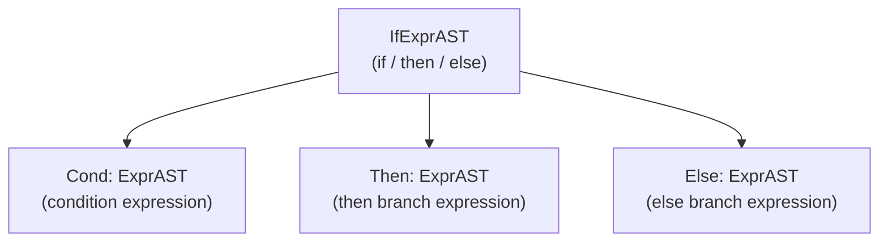

# Step 6.1: Lexing and Parsing 'if / then / else'

In many traditional languages like C and C++, `if` is a statement.  Statements perform side effects and produce no value.  In functional languages, and in Kaleidoscope, `if` is an **expression**.  It computes a condition, evaluates one of two branches, and returns the result of that branch:

```kaleidoscope
if x < 3 then 1 else 2
```

Because `if` is an expression, it can appear anywhere a number or function call can appear, such as inside another expression:

```kaleidoscope
4 + (if x then 10 else 20) * 2
```



> [!NOTE]
> **Expression-Oriented Languages**:
> In statement-based languages, an `if` statement without an `else` branch simply performs no action if the condition is false.  In an expression-oriented language, every expression must evaluate to a concrete value.  Requiring both `then` and `else` branches guarantees that the expression always produces a well-defined value regardless of which path executes.

In this step, you will add `if`, `then`, and `else` to your lexer, create the AST node, and write the parser.

---

## Incremental Code Changes

Open `kaleidoscope.cpp` to add support for conditional expressions.

### 1. Updating the Lexer

Add three new tokens to your `Token` enum:

```cpp
enum Token {
  tok_eof = -1,

  // Commands / Keywords
  tok_def = -100,
  tok_extern = -101,
  tok_if = -102,
  tok_then = -103,
  tok_else = -104,

  // Primary
  tok_identifier = -200,
  tok_number = -201,
};
```

Teach `gettok()` to recognise these keyword strings when scanning identifiers:

```cpp
    if (IdentifierStr == "def")
      return tok_def;
    if (IdentifierStr == "extern")
      return tok_extern;
    if (IdentifierStr == "if")
      return tok_if;
    if (IdentifierStr == "then")
      return tok_then;
    if (IdentifierStr == "else")
      return tok_else;
    return tok_identifier;
```

### 2. Defining the AST Node

An `if` expression stores three subexpressions: the condition, the "then" branch, and the "else" branch.  Add `IfExprAST` right after `CallExprAST`:

```cpp
class IfExprAST : public ExprAST {
  std::unique_ptr<ExprAST> Cond, Then, Else;

public:
  IfExprAST(std::unique_ptr<ExprAST> Cond, std::unique_ptr<ExprAST> Then,
            std::unique_ptr<ExprAST> Else)
      : Cond(std::move(Cond)), Then(std::move(Then)), Else(std::move(Else)) {}

  llvm::Value *codegen() override;
};
```

For now, provide a stub for `codegen()` so your code compiles cleanly:

```cpp
llvm::Value *IfExprAST::codegen() {
  fprintf(stderr, "Parsed an if/then/else AST node!\n");
  return llvm::ConstantFP::get(*TheContext, llvm::APFloat(1.0));
}
```

### 3. Parsing the Expression

Parsing `if / then / else` is straightforward because the syntax is strictly delimited by keywords:

```cpp
static std::unique_ptr<ExprAST> ParseIfExpr() {
  getNextToken(); // eat the 'if'

  auto Cond = ParseExpression();
  if (!Cond)
    return nullptr;

  if (CurTok != tok_then) {
    fprintf(stderr, "Error: expected 'then'\n");
    return nullptr;
  }
  getNextToken(); // eat the 'then'

  auto Then = ParseExpression();
  if (!Then)
    return nullptr;

  if (CurTok != tok_else) {
    fprintf(stderr, "Error: expected 'else'\n");
    return nullptr;
  }
  getNextToken(); // eat the 'else'

  auto Else = ParseExpression();
  if (!Else)
    return nullptr;

  return std::make_unique<IfExprAST>(std::move(Cond), std::move(Then),
                                     std::move(Else));
}
```

Hook `ParseIfExpr()` into `ParsePrimary()` so `if` expressions are recognised whenever a primary expression is expected:

```cpp
static std::unique_ptr<ExprAST> ParsePrimary() {
  switch (CurTok) {
  case tok_identifier:
    return ParseIdentifierExpr();
  case tok_number:
    return ParseNumberExpr();
  case '(':
    return ParseParenExpr();
  case tok_if:
    return ParseIfExpr();
  default:
    fprintf(stderr, "Error: unknown token when expecting an expression\n");
    return nullptr;
  }
}
```

---

## Verifying Your Code

Before compiling, check your `kaleidoscope.cpp` against the reference file.

<details>
<summary>Click here to compare against the reference kaleidoscope.cpp</summary>

```cpp
#include "KaleidoscopeJIT.h"
#include "llvm/ADT/APFloat.h"
#include "llvm/IR/BasicBlock.h"
#include "llvm/IR/Constants.h"
#include "llvm/IR/DerivedTypes.h"
#include "llvm/IR/Function.h"
#include "llvm/IR/IRBuilder.h"
#include "llvm/IR/LLVMContext.h"
#include "llvm/IR/Module.h"
#include "llvm/IR/Type.h"
#include "llvm/IR/Verifier.h"
#include "llvm/Support/TargetSelect.h"
#include <cctype>
#include <cstdio>
#include <cstdlib>
#include <iostream>
#include <map>
#include <memory>
#include <string>
#include <utility>
#include <vector>

//===----------------------------------------------------------------------===//
// Lexer
//===----------------------------------------------------------------------===//

enum Token {
  tok_eof = -1,

  // Commands / Keywords
  tok_def = -100,
  tok_extern = -101,
  tok_if = -102,
  tok_then = -103,
  tok_else = -104,

  // Primary
  tok_identifier = -200,
  tok_number = -201,
};

static std::string IdentifierStr;
static double NumVal;

static int gettok() {
  static int LastChar = ' ';

  while (isspace(LastChar))
    LastChar = getchar();

  if (isalpha(LastChar)) {
    IdentifierStr = LastChar;
    while (isalnum((LastChar = getchar())))
      IdentifierStr += LastChar;

    if (IdentifierStr == "def")
      return tok_def;
    if (IdentifierStr == "extern")
      return tok_extern;
    if (IdentifierStr == "if")
      return tok_if;
    if (IdentifierStr == "then")
      return tok_then;
    if (IdentifierStr == "else")
      return tok_else;
    return tok_identifier;
  }

  if (isdigit(LastChar) || LastChar == '.') {
    std::string NumStr;
    do {
      NumStr += LastChar;
      LastChar = getchar();
    } while (isdigit(LastChar) || LastChar == '.');

    NumVal = strtod(NumStr.c_str(), nullptr);
    return tok_number;
  }

  if (LastChar == '#') {
    do
      LastChar = getchar();
    while (LastChar != EOF && LastChar != '\n' && LastChar != '\r');

    if (LastChar != EOF)
      return gettok();
  }

  if (LastChar == EOF)
    return tok_eof;

  int ThisChar = LastChar;
  LastChar = getchar();
  return ThisChar;
}

//===----------------------------------------------------------------------===//
// AST Forward Declarations
//===----------------------------------------------------------------------===//

class ExprAST;
class PrototypeAST;
class FunctionAST;

//===----------------------------------------------------------------------===//
// LLVM and JIT State
//===----------------------------------------------------------------------===//

static std::unique_ptr<llvm::LLVMContext> TheContext;
static std::unique_ptr<llvm::Module> TheModule;
static std::unique_ptr<llvm::IRBuilder<>> Builder;
static std::map<std::string, llvm::Value *> NamedValues;
static std::map<std::string, std::unique_ptr<PrototypeAST>> FunctionProtos;
static std::unique_ptr<llvm::orc::KaleidoscopeJIT> TheJIT;
static llvm::ExitOnError ExitOnErr;

static void InitializeModuleAndManagers() {
  TheContext = std::make_unique<llvm::LLVMContext>();
  TheModule = std::make_unique<llvm::Module>("KaleidoscopeJIT", *TheContext);
  TheModule->setDataLayout(TheJIT->getDataLayout());
  Builder = std::make_unique<llvm::IRBuilder<>>(*TheContext);
}

llvm::Function *getFunction(std::string Name);

//===----------------------------------------------------------------------===//
// AST
//===----------------------------------------------------------------------===//

class ExprAST {
public:
  virtual ~ExprAST() = default;
  virtual llvm::Value *codegen() = 0;
};

class NumberExprAST : public ExprAST {
  double Val;

public:
  explicit NumberExprAST(double Val) : Val(Val) {}

  llvm::Value *codegen() override {
    return llvm::ConstantFP::get(*TheContext, llvm::APFloat(Val));
  }
};

class VariableExprAST : public ExprAST {
  std::string Name;

public:
  explicit VariableExprAST(std::string Name) : Name(std::move(Name)) {}

  llvm::Value *codegen() override {
    llvm::Value *V = NamedValues[Name];
    if (!V) {
      fprintf(stderr, "Error: unknown variable name: %s\n", Name.c_str());
      return nullptr;
    }
    return V;
  }
};

class BinaryExprAST : public ExprAST {
  char Op;
  std::unique_ptr<ExprAST> LHS, RHS;

public:
  BinaryExprAST(char Op, std::unique_ptr<ExprAST> LHS,
                std::unique_ptr<ExprAST> RHS)
      : Op(Op), LHS(std::move(LHS)), RHS(std::move(RHS)) {}

  llvm::Value *codegen() override {
    llvm::Value *L = LHS->codegen();
    llvm::Value *R = RHS->codegen();
    if (!L || !R)
      return nullptr;

    switch (Op) {
    case '+':
      return Builder->CreateFAdd(L, R, "addtmp");
    case '-':
      return Builder->CreateFSub(L, R, "subtmp");
    case '*':
      return Builder->CreateFMul(L, R, "multmp");
    case '/':
      return Builder->CreateFDiv(L, R, "divtmp");
    case '<':
      L = Builder->CreateFCmpULT(L, R, "cmptmp");
      return Builder->CreateUIToFP(L, llvm::Type::getDoubleTy(*TheContext),
                                   "booltmp");
    default:
      fprintf(stderr, "invalid binary operator: %c\n", Op);
      return nullptr;
    }
  }
};

class CallExprAST : public ExprAST {
  std::string Callee;
  std::vector<std::unique_ptr<ExprAST>> Args;

public:
  CallExprAST(std::string Callee, std::vector<std::unique_ptr<ExprAST>> Args)
      : Callee(std::move(Callee)), Args(std::move(Args)) {}

  llvm::Value *codegen() override {
    llvm::Function *CalleeF = getFunction(Callee);
    if (!CalleeF) {
      fprintf(stderr, "Error: unknown function referenced: %s\n",
              Callee.c_str());
      return nullptr;
    }

    if (CalleeF->arg_size() != Args.size()) {
      fprintf(stderr, "Error: incorrect # arguments passed\n");
      return nullptr;
    }

    std::vector<llvm::Value *> ArgsV;
    for (unsigned i = 0, e = Args.size(); i != e; ++i) {
      ArgsV.push_back(Args[i]->codegen());
      if (!ArgsV.back())
        return nullptr;
    }

    return Builder->CreateCall(CalleeF, ArgsV, "calltmp");
  }
};

class IfExprAST : public ExprAST {
  std::unique_ptr<ExprAST> Cond, Then, Else;

public:
  IfExprAST(std::unique_ptr<ExprAST> Cond, std::unique_ptr<ExprAST> Then,
            std::unique_ptr<ExprAST> Else)
      : Cond(std::move(Cond)), Then(std::move(Then)), Else(std::move(Else)) {}

  llvm::Value *codegen() override {
    fprintf(stderr, "Parsed an if/then/else AST node!\n");
    return llvm::ConstantFP::get(*TheContext, llvm::APFloat(1.0));
  }
};

class PrototypeAST {
  std::string Name;
  std::vector<std::string> Args;

public:
  PrototypeAST(std::string Name, std::vector<std::string> Args)
      : Name(std::move(Name)), Args(std::move(Args)) {}

  const std::string &getName() const { return Name; }
  llvm::Function *codegen();
};

class FunctionAST {
  std::unique_ptr<PrototypeAST> Proto;
  std::unique_ptr<ExprAST> Body;

public:
  FunctionAST(std::unique_ptr<PrototypeAST> Proto,
              std::unique_ptr<ExprAST> Body)
      : Proto(std::move(Proto)), Body(std::move(Body)) {}

  llvm::Function *codegen();
};

llvm::Function *PrototypeAST::codegen() {
  std::vector<llvm::Type *> Doubles(Args.size(),
                                    llvm::Type::getDoubleTy(*TheContext));
  auto *FT = llvm::FunctionType::get(llvm::Type::getDoubleTy(*TheContext),
                                     Doubles, false);
  auto *F = llvm::Function::Create(FT, llvm::Function::ExternalLinkage, Name,
                                   TheModule.get());

  unsigned Idx = 0;
  for (auto &Arg : F->args())
    Arg.setName(Args[Idx++]);

  return F;
}

llvm::Function *getFunction(std::string Name) {
  if (auto *F = TheModule->getFunction(Name))
    return F;

  auto FI = FunctionProtos.find(Name);
  if (FI != FunctionProtos.end())
    return FI->second->codegen();

  return nullptr;
}

llvm::Function *FunctionAST::codegen() {
  auto &P = *Proto;
  FunctionProtos[Proto->getName()] = std::move(Proto);
  auto *TheFunction = getFunction(P.getName());
  if (!TheFunction)
    return nullptr;

  auto *BB = llvm::BasicBlock::Create(*TheContext, "entry", TheFunction);
  Builder->SetInsertPoint(BB);

  NamedValues.clear();
  for (auto &Arg : TheFunction->args())
    NamedValues[std::string(Arg.getName())] = &Arg;

  if (auto *RetVal = Body->codegen()) {
    Builder->CreateRet(RetVal);
    llvm::verifyFunction(*TheFunction);
    return TheFunction;
  }

  TheFunction->eraseFromParent();
  return nullptr;
}

//===----------------------------------------------------------------------===//
// Parser
//===----------------------------------------------------------------------===//

static int CurTok;
static int getNextToken() { return CurTok = gettok(); }

static std::map<char, int> BinopPrecedence;

static int GetTokPrecedence() {
  if (!isascii(CurTok))
    return -1;

  int TokPrec = BinopPrecedence[static_cast<char>(CurTok)];
  if (TokPrec <= 0)
    return -1;
  return TokPrec;
}

static std::unique_ptr<ExprAST> ParseExpression();

static std::unique_ptr<ExprAST> ParseNumberExpr() {
  auto Result = std::make_unique<NumberExprAST>(NumVal);
  getNextToken();
  return Result;
}

static std::unique_ptr<ExprAST> ParseParenExpr() {
  getNextToken(); // eat '('
  auto V = ParseExpression();
  if (!V)
    return nullptr;

  if (CurTok != ')') {
    fprintf(stderr, "Error: expected ')'\n");
    return nullptr;
  }
  getNextToken(); // eat ')'
  return V;
}

static std::unique_ptr<ExprAST> ParseIdentifierExpr() {
  std::string IdName = IdentifierStr;
  getNextToken(); // eat identifier

  if (CurTok != '(')
    return std::make_unique<VariableExprAST>(IdName);

  getNextToken(); // eat '('
  std::vector<std::unique_ptr<ExprAST>> Args;
  if (CurTok != ')') {
    while (true) {
      if (auto Arg = ParseExpression())
        Args.push_back(std::move(Arg));
      else
        return nullptr;

      if (CurTok == ')')
        break;

      if (CurTok != ',') {
        fprintf(stderr, "Error: expected ')' or ',' in argument list\n");
        return nullptr;
      }
      getNextToken();
    }
  }

  getNextToken(); // eat ')'
  return std::make_unique<CallExprAST>(IdName, std::move(Args));
}

static std::unique_ptr<ExprAST> ParseIfExpr() {
  getNextToken(); // eat the 'if'

  auto Cond = ParseExpression();
  if (!Cond)
    return nullptr;

  if (CurTok != tok_then) {
    fprintf(stderr, "Error: expected 'then'\n");
    return nullptr;
  }
  getNextToken(); // eat the 'then'

  auto Then = ParseExpression();
  if (!Then)
    return nullptr;

  if (CurTok != tok_else) {
    fprintf(stderr, "Error: expected 'else'\n");
    return nullptr;
  }
  getNextToken(); // eat the 'else'

  auto Else = ParseExpression();
  if (!Else)
    return nullptr;

  return std::make_unique<IfExprAST>(std::move(Cond), std::move(Then),
                                     std::move(Else));
}

static std::unique_ptr<ExprAST> ParsePrimary() {
  switch (CurTok) {
  case tok_identifier:
    return ParseIdentifierExpr();
  case tok_number:
    return ParseNumberExpr();
  case '(':
    return ParseParenExpr();
  case tok_if:
    return ParseIfExpr();
  default:
    fprintf(stderr, "Error: unknown token when expecting an expression\n");
    return nullptr;
  }
}

static std::unique_ptr<ExprAST> ParseBinOpRHS(int ExprPrec,
                                              std::unique_ptr<ExprAST> LHS) {
  while (true) {
    int TokPrec = GetTokPrecedence();

    if (TokPrec < ExprPrec)
      return LHS;

    int BinOp = CurTok;
    getNextToken();

    auto RHS = ParsePrimary();
    if (!RHS)
      return nullptr;

    int NextPrec = GetTokPrecedence();
    if (TokPrec < NextPrec) {
      RHS = ParseBinOpRHS(TokPrec + 1, std::move(RHS));
      if (!RHS)
        return nullptr;
    }

    LHS = std::make_unique<BinaryExprAST>(static_cast<char>(BinOp),
                                          std::move(LHS), std::move(RHS));
  }
}

static std::unique_ptr<ExprAST> ParseExpression() {
  auto LHS = ParsePrimary();
  if (!LHS)
    return nullptr;

  return ParseBinOpRHS(0, std::move(LHS));
}

static std::unique_ptr<PrototypeAST> ParsePrototype() {
  if (CurTok != tok_identifier) {
    fprintf(stderr, "Error: expected function name in prototype\n");
    return nullptr;
  }

  std::string FnName = IdentifierStr;
  getNextToken();

  if (CurTok != '(') {
    fprintf(stderr, "Error: expected '(' in prototype\n");
    return nullptr;
  }

  std::vector<std::string> ArgNames;
  while (getNextToken() == tok_identifier)
    ArgNames.push_back(IdentifierStr);

  if (CurTok != ')') {
    fprintf(stderr, "Error: expected ')' in prototype\n");
    return nullptr;
  }

  getNextToken(); // eat ')'
  return std::make_unique<PrototypeAST>(FnName, std::move(ArgNames));
}

static std::unique_ptr<FunctionAST> ParseDefinition() {
  getNextToken(); // eat 'def'
  auto Proto = ParsePrototype();
  if (!Proto)
    return nullptr;

  if (auto E = ParseExpression())
    return std::make_unique<FunctionAST>(std::move(Proto), std::move(E));
  return nullptr;
}

static std::unique_ptr<PrototypeAST> ParseExtern() {
  getNextToken(); // eat 'extern'
  return ParsePrototype();
}

static std::unique_ptr<FunctionAST> ParseTopLevelExpr() {
  if (auto E = ParseExpression()) {
    auto Proto = std::make_unique<PrototypeAST>("__anon_expr",
                                                std::vector<std::string>());
    return std::make_unique<FunctionAST>(std::move(Proto), std::move(E));
  }
  return nullptr;
}

//===----------------------------------------------------------------------===//
// Driver Loop
//===----------------------------------------------------------------------===//

static void HandleDefinition() {
  if (auto FnAST = ParseDefinition()) {
    if (auto *FnIR = FnAST->codegen()) {
      fprintf(stderr, "Compiled function definition:\n");
      FnIR->print(llvm::errs());
      fprintf(stderr, "\n");
      ExitOnErr(TheJIT->addModule(llvm::orc::ThreadSafeModule(
          std::move(TheModule), std::move(TheContext))));
      InitializeModuleAndManagers();
    }
  } else {
    getNextToken();
  }
}

static void HandleExtern() {
  if (auto ProtoAST = ParseExtern()) {
    if (auto *FnIR = ProtoAST->codegen()) {
      fprintf(stderr, "Registered extern:\n");
      FnIR->print(llvm::errs());
      fprintf(stderr, "\n");
      FunctionProtos[ProtoAST->getName()] = std::move(ProtoAST);
    }
  } else {
    getNextToken();
  }
}

static void HandleTopLevelExpression() {
  if (auto FnAST = ParseTopLevelExpr()) {
    if (FnAST->codegen()) {
      auto RT = TheJIT->getMainJITDylib().createResourceTracker();

      auto TSM = llvm::orc::ThreadSafeModule(std::move(TheModule),
                                             std::move(TheContext));
      ExitOnErr(TheJIT->addModule(std::move(TSM), RT));
      InitializeModuleAndManagers();

      auto ExprSymbol = ExitOnErr(TheJIT->lookup("__anon_expr"));

      double (*FP)() = ExprSymbol.toPtr<double (*)()>();
      fprintf(stderr, "Evaluated to %f\n", FP());

      ExitOnErr(RT->remove());
    }
  } else {
    getNextToken();
  }
}

static void MainLoop() {
  while (true) {
    fprintf(stderr, "ready> ");
    switch (CurTok) {
    case tok_eof:
      return;
    case ';':
      getNextToken();
      break;
    case tok_def:
      HandleDefinition();
      break;
    case tok_extern:
      HandleExtern();
      break;
    default:
      HandleTopLevelExpression();
      break;
    }
  }
}

int main() {
  llvm::InitializeNativeTarget();
  llvm::InitializeNativeTargetAsmPrinter();
  llvm::InitializeNativeTargetAsmParser();

  BinopPrecedence['<'] = 10;
  BinopPrecedence['+'] = 20;
  BinopPrecedence['-'] = 20;
  BinopPrecedence['*'] = 40;
  BinopPrecedence['/'] = 40;

  TheJIT = ExitOnErr(llvm::orc::KaleidoscopeJIT::Create());
  InitializeModuleAndManagers();

  printf("Kaleidoscope JIT REPL (Step 6.1: If AST)\n");
  printf("Type math, definitions, or conditionals followed by ';' and press Enter "
         "(Ctrl+D to exit):\n\n");

  getNextToken();
  MainLoop();

  return 0;
}
```
</details>

---

## Compiling and Running

Compile your compiler:

```bash
clang++ -Iinclude -Wall -Wextra kaleidoscope.cpp $(llvm-config --cxxflags --ldflags --system-libs --libs core orcjit native) -o kaleidoscope
```

Launch `./kaleidoscope` and enter a conditional expression:

```text
ready> if 1 then 2 else 3;
Parsed an if/then/else AST node!
Evaluated to 1.000000
```

Your parser cleanly captures the conditional AST structure.

In [Step 6.2](02-basic-blocks-branching.md), we will explore how LLVM represents control flow using basic blocks and conditional branches.
