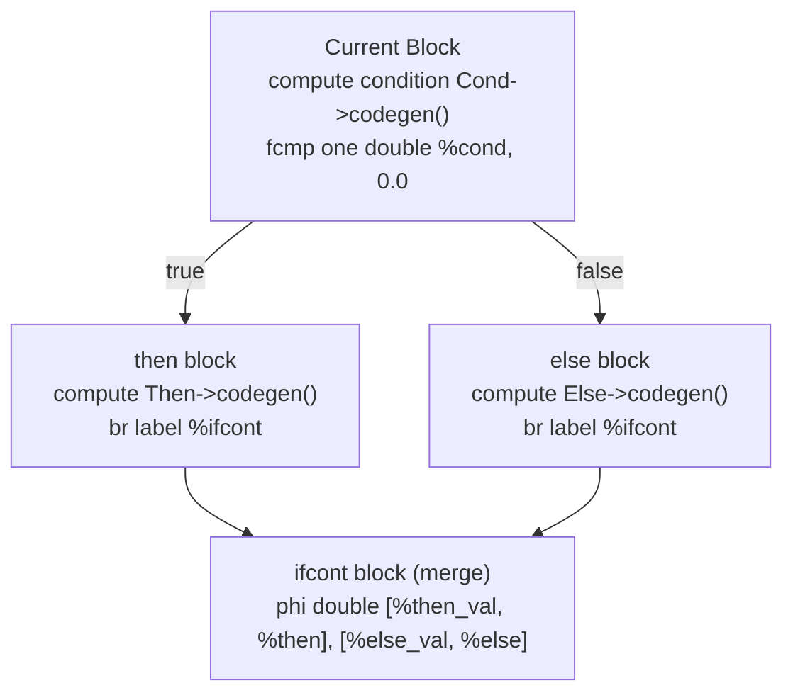

# Step 6.2: Basic Blocks and Branching

In previous sections, your functions consisted of a single linear sequence of instructions executed straight through from top to bottom.  To implement decisions, your compiler must jump between different paths.  In LLVM IR, control flow is structured using **Basic Blocks**.

---

## What is a Basic Block?

A `BasicBlock` is a sequence of LLVM instructions with two fundamental properties:

1.  **Single Entry**: Execution always starts at the first instruction.  No instruction inside the block can be jumped into from the outside.
2.  **Single Exit**: Execution always proceeds to the end of the block.  The final instruction in every basic block **must** be a **terminator instruction** (such as an unconditional branch `br`, a conditional branch `br i1`, or a return `ret`).

Because basic blocks cannot contain internal branches, compilers can analyse and optimise them as indivisible units.

> [!WARNING]
> **Strict Block Termination Rules**:
> In LLVM IR, every basic block must have exactly one terminator instruction at the end, and no instructions may appear after the terminator.  A common bug in compiler frontends is forgetting to emit a terminator before moving to the next block, or continuing to insert instructions into a block that has already been terminated.

---

## The Control Flow Graph for 'if / then / else'

An `if / then / else` expression splits control flow into distinct paths before merging:



> [!NOTE]
> **Tracking Dynamic Block Insertion Points**:
> Why must we update `ThenBB = Builder->GetInsertBlock();` and `ElseBB = Builder->GetInsertBlock();` after generating code for the branch bodies?  Because the expression inside `then` or `else` might itself contain nested `if` expressions or loops!  If nested control flow creates additional basic blocks, the block that ends up branching to `MergeBB` is the final block produced by the nested expression, not the initial `ThenBB`.

---

## Phased Code Generation Breakdown

Let us inspect each phase of generating basic blocks for `IfExprAST::codegen()`.

### 1. Converting the Condition to a Boolean

In Kaleidoscope, all numeric values are 64-bit IEEE 754 floating-point doubles.  However, conditional branch instructions in LLVM IR require a 1-bit integer (`i1`, boolean).

To convert a floating-point value into a boolean, compare it against `0.0`.  In IEEE floating-point math, non-equality is checked with `CreateFCmpONE` (Ordered and Not Equal):

```cpp
  llvm::Value *CondV = Cond->codegen();
  if (!CondV)
    return nullptr;

  CondV = Builder->CreateFCmpONE(
      CondV, llvm::ConstantFP::get(*TheContext, llvm::APFloat(0.0)), "ifcond");
```

### 2. Creating Blocks and Emitting the Conditional Branch

Retrieve the enclosing function from the builder's current insertion point, and construct the three blocks:

```cpp
  llvm::Function *TheFunction = Builder->GetInsertBlock()->getParent();

  llvm::BasicBlock *ThenBB =
      llvm::BasicBlock::Create(*TheContext, "then", TheFunction);
  llvm::BasicBlock *ElseBB = llvm::BasicBlock::Create(*TheContext, "else");
  llvm::BasicBlock *MergeBB = llvm::BasicBlock::Create(*TheContext, "ifcont");

  Builder->CreateCondBr(CondV, ThenBB, ElseBB);
```

Notice that only `ThenBB` is passed `TheFunction` upon creation.  This automatically appends `ThenBB` to the function.  `ElseBB` and `MergeBB` are created unattached for now; we attach them in order as we emit their contents.

### 3. Emitting the 'then' and 'else' Bodies

To emit instructions into `ThenBB`, move the builder's insertion point:

```cpp
  Builder->SetInsertPoint(ThenBB);
  llvm::Value *ThenV = Then->codegen();
  if (!ThenV)
    return nullptr;

  Builder->CreateBr(MergeBB);
  ThenBB = Builder->GetInsertBlock();
```

After generating code for `Then`, emit an unconditional branch (`CreateBr`) to jump to `MergeBB`.

Next, attach and emit `ElseBB`:

```cpp
  TheFunction->insert(TheFunction->end(), ElseBB);
  Builder->SetInsertPoint(ElseBB);
  llvm::Value *ElseV = Else->codegen();
  if (!ElseV)
    return nullptr;

  Builder->CreateBr(MergeBB);
  ElseBB = Builder->GetInsertBlock();
```

Now both branches are generated and jump to `MergeBB`.

In [Step 6.3](03-phi-nodes.md), we will complete `IfExprAST::codegen()` by merging the values in `MergeBB` with an SSA PHI node.
