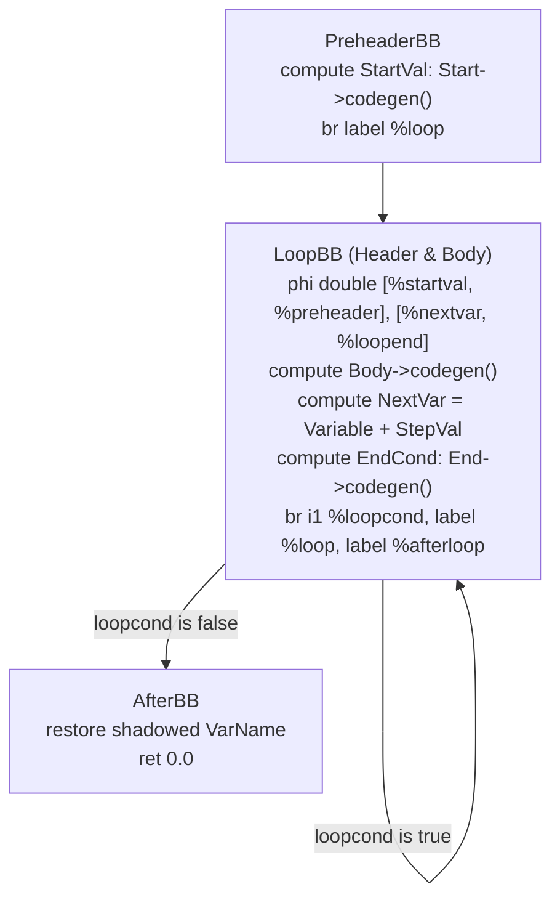

# Step 7.2: Emitting Loop Basic Blocks and PHI Nodes

In an imperative language, a loop counter is a variable in memory updated on each iteration (`i++`).  In pure SSA form, how can a loop counter change its value when values cannot be reassigned?

The answer is once again the **PHI node**.  On the very first iteration, the counter receives the starting value from outside the loop (the preheader).  On all subsequent iterations, the counter receives the incremented value from the end of the previous iteration!

---

## The Loop Control Flow Structure

A standard SSA loop consists of three primary regions:



> [!NOTE]
> **Loop Induction Variables in SSA**:
> In pure Static Single Assignment form, there are no mutable variables.  We cannot emit `i = i + 1` into a fixed memory location.  Instead, a PHI node at the head of `LoopBB` chooses between two incoming values: `StartVal` if entering from `PreheaderBB`, or `NextVar` if looping back from `LoopEndBB`.  This elegantly models iteration within the mathematical constraints of SSA.

> [!TIP]
> **Variable Shadowing and Scope Restoration**:
> Notice how `NamedValues[VarName]` is carefully saved into `OldVal` before entering the loop body, and restored in `AfterBB`.  If an enclosing function already defined a variable named `i`, the loop shadows it during iteration, and the outer variable is safely restored once the loop terminates.

---

## Phased Code Generation Breakdown

Open `kaleidoscope.cpp` and replace your stub `ForExprAST::codegen()` with the full implementation:

```cpp
llvm::Value *ForExprAST::codegen() {
  // 1. Evaluate the start expression.
  llvm::Value *StartVal = Start->codegen();
  if (!StartVal)
    return nullptr;

  // 2. Set up basic blocks.
  llvm::Function *TheFunction = Builder->GetInsertBlock()->getParent();
  llvm::BasicBlock *PreheaderBB = Builder->GetInsertBlock();
  llvm::BasicBlock *LoopBB =
      llvm::BasicBlock::Create(*TheContext, "loop", TheFunction);

  // Jump from preheader into the loop header.
  Builder->CreateBr(LoopBB);
  Builder->SetInsertPoint(LoopBB);

  // 3. Create the PHI node for the loop induction variable.
  llvm::PHINode *Variable =
      Builder->CreatePHI(llvm::Type::getDoubleTy(*TheContext), 2, VarName);
  Variable->addIncoming(StartVal, PreheaderBB);

  // Shadow any existing variable with this name in NamedValues.
  llvm::Value *OldVal = NamedValues[VarName];
  NamedValues[VarName] = Variable;

  // 4. Emit the loop body.
  if (!Body->codegen())
    return nullptr;

  // 5. Compute the step value (defaulting to 1.0 if omitted).
  llvm::Value *StepVal = nullptr;
  if (Step) {
    StepVal = Step->codegen();
    if (!StepVal)
      return nullptr;
  } else {
    StepVal = llvm::ConstantFP::get(*TheContext, llvm::APFloat(1.0));
  }

  llvm::Value *NextVar = Builder->CreateFAdd(Variable, StepVal, "nextvar");

  // 6. Evaluate the termination condition.
  llvm::Value *EndCond = End->codegen();
  if (!EndCond)
    return nullptr;

  EndCond = Builder->CreateFCmpONE(
      EndCond, llvm::ConstantFP::get(*TheContext, llvm::APFloat(0.0)),
      "loopcond");

  // Record where the loop ended (in case nested expressions branched).
  llvm::BasicBlock *LoopEndBB = Builder->GetInsertBlock();
  llvm::BasicBlock *AfterBB =
      llvm::BasicBlock::Create(*TheContext, "afterloop", TheFunction);

  // Branch back to LoopBB if EndCond is true, otherwise jump to AfterBB.
  Builder->CreateCondBr(EndCond, LoopBB, AfterBB);
  Builder->SetInsertPoint(AfterBB);

  // Add the incoming edge from the end of the loop to the induction PHI node.
  Variable->addIncoming(NextVar, LoopEndBB);

  // Restore the shadowed variable.
  if (OldVal)
    NamedValues[VarName] = OldVal;
  else
    NamedValues.erase(VarName);

  // For-loop expressions always return 0.0.
  return llvm::Constant::getNullValue(llvm::Type::getDoubleTy(*TheContext));
}
```

---

## Verifying Your Code

Before compiling, verify your complete `kaleidoscope.cpp` implementation against the reference file.

<details>
<summary>Click here to compare against the reference kaleidoscope.cpp</summary>

```cpp
#include "KaleidoscopeJIT.h"
#include "llvm/ADT/APFloat.h"
#include "llvm/ADT/STLExtras.h"
#include "llvm/IR/BasicBlock.h"
#include "llvm/IR/Constants.h"
#include "llvm/IR/DerivedTypes.h"
#include "llvm/IR/Function.h"
#include "llvm/IR/IRBuilder.h"
#include "llvm/IR/Instructions.h"
#include "llvm/IR/LLVMContext.h"
#include "llvm/IR/Module.h"
#include "llvm/IR/PassManager.h"
#include "llvm/IR/Type.h"
#include "llvm/IR/Verifier.h"
#include "llvm/Passes/PassBuilder.h"
#include "llvm/Passes/StandardInstrumentations.h"
#include "llvm/Support/TargetSelect.h"
#include "llvm/Target/TargetMachine.h"
#include "llvm/Transforms/InstCombine/InstCombine.h"
#include "llvm/Transforms/Scalar.h"
#include "llvm/Transforms/Scalar/GVN.h"
#include "llvm/Transforms/Scalar/Reassociate.h"
#include "llvm/Transforms/Scalar/SimplifyCFG.h"
#include <cctype>
#include <cstdio>
#include <cstdlib>
#include <map>
#include <memory>
#include <string>
#include <utility>
#include <vector>

enum Token {
  tok_eof = -1,
  tok_def = -2,
  tok_extern = -3,
  tok_identifier = -4,
  tok_number = -5,
  tok_if = -6,
  tok_then = -7,
  tok_else = -8,
  tok_for = -9,
  tok_in = -10,
};

static std::string IdentifierStr;
static double NumVal;

static int gettok() {
  static int LastChar = ' ';

  while (isspace(LastChar))
    LastChar = getchar();

  if (isalpha(LastChar)) {
    IdentifierStr = LastChar;
    while (isalnum((LastChar = getchar())))
      IdentifierStr += LastChar;

    if (IdentifierStr == "def")
      return tok_def;
    if (IdentifierStr == "extern")
      return tok_extern;
    if (IdentifierStr == "if")
      return tok_if;
    if (IdentifierStr == "then")
      return tok_then;
    if (IdentifierStr == "else")
      return tok_else;
    if (IdentifierStr == "for")
      return tok_for;
    if (IdentifierStr == "in")
      return tok_in;
    return tok_identifier;
  }

  if (isdigit(LastChar) || LastChar == '.') {
    std::string NumStr;
    do {
      NumStr += LastChar;
      LastChar = getchar();
    } while (isdigit(LastChar) || LastChar == '.');

    NumVal = strtod(NumStr.c_str(), nullptr);
    return tok_number;
  }

  if (LastChar == '#') {
    do
      LastChar = getchar();
    while (LastChar != EOF && LastChar != '\n' && LastChar != '\r');

    if (LastChar != EOF)
      return gettok();
  }

  if (LastChar == EOF)
    return tok_eof;

  int ThisChar = LastChar;
  LastChar = getchar();
  return ThisChar;
}

class ExprAST {
public:
  virtual ~ExprAST() = default;
  virtual llvm::Value *codegen() = 0;
};

class NumberExprAST : public ExprAST {
  double Val;

public:
  explicit NumberExprAST(double Val) : Val(Val) {}
  llvm::Value *codegen() override;
};

class VariableExprAST : public ExprAST {
  std::string Name;

public:
  explicit VariableExprAST(std::string Name) : Name(std::move(Name)) {}
  llvm::Value *codegen() override;
};

class BinaryExprAST : public ExprAST {
  char Op;
  std::unique_ptr<ExprAST> LHS, RHS;

public:
  BinaryExprAST(char Op, std::unique_ptr<ExprAST> LHS,
                std::unique_ptr<ExprAST> RHS)
      : Op(Op), LHS(std::move(LHS)), RHS(std::move(RHS)) {}
  llvm::Value *codegen() override;
};

class CallExprAST : public ExprAST {
  std::string Callee;
  std::vector<std::unique_ptr<ExprAST>> Args;

public:
  CallExprAST(std::string Callee, std::vector<std::unique_ptr<ExprAST>> Args)
      : Callee(std::move(Callee)), Args(std::move(Args)) {}
  llvm::Value *codegen() override;
};

class IfExprAST : public ExprAST {
  std::unique_ptr<ExprAST> Cond, Then, Else;

public:
  IfExprAST(std::unique_ptr<ExprAST> Cond, std::unique_ptr<ExprAST> Then,
            std::unique_ptr<ExprAST> Else)
      : Cond(std::move(Cond)), Then(std::move(Then)), Else(std::move(Else)) {}

  llvm::Value *codegen() override;
};

class ForExprAST : public ExprAST {
  std::string VarName;
  std::unique_ptr<ExprAST> Start, End, Step, Body;

public:
  ForExprAST(const std::string &VarName, std::unique_ptr<ExprAST> Start,
             std::unique_ptr<ExprAST> End, std::unique_ptr<ExprAST> Step,
             std::unique_ptr<ExprAST> Body)
      : VarName(VarName), Start(std::move(Start)), End(std::move(End)),
        Step(std::move(Step)), Body(std::move(Body)) {}

  llvm::Value *codegen() override;
};

class PrototypeAST {
  std::string Name;
  std::vector<std::string> Args;

public:
  PrototypeAST(const std::string &Name, std::vector<std::string> Args)
      : Name(Name), Args(std::move(Args)) {}
  llvm::Function *codegen();
  const std::string &getName() const { return Name; }
};

class FunctionAST {
  std::unique_ptr<PrototypeAST> Proto;
  std::unique_ptr<ExprAST> Body;

public:
  FunctionAST(std::unique_ptr<PrototypeAST> Proto,
              std::unique_ptr<ExprAST> Body)
      : Proto(std::move(Proto)), Body(std::move(Body)) {}
  llvm::Function *codegen();
};

static int CurTok;
static int getNextToken() { return CurTok = gettok(); }

static std::map<char, int> BinopPrecedence;

static int GetTokPrecedence() {
  if (!isascii(CurTok))
    return -1;

  int TokPrec = BinopPrecedence[CurTok];
  if (TokPrec <= 0)
    return -1;
  return TokPrec;
}

static std::unique_ptr<ExprAST> LogError(const char *Str) {
  fprintf(stderr, "Error: %s\n", Str);
  return nullptr;
}

static llvm::Value *LogErrorV(const char *Str) {
  LogError(Str);
  return nullptr;
}

static std::unique_ptr<ExprAST> ParseExpression();

static std::unique_ptr<ExprAST> ParseNumberExpr() {
  auto Result = std::make_unique<NumberExprAST>(NumVal);
  getNextToken();
  return Result;
}

static std::unique_ptr<ExprAST> ParseParenExpr() {
  getNextToken();
  auto V = ParseExpression();
  if (!V)
    return nullptr;

  if (CurTok != ')')
    return LogError("expected ')'");
  getNextToken();
  return V;
}

static std::unique_ptr<ExprAST> ParseIdentifierExpr() {
  std::string IdName = IdentifierStr;
  getNextToken();

  if (CurTok != '(')
    return std::make_unique<VariableExprAST>(IdName);

  getNextToken();
  std::vector<std::unique_ptr<ExprAST>> Args;
  if (CurTok != ')') {
    while (true) {
      if (auto Arg = ParseExpression())
        Args.push_back(std::move(Arg));
      else
        return nullptr;

      if (CurTok == ')')
        break;

      if (CurTok != ',')
        return LogError("expected ')' or ',' in argument list");
      getNextToken();
    }
  }

  getNextToken();
  return std::make_unique<CallExprAST>(IdName, std::move(Args));
}

static std::unique_ptr<ExprAST> ParseIfExpr() {
  getNextToken();

  auto Cond = ParseExpression();
  if (!Cond)
    return nullptr;

  if (CurTok != tok_then)
    return LogError("expected 'then'");
  getNextToken();

  auto Then = ParseExpression();
  if (!Then)
    return nullptr;

  if (CurTok != tok_else)
    return LogError("expected 'else'");
  getNextToken();

  auto Else = ParseExpression();
  if (!Else)
    return nullptr;

  return std::make_unique<IfExprAST>(std::move(Cond), std::move(Then),
                                     std::move(Else));
}

static std::unique_ptr<ExprAST> ParseForExpr() {
  getNextToken();

  if (CurTok != tok_identifier)
    return LogError("expected identifier after for");

  std::string IdName = IdentifierStr;
  getNextToken();

  if (CurTok != '=')
    return LogError("expected '=' after for");
  getNextToken();

  auto Start = ParseExpression();
  if (!Start)
    return nullptr;
  if (CurTok != ',')
    return LogError("expected ',' after for start value");
  getNextToken();

  auto End = ParseExpression();
  if (!End)
    return nullptr;

  std::unique_ptr<ExprAST> Step;
  if (CurTok == ',') {
    getNextToken();
    Step = ParseExpression();
    if (!Step)
      return nullptr;
  }

  if (CurTok != tok_in)
    return LogError("expected 'in' after for");
  getNextToken();

  auto Body = ParseExpression();
  if (!Body)
    return nullptr;

  return std::make_unique<ForExprAST>(IdName, std::move(Start), std::move(End),
                                      std::move(Step), std::move(Body));
}

static std::unique_ptr<ExprAST> ParsePrimary() {
  switch (CurTok) {
  case tok_identifier:
    return ParseIdentifierExpr();
  case tok_number:
    return ParseNumberExpr();
  case '(':
    return ParseParenExpr();
  case tok_if:
    return ParseIfExpr();
  case tok_for:
    return ParseForExpr();
  default:
    return LogError("unknown token when expecting an expression");
  }
}

static std::unique_ptr<ExprAST> ParseBinOpRHS(int ExprPrec,
                                              std::unique_ptr<ExprAST> LHS) {
  while (true) {
    int TokPrec = GetTokPrecedence();

    if (TokPrec < ExprPrec)
      return LHS;

    int BinOp = CurTok;
    getNextToken();

    auto RHS = ParsePrimary();
    if (!RHS)
      return nullptr;

    int NextPrec = GetTokPrecedence();
    if (TokPrec < NextPrec) {
      RHS = ParseBinOpRHS(TokPrec + 1, std::move(RHS));
      if (!RHS)
        return nullptr;
    }

    LHS = std::make_unique<BinaryExprAST>(BinOp, std::move(LHS),
                                          std::move(RHS));
  }
}

static std::unique_ptr<ExprAST> ParseExpression() {
  auto LHS = ParsePrimary();
  if (!LHS)
    return nullptr;

  return ParseBinOpRHS(0, std::move(LHS));
}

static std::unique_ptr<PrototypeAST> ParsePrototype() {
  if (CurTok != tok_identifier)
    return LogErrorP("expected function name in prototype");

  std::string FnName = IdentifierStr;
  getNextToken();

  if (CurTok != '(')
    return LogErrorP("expected '(' in prototype");

  std::vector<std::string> ArgNames;
  while (getNextToken() == tok_identifier)
    ArgNames.push_back(IdentifierStr);
  if (CurTok != ')')
    return LogErrorP("expected ')' in prototype");

  getNextToken();
  return std::make_unique<PrototypeAST>(FnName, std::move(ArgNames));
}

static std::unique_ptr<FunctionAST> ParseDefinition() {
  getNextToken();
  auto Proto = ParsePrototype();
  if (!Proto)
    return nullptr;

  if (auto E = ParseExpression())
    return std::make_unique<FunctionAST>(std::move(Proto), std::move(E));
  return nullptr;
}

static std::unique_ptr<FunctionAST> ParseTopLevelExpr() {
  if (auto E = ParseExpression()) {
    auto Proto = std::make_unique<PrototypeAST>("__anon_expr",
                                                std::vector<std::string>());
    return std::make_unique<FunctionAST>(std::move(Proto), std::move(E));
  }
  return nullptr;
}

static std::unique_ptr<PrototypeAST> ParseExtern() {
  getNextToken();
  return ParsePrototype();
}

static std::unique_ptr<llvm::LLVMContext> TheContext;
static std::unique_ptr<llvm::Module> TheModule;
static std::unique_ptr<llvm::IRBuilder<>> Builder;
static std::map<std::string, llvm::Value *> NamedValues;
static std::unique_ptr<llvm::orc::KaleidoscopeJIT> TheJIT;
static std::map<std::string, std::unique_ptr<PrototypeAST>> FunctionProtos;
static llvm::ExitOnError ExitOnErr;

static void InitializeModuleAndManagers() {
  TheContext = std::make_unique<llvm::LLVMContext>();
  TheModule = std::make_unique<llvm::Module>("KaleidoscopeJIT", *TheContext);
  TheModule->setDataLayout(TheJIT->getDataLayout());
  Builder = std::make_unique<llvm::IRBuilder<>>(*TheContext);
}

static llvm::Function *getFunction(std::string Name) {
  if (auto *F = TheModule->getFunction(Name))
    return F;

  auto FI = FunctionProtos.find(Name);
  if (FI != FunctionProtos.end())
    return FI->second->codegen();

  return nullptr;
}

llvm::Value *NumberExprAST::codegen() {
  return llvm::ConstantFP::get(*TheContext, llvm::APFloat(Val));
}

llvm::Value *VariableExprAST::codegen() {
  llvm::Value *V = NamedValues[Name];
  if (!V)
    return LogErrorV("unknown variable name");
  return V;
}

llvm::Value *BinaryExprAST::codegen() {
  llvm::Value *L = LHS->codegen();
  llvm::Value *R = RHS->codegen();
  if (!L || !R)
    return nullptr;

  switch (Op) {
  case '+':
    return Builder->CreateFAdd(L, R, "addtmp");
  case '-':
    return Builder->CreateFSub(L, R, "subtmp");
  case '*':
    return Builder->CreateFMul(L, R, "multmp");
  case '/':
    return Builder->CreateFDiv(L, R, "divtmp");
  case '<':
    L = Builder->CreateFCmpULT(L, R, "cmptmp");
    return Builder->CreateUIToFP(L, llvm::Type::getDoubleTy(*TheContext),
                                 "booltmp");
  default:
    return LogErrorV("invalid binary operator");
  }
}

llvm::Value *CallExprAST::codegen() {
  llvm::Function *CalleeF = getFunction(Callee);
  if (!CalleeF)
    return LogErrorV("unknown function referenced");

  if (CalleeF->arg_size() != Args.size())
    return LogErrorV("incorrect number of arguments passed");

  std::vector<llvm::Value *> ArgsV;
  for (unsigned i = 0, e = Args.size(); i != e; ++i) {
    ArgsV.push_back(Args[i]->codegen());
    if (!ArgsV.back())
      return nullptr;
  }

  return Builder->CreateCall(CalleeF, ArgsV, "calltmp");
}

llvm::Value *IfExprAST::codegen() {
  llvm::Value *CondV = Cond->codegen();
  if (!CondV)
    return nullptr;

  CondV = Builder->CreateFCmpONE(
      CondV, llvm::ConstantFP::get(*TheContext, llvm::APFloat(0.0)), "ifcond");

  llvm::Function *TheFunction = Builder->GetInsertBlock()->getParent();

  llvm::BasicBlock *ThenBB =
      llvm::BasicBlock::Create(*TheContext, "then", TheFunction);
  llvm::BasicBlock *ElseBB = llvm::BasicBlock::Create(*TheContext, "else");
  llvm::BasicBlock *MergeBB = llvm::BasicBlock::Create(*TheContext, "ifcont");

  Builder->CreateCondBr(CondV, ThenBB, ElseBB);

  Builder->SetInsertPoint(ThenBB);
  llvm::Value *ThenV = Then->codegen();
  if (!ThenV)
    return nullptr;

  Builder->CreateBr(MergeBB);
  ThenBB = Builder->GetInsertBlock();

  TheFunction->insert(TheFunction->end(), ElseBB);
  Builder->SetInsertPoint(ElseBB);

  llvm::Value *ElseV = Else->codegen();
  if (!ElseV)
    return nullptr;

  Builder->CreateBr(MergeBB);
  ElseBB = Builder->GetInsertBlock();

  TheFunction->insert(TheFunction->end(), MergeBB);
  Builder->SetInsertPoint(MergeBB);

  llvm::PHINode *PN =
      Builder->CreatePHI(llvm::Type::getDoubleTy(*TheContext), 2, "iftmp");

  PN->addIncoming(ThenV, ThenBB);
  PN->addIncoming(ElseV, ElseBB);
  return PN;
}

llvm::Value *ForExprAST::codegen() {
  llvm::Value *StartVal = Start->codegen();
  if (!StartVal)
    return nullptr;

  llvm::Function *TheFunction = Builder->GetInsertBlock()->getParent();
  llvm::BasicBlock *PreheaderBB = Builder->GetInsertBlock();
  llvm::BasicBlock *LoopBB =
      llvm::BasicBlock::Create(*TheContext, "loop", TheFunction);

  Builder->CreateBr(LoopBB);
  Builder->SetInsertPoint(LoopBB);

  llvm::PHINode *Variable =
      Builder->CreatePHI(llvm::Type::getDoubleTy(*TheContext), 2, VarName);
  Variable->addIncoming(StartVal, PreheaderBB);

  llvm::Value *OldVal = NamedValues[VarName];
  NamedValues[VarName] = Variable;

  if (!Body->codegen())
    return nullptr;

  llvm::Value *StepVal = nullptr;
  if (Step) {
    StepVal = Step->codegen();
    if (!StepVal)
      return nullptr;
  } else {
    StepVal = llvm::ConstantFP::get(*TheContext, llvm::APFloat(1.0));
  }

  llvm::Value *NextVar = Builder->CreateFAdd(Variable, StepVal, "nextvar");

  llvm::Value *EndCond = End->codegen();
  if (!EndCond)
    return nullptr;

  EndCond = Builder->CreateFCmpONE(
      EndCond, llvm::ConstantFP::get(*TheContext, llvm::APFloat(0.0)),
      "loopcond");

  llvm::BasicBlock *LoopEndBB = Builder->GetInsertBlock();
  llvm::BasicBlock *AfterBB =
      llvm::BasicBlock::Create(*TheContext, "afterloop", TheFunction);

  Builder->CreateCondBr(EndCond, LoopBB, AfterBB);
  Builder->SetInsertPoint(AfterBB);

  Variable->addIncoming(NextVar, LoopEndBB);

  if (OldVal)
    NamedValues[VarName] = OldVal;
  else
    NamedValues.erase(VarName);

  return llvm::Constant::getNullValue(llvm::Type::getDoubleTy(*TheContext));
}

llvm::Function *PrototypeAST::codegen() {
  std::vector<llvm::Type *> Doubles(Args.size(),
                                    llvm::Type::getDoubleTy(*TheContext));
  llvm::FunctionType *FT = llvm::FunctionType::get(
      llvm::Type::getDoubleTy(*TheContext), Doubles, false);

  llvm::Function *F = llvm::Function::Create(
      FT, llvm::Function::ExternalLinkage, Name, TheModule.get());

  unsigned Idx = 0;
  for (auto &Arg : F->args())
    Arg.setName(Args[Idx++]);

  return F;
}

llvm::Function *FunctionAST::codegen() {
  auto &P = *Proto;
  FunctionProtos[Proto->getName()] = std::move(Proto);
  llvm::Function *TheFunction = getFunction(P.getName());
  if (!TheFunction)
    return nullptr;

  llvm::BasicBlock *BB =
      llvm::BasicBlock::Create(*TheContext, "entry", TheFunction);
  Builder->SetInsertPoint(BB);

  NamedValues.clear();
  for (auto &Arg : TheFunction->args())
    NamedValues[std::string(Arg.getName())] = &Arg;

  if (llvm::Value *RetVal = Body->codegen()) {
    Builder->CreateRet(RetVal);
    llvm::verifyFunction(*TheFunction);
    return TheFunction;
  }

  TheFunction->eraseFromParent();
  return nullptr;
}

static void HandleDefinition() {
  if (auto FnAST = ParseDefinition()) {
    if (auto *FnIR = FnAST->codegen()) {
      fprintf(stderr, "Read function definition:\n");
      FnIR->print(llvm::errs());
      fprintf(stderr, "\n");
      ExitOnErr(TheJIT->addModule(llvm::orc::ThreadSafeModule(
          std::move(TheModule), std::move(TheContext))));
      InitializeModuleAndManagers();
    }
  } else {
    getNextToken();
  }
}

static void HandleExtern() {
  if (auto ProtoAST = ParseExtern()) {
    if (auto *FnIR = ProtoAST->codegen()) {
      fprintf(stderr, "Read extern:\n");
      FnIR->print(llvm::errs());
      fprintf(stderr, "\n");
      FunctionProtos[ProtoAST->getName()] = std::move(ProtoAST);
    }
  } else {
    getNextToken();
  }
}

static void HandleTopLevelExpression() {
  if (auto FnAST = ParseTopLevelExpr()) {
    if (FnAST->codegen()) {
      auto RT = TheJIT->getMainJITDylib().createResourceTracker();

      auto TSM = llvm::orc::ThreadSafeModule(std::move(TheModule),
                                             std::move(TheContext));
      ExitOnErr(TheJIT->addModule(std::move(TSM), RT));
      InitializeModuleAndManagers();

      auto ExprSymbol = ExitOnErr(TheJIT->lookup("__anon_expr"));

      double (*FP)() = ExprSymbol.toPtr<double (*)()>();
      fprintf(stderr, "Evaluated to %f\n", FP());

      ExitOnErr(RT->remove());
    }
  } else {
    getNextToken();
  }
}

static void MainLoop() {
  while (true) {
    fprintf(stderr, "ready> ");
    switch (CurTok) {
    case tok_eof:
      return;
    case ';':
      getNextToken();
      break;
    case tok_def:
      HandleDefinition();
      break;
    case tok_extern:
      HandleExtern();
      break;
    default:
      HandleTopLevelExpression();
      break;
    }
  }
}

int main() {
  llvm::InitializeNativeTarget();
  llvm::InitializeNativeTargetAsmPrinter();
  llvm::InitializeNativeTargetAsmParser();

  BinopPrecedence['<'] = 10;
  BinopPrecedence['+'] = 20;
  BinopPrecedence['-'] = 20;
  BinopPrecedence['*'] = 40;
  BinopPrecedence['/'] = 40;

  TheJIT = ExitOnErr(llvm::orc::KaleidoscopeJIT::Create());
  InitializeModuleAndManagers();

  getNextToken();
  MainLoop();

  return 0;
}
```
</details>

---

## Compiling and Running

Compile your compiler:

```bash
clang++ -Iinclude -Wall -Wextra kaleidoscope.cpp $(llvm-config --cxxflags --ldflags --system-libs --libs core orcjit native) -o kaleidoscope
```

Launch `./kaleidoscope` and inspect the generated IR for a loop function:

```text
ready> def looptest(n)
         for i = 1, i < n, 1.0 in
           i;
Read function definition:
define double @looptest(double %n) {
entry:
  br label %loop

loop:                                             ; preds = %loop, %entry
  %i = phi double [ 1.000000e+00, %entry ], [ %nextvar, %loop ]
  %nextvar = fadd double %i, 1.000000e+00
  %cmptmp = fcmp ult double %i, %n
  %booltmp = uitofp i1 %cmptmp to double
  %loopcond = fcmp one double %booltmp, 0.000000e+00
  br i1 %loopcond, label %loop, label %afterloop

afterloop:                                        ; preds = %loop
  ret double 0.000000e+00
}
```

Notice how the PHI node cleanly merges `%entry` and the backedge `%loop`, creating a pure SSA iteration counter without mutable memory.

In [Step 7.3](03-terminal-graphics.md), we will connect host C I/O routines using `-rdynamic` to draw patterns directly from JIT loops.
