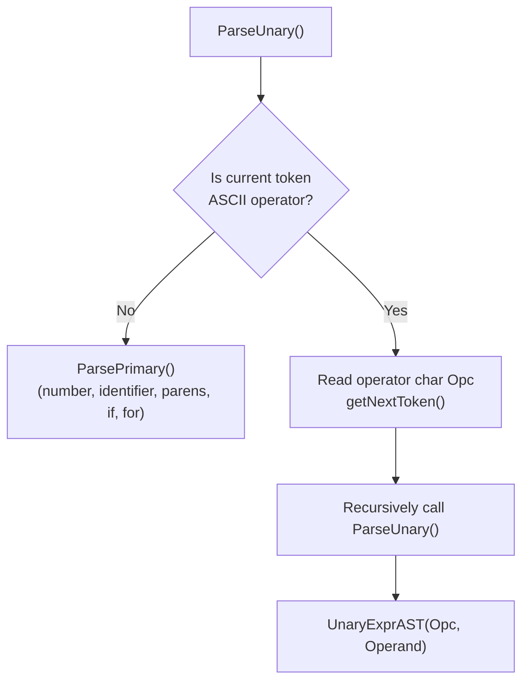

# Step 8.2: Unary Operators

Now that prototypes can declare unary operators, your parser and code generator must be taught how to parse and evaluate unary prefix expressions like `!x` or `-(a + b)`.

---

## Recursive Parsing of Unary Operators

In standard grammars, unary prefix operators bind more tightly than binary operators, but looser than primary expressions like numbers, variables, and parentheses:



> [!NOTE]
> **Unary Chaining and Right-Associativity**:
> Because `ParseUnary()` calls itself recursively, unary prefix operators chain naturally from right to left (`! ! x` parses as `!(!x)`).  Prefix operators bind tightly before entering the binary precedence climbing loop.

> [!TIP]
> **Lowering Operators to Function Calls**:
> Generating IR for a unary operator requires no new LLVM instructions.  In `UnaryExprAST::codegen()`, evaluating `!x` simply looks up the function named `unary!` using `getFunction()` and emits a standard `call` instruction.  This keeps the code generator minimal and reusable.

---

## Incremental Code Changes

Open `kaleidoscope.cpp` to implement unary operators.

### 1. Defining `UnaryExprAST`

Add `UnaryExprAST` to your AST section:

```cpp
class UnaryExprAST : public ExprAST {
  char Opcode;
  std::unique_ptr<ExprAST> Operand;

public:
  UnaryExprAST(char Opcode, std::unique_ptr<ExprAST> Operand)
      : Opcode(Opcode), Operand(std::move(Operand)) {}

  llvm::Value *codegen() override;
};
```

### 2. Parsing Unary Expressions

Add `ParseUnary()` right below `ParsePrimary()`:

```cpp
static std::unique_ptr<ExprAST> ParseUnary() {
  // If the current token is not an operator, it must be a primary expression.
  if (!isascii(CurTok) || CurTok == '(' || CurTok == ',')
    return ParsePrimary();

  // If this is a unary operator, read it.
  int Opc = CurTok;
  getNextToken();
  if (auto Operand = ParseUnary())
    return std::make_unique<UnaryExprAST>(Opc, std::move(Operand));
  return nullptr;
}
```

Update `ParseBinOpRHS()` and `ParseExpression()` to parse unary expressions on the left-hand and right-hand sides instead of primary expressions:

```cpp
static std::unique_ptr<ExprAST> ParseBinOpRHS(int ExprPrec,
                                              std::unique_ptr<ExprAST> LHS) {
  while (true) {
    int TokPrec = GetTokPrecedence();
    if (TokPrec < ExprPrec)
      return LHS;

    int BinOp = CurTok;
    getNextToken();

    // Parse RHS as a unary expression instead of ParsePrimary().
    auto RHS = ParseUnary();
    if (!RHS)
      return nullptr;

    int NextPrec = GetTokPrecedence();
    if (TokPrec < NextPrec) {
      RHS = ParseBinOpRHS(TokPrec + 1, std::move(RHS));
      if (!RHS)
        return nullptr;
    }

    LHS = std::make_unique<BinaryExprAST>(BinOp, std::move(LHS),
                                          std::move(RHS));
  }
}

static std::unique_ptr<ExprAST> ParseExpression() {
  // Parse LHS as a unary expression instead of ParsePrimary().
  auto LHS = ParseUnary();
  if (!LHS)
    return nullptr;

  return ParseBinOpRHS(0, std::move(LHS));
}
```

### 3. Emitting IR for Unary Operators

Generating code for a unary operator looks up the corresponding function named `unary<op>` and emits an LLVM `call`:

```cpp
llvm::Value *UnaryExprAST::codegen() {
  llvm::Value *OperandV = Operand->codegen();
  if (!OperandV)
    return nullptr;

  llvm::Function *F = getFunction(std::string("unary") + Opcode);
  if (!F)
    return LogErrorV("unknown unary operator");

  return Builder->CreateCall(F, OperandV, "unop");
}
```

In [Step 8.3](03-binary-operators.md), we will register dynamic precedence and emit user-defined binary operators.
