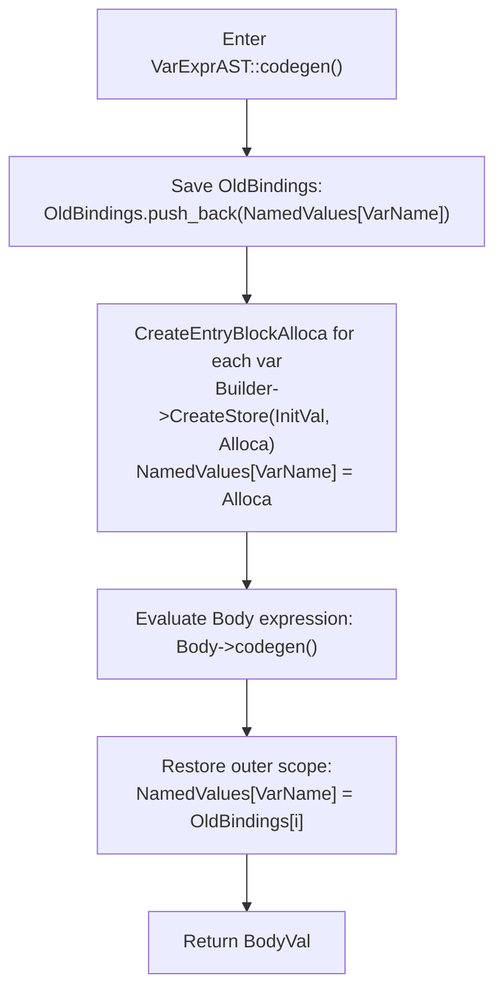

# Step 9.2: Local Variables and Assignment

Now that your compiler manages stack allocations with `alloca`, we can introduce two key language features:
1.  Declaring local variables with `var / in`.
2.  Mutating variables using the assignment operator `=`.

---

## Lexical Scoping and Variable Shadowing

A `var` expression declares one or more local variables, optionally initialises them, and scopes them strictly to an inner body expression:

```kaleidoscope
var a = 1, b = 2 in
  a + b
```

The assignment operator `=` updates an existing variable:

```kaleidoscope
var a = 1 in (
  a = a + 10 :
  a
)
```



> [!NOTE]
> **Scope Nesting and Shadowing**:
> By saving existing bindings in `OldBindings` and restoring them after the body finishes, `var / in` expressions can nest arbitrarily.  An inner `var` expression can shadow a variable from an outer scope without corrupting the outer scope when the inner expression terminates.

> [!TIP]
> **Assignment Operator Precedence**:
> The assignment operator `=` has a very low precedence (`BinopPrecedence['='] = 2;`).  This ensures that an expression like `x = a + b * 2` parses as `x = (a + (b * 2))` rather than `(x = a) + (b * 2)`.

---

## Incremental Code Changes

Open `kaleidoscope.cpp` to implement local variables and assignment.

### 1. Defining `VarExprAST`

Add `VarExprAST` to represent local variable declarations:

```cpp
class VarExprAST : public ExprAST {
  std::vector<std::pair<std::string, std::unique_ptr<ExprAST>>> VarNames;
  std::unique_ptr<ExprAST> Body;

public:
  VarExprAST(
      std::vector<std::pair<std::string, std::unique_ptr<ExprAST>>> VarNames,
      std::unique_ptr<ExprAST> Body)
      : VarNames(std::move(VarNames)), Body(std::move(Body)) {}

  llvm::Value *codegen() override;
};
```

### 2. Parsing `var` Expressions

Add `tok_var = -13` to `Token`, and teach `gettok()` to recognise `"var"`.

Write `ParseVarExpr()`:

```cpp
static std::unique_ptr<ExprAST> ParseVarExpr() {
  getNextToken(); // eat 'var'

  std::vector<std::pair<std::string, std::unique_ptr<ExprAST>>> VarNames;

  if (CurTok != tok_identifier)
    return LogError("expected identifier after var");

  while (true) {
    std::string Name = IdentifierStr;
    getNextToken(); // eat identifier

    std::unique_ptr<ExprAST> Init = nullptr;
    if (CurTok == '=') {
      getNextToken(); // eat '='
      Init = ParseExpression();
      if (!Init)
        return nullptr;
    }

    VarNames.push_back(std::make_pair(Name, std::move(Init)));

    if (CurTok != ',')
      break;
    getNextToken(); // eat ','

    if (CurTok != tok_identifier)
      return LogError("expected identifier list after var");
  }

  if (CurTok != tok_in)
    return LogError("expected 'in' keyword after 'var'");
  getNextToken(); // eat 'in'

  auto Body = ParseExpression();
  if (!Body)
    return nullptr;

  return std::make_unique<VarExprAST>(std::move(VarNames), std::move(Body));
}
```

Add `case tok_var: return ParseVarExpr();` to `ParsePrimary()`.

### 3. Emitting IR for `var / in` and Assignment

In `VarExprAST::codegen()`, create an alloca for each variable, store its initial value (defaulting to `0.0`), shadow any existing variable with the same name, emit the body, and restore previous bindings upon exit:

```cpp
llvm::Value *VarExprAST::codegen() {
  std::vector<llvm::AllocaInst *> OldBindings;
  llvm::Function *TheFunction = Builder->GetInsertBlock()->getParent();

  for (unsigned i = 0, e = VarNames.size(); i != e; ++i) {
    const std::string &VarName = VarNames[i].first;
    ExprAST *Init = VarNames[i].second.get();

    llvm::Value *InitVal;
    if (Init) {
      InitVal = Init->codegen();
      if (!InitVal)
        return nullptr;
    } else {
      InitVal = llvm::ConstantFP::get(*TheContext, llvm::APFloat(0.0));
    }

    llvm::AllocaInst *Alloca = CreateEntryBlockAlloca(TheFunction, VarName);
    Builder->CreateStore(InitVal, Alloca);

    OldBindings.push_back(NamedValues[VarName]);
    NamedValues[VarName] = Alloca;
  }

  llvm::Value *BodyVal = Body->codegen();
  if (!BodyVal)
    return nullptr;

  for (unsigned i = 0, e = VarNames.size(); i != e; ++i)
    NamedValues[VarNames[i].first] = OldBindings[i];

  return BodyVal;
}
```

In `BinaryExprAST::codegen()`, handle the assignment operator `=`:

```cpp
  if (Op == '=') {
    VariableExprAST *LHSE = dynamic_cast<VariableExprAST *>(LHS.get());
    if (!LHSE)
      return LogErrorV("destination of '=' must be a variable");

    llvm::Value *Val = RHS->codegen();
    if (!Val)
      return nullptr;

    llvm::AllocaInst *Variable = NamedValues[LHSE->getName()];
    if (!Variable)
      return LogErrorV("unknown variable name");

    Builder->CreateStore(Val, Variable);
    return Val;
  }
```

In `main()`, set the lowest precedence for `=`:

```cpp
  BinopPrecedence['='] = 2;
```

---

## Verifying Your Code

Before compiling, verify your complete `kaleidoscope.cpp` against the reference file.

<details>
<summary>Click here to compare against the reference kaleidoscope.cpp</summary>

```cpp
#include "KaleidoscopeJIT.h"
#include "llvm/ADT/APFloat.h"
#include "llvm/ADT/STLExtras.h"
#include "llvm/IR/BasicBlock.h"
#include "llvm/IR/Constants.h"
#include "llvm/IR/DerivedTypes.h"
#include "llvm/IR/Function.h"
#include "llvm/IR/IRBuilder.h"
#include "llvm/IR/Instructions.h"
#include "llvm/IR/LLVMContext.h"
#include "llvm/IR/Module.h"
#include "llvm/IR/PassManager.h"
#include "llvm/IR/Type.h"
#include "llvm/IR/Verifier.h"
#include "llvm/Passes/PassBuilder.h"
#include "llvm/Passes/StandardInstrumentations.h"
#include "llvm/Support/TargetSelect.h"
#include "llvm/Target/TargetMachine.h"
#include "llvm/Transforms/InstCombine/InstCombine.h"
#include "llvm/Transforms/Scalar.h"
#include "llvm/Transforms/Scalar/GVN.h"
#include "llvm/Transforms/Scalar/Reassociate.h"
#include "llvm/Transforms/Scalar/SimplifyCFG.h"
#include <cctype>
#include <cstdio>
#include <cstdlib>
#include <map>
#include <memory>
#include <string>
#include <utility>
#include <vector>

#ifdef _WIN32
#define DLLEXPORT __declspec(dllexport)
#else
#define DLLEXPORT
#endif

extern "C" DLLEXPORT double putchard(double X) {
  fputc(static_cast<char>(X), stderr);
  return 0;
}

extern "C" DLLEXPORT double printd(double X) {
  fprintf(stderr, "%f\n", X);
  return 0;
}

enum Token {
  tok_eof = -1,
  tok_def = -2,
  tok_extern = -3,
  tok_identifier = -4,
  tok_number = -5,
  tok_if = -6,
  tok_then = -7,
  tok_else = -8,
  tok_for = -9,
  tok_in = -10,
  tok_binary = -11,
  tok_unary = -12,
  tok_var = -13,
};

static std::string IdentifierStr;
static double NumVal;

static int gettok() {
  static int LastChar = ' ';

  while (isspace(LastChar))
    LastChar = getchar();

  if (isalpha(LastChar)) {
    IdentifierStr = LastChar;
    while (isalnum((LastChar = getchar())))
      IdentifierStr += LastChar;

    if (IdentifierStr == "def")
      return tok_def;
    if (IdentifierStr == "extern")
      return tok_extern;
    if (IdentifierStr == "if")
      return tok_if;
    if (IdentifierStr == "then")
      return tok_then;
    if (IdentifierStr == "else")
      return tok_else;
    if (IdentifierStr == "for")
      return tok_for;
    if (IdentifierStr == "in")
      return tok_in;
    if (IdentifierStr == "binary")
      return tok_binary;
    if (IdentifierStr == "unary")
      return tok_unary;
    if (IdentifierStr == "var")
      return tok_var;
    return tok_identifier;
  }

  if (isdigit(LastChar) || LastChar == '.') {
    std::string NumStr;
    do {
      NumStr += LastChar;
      LastChar = getchar();
    } while (isdigit(LastChar) || LastChar == '.');

    NumVal = strtod(NumStr.c_str(), nullptr);
    return tok_number;
  }

  if (LastChar == '#') {
    do
      LastChar = getchar();
    while (LastChar != EOF && LastChar != '\n' && LastChar != '\r');

    if (LastChar != EOF)
      return gettok();
  }

  if (LastChar == EOF)
    return tok_eof;

  int ThisChar = LastChar;
  LastChar = getchar();
  return ThisChar;
}

class ExprAST {
public:
  virtual ~ExprAST() = default;
  virtual llvm::Value *codegen() = 0;
};

class NumberExprAST : public ExprAST {
  double Val;

public:
  explicit NumberExprAST(double Val) : Val(Val) {}
  llvm::Value *codegen() override;
};

class VariableExprAST : public ExprAST {
  std::string Name;

public:
  explicit VariableExprAST(std::string Name) : Name(std::move(Name)) {}
  llvm::Value *codegen() override;
  const std::string &getName() const { return Name; }
};

class UnaryExprAST : public ExprAST {
  char Opcode;
  std::unique_ptr<ExprAST> Operand;

public:
  UnaryExprAST(char Opcode, std::unique_ptr<ExprAST> Operand)
      : Opcode(Opcode), Operand(std::move(Operand)) {}
  llvm::Value *codegen() override;
};

class BinaryExprAST : public ExprAST {
  char Op;
  std::unique_ptr<ExprAST> LHS, RHS;

public:
  BinaryExprAST(char Op, std::unique_ptr<ExprAST> LHS,
                std::unique_ptr<ExprAST> RHS)
      : Op(Op), LHS(std::move(LHS)), RHS(std::move(RHS)) {}
  llvm::Value *codegen() override;
};

class CallExprAST : public ExprAST {
  std::string Callee;
  std::vector<std::unique_ptr<ExprAST>> Args;

public:
  CallExprAST(std::string Callee, std::vector<std::unique_ptr<ExprAST>> Args)
      : Callee(std::move(Callee)), Args(std::move(Args)) {}
  llvm::Value *codegen() override;
};

class IfExprAST : public ExprAST {
  std::unique_ptr<ExprAST> Cond, Then, Else;

public:
  IfExprAST(std::unique_ptr<ExprAST> Cond, std::unique_ptr<ExprAST> Then,
            std::unique_ptr<ExprAST> Else)
      : Cond(std::move(Cond)), Then(std::move(Then)), Else(std::move(Else)) {}

  llvm::Value *codegen() override;
};

class ForExprAST : public ExprAST {
  std::string VarName;
  std::unique_ptr<ExprAST> Start, End, Step, Body;

public:
  ForExprAST(const std::string &VarName, std::unique_ptr<ExprAST> Start,
             std::unique_ptr<ExprAST> End, std::unique_ptr<ExprAST> Step,
             std::unique_ptr<ExprAST> Body)
      : VarName(VarName), Start(std::move(Start)), End(std::move(End)),
        Step(std::move(Step)), Body(std::move(Body)) {}

  llvm::Value *codegen() override;
};

class VarExprAST : public ExprAST {
  std::vector<std::pair<std::string, std::unique_ptr<ExprAST>>> VarNames;
  std::unique_ptr<ExprAST> Body;

public:
  VarExprAST(
      std::vector<std::pair<std::string, std::unique_ptr<ExprAST>>> VarNames,
      std::unique_ptr<ExprAST> Body)
      : VarNames(std::move(VarNames)), Body(std::move(Body)) {}

  llvm::Value *codegen() override;
};

class PrototypeAST {
  std::string Name;
  std::vector<std::string> Args;
  bool IsOperator;
  unsigned Precedence;

public:
  PrototypeAST(const std::string &Name, std::vector<std::string> Args,
               bool IsOperator = false, unsigned Prec = 0)
      : Name(Name), Args(std::move(Args)), IsOperator(IsOperator),
        Precedence(Prec) {}

  llvm::Function *codegen();
  const std::string &getName() const { return Name; }
  bool isUnaryOp() const { return IsOperator && Args.size() == 1; }
  bool isBinaryOp() const { return IsOperator && Args.size() == 2; }
  char getOperatorName() const { return Name[Name.size() - 1]; }
  unsigned getBinaryPrecedence() const { return Precedence; }
};

class FunctionAST {
  std::unique_ptr<PrototypeAST> Proto;
  std::unique_ptr<ExprAST> Body;

public:
  FunctionAST(std::unique_ptr<PrototypeAST> Proto,
              std::unique_ptr<ExprAST> Body)
      : Proto(std::move(Proto)), Body(std::move(Body)) {}
  llvm::Function *codegen();
};

static int CurTok;
static int getNextToken() { return CurTok = gettok(); }

static std::map<char, int> BinopPrecedence;

static int GetTokPrecedence() {
  if (!isascii(CurTok))
    return -1;

  int TokPrec = BinopPrecedence[CurTok];
  if (TokPrec <= 0)
    return -1;
  return TokPrec;
}

static std::unique_ptr<ExprAST> LogError(const char *Str) {
  fprintf(stderr, "Error: %s\n", Str);
  return nullptr;
}

static std::unique_ptr<PrototypeAST> LogErrorP(const char *Str) {
  LogError(Str);
  return nullptr;
}

static llvm::Value *LogErrorV(const char *Str) {
  LogError(Str);
  return nullptr;
}

static std::unique_ptr<ExprAST> ParseExpression();

static std::unique_ptr<ExprAST> ParseNumberExpr() {
  auto Result = std::make_unique<NumberExprAST>(NumVal);
  getNextToken();
  return Result;
}

static std::unique_ptr<ExprAST> ParseParenExpr() {
  getNextToken();
  auto V = ParseExpression();
  if (!V)
    return nullptr;

  if (CurTok != ')')
    return LogError("expected ')'");
  getNextToken();
  return V;
}

static std::unique_ptr<ExprAST> ParseIdentifierExpr() {
  std::string IdName = IdentifierStr;
  getNextToken();

  if (CurTok != '(')
    return std::make_unique<VariableExprAST>(IdName);

  getNextToken();
  std::vector<std::unique_ptr<ExprAST>> Args;
  if (CurTok != ')') {
    while (true) {
      if (auto Arg = ParseExpression())
        Args.push_back(std::move(Arg));
      else
        return nullptr;

      if (CurTok == ')')
        break;

      if (CurTok != ',')
        return LogError("expected ')' or ',' in argument list");
      getNextToken();
    }
  }

  getNextToken();
  return std::make_unique<CallExprAST>(IdName, std::move(Args));
}

static std::unique_ptr<ExprAST> ParseIfExpr() {
  getNextToken();

  auto Cond = ParseExpression();
  if (!Cond)
    return nullptr;

  if (CurTok != tok_then)
    return LogError("expected 'then'");
  getNextToken();

  auto Then = ParseExpression();
  if (!Then)
    return nullptr;

  if (CurTok != tok_else)
    return LogError("expected 'else'");
  getNextToken();

  auto Else = ParseExpression();
  if (!Else)
    return nullptr;

  return std::make_unique<IfExprAST>(std::move(Cond), std::move(Then),
                                     std::move(Else));
}

static std::unique_ptr<ExprAST> ParseForExpr() {
  getNextToken();

  if (CurTok != tok_identifier)
    return LogError("expected identifier after for");

  std::string IdName = IdentifierStr;
  getNextToken();

  if (CurTok != '=')
    return LogError("expected '=' after for");
  getNextToken();

  auto Start = ParseExpression();
  if (!Start)
    return nullptr;
  if (CurTok != ',')
    return LogError("expected ',' after for start value");
  getNextToken();

  auto End = ParseExpression();
  if (!End)
    return nullptr;

  std::unique_ptr<ExprAST> Step;
  if (CurTok == ',') {
    getNextToken();
    Step = ParseExpression();
    if (!Step)
      return nullptr;
  }

  if (CurTok != tok_in)
    return LogError("expected 'in' after for");
  getNextToken();

  auto Body = ParseExpression();
  if (!Body)
    return nullptr;

  return std::make_unique<ForExprAST>(IdName, std::move(Start), std::move(End),
                                      std::move(Step), std::move(Body));
}

static std::unique_ptr<ExprAST> ParseVarExpr() {
  getNextToken();

  std::vector<std::pair<std::string, std::unique_ptr<ExprAST>>> VarNames;

  if (CurTok != tok_identifier)
    return LogError("expected identifier after var");

  while (true) {
    std::string Name = IdentifierStr;
    getNextToken();

    std::unique_ptr<ExprAST> Init = nullptr;
    if (CurTok == '=') {
      getNextToken();
      Init = ParseExpression();
      if (!Init)
        return nullptr;
    }

    VarNames.push_back(std::make_pair(Name, std::move(Init)));

    if (CurTok != ',')
      break;
    getNextToken();

    if (CurTok != tok_identifier)
      return LogError("expected identifier list after var");
  }

  if (CurTok != tok_in)
    return LogError("expected 'in' keyword after 'var'");
  getNextToken();

  auto Body = ParseExpression();
  if (!Body)
    return nullptr;

  return std::make_unique<VarExprAST>(std::move(VarNames), std::move(Body));
}

static std::unique_ptr<ExprAST> ParsePrimary() {
  switch (CurTok) {
  case tok_identifier:
    return ParseIdentifierExpr();
  case tok_number:
    return ParseNumberExpr();
  case '(':
    return ParseParenExpr();
  case tok_if:
    return ParseIfExpr();
  case tok_for:
    return ParseForExpr();
  case tok_var:
    return ParseVarExpr();
  default:
    return LogError("unknown token when expecting an expression");
  }
}

static std::unique_ptr<ExprAST> ParseUnary() {
  if (!isascii(CurTok) || CurTok == '(' || CurTok == ',')
    return ParsePrimary();

  int Opc = CurTok;
  getNextToken();
  if (auto Operand = ParseUnary())
    return std::make_unique<UnaryExprAST>(Opc, std::move(Operand));
  return nullptr;
}

static std::unique_ptr<ExprAST> ParseBinOpRHS(int ExprPrec,
                                              std::unique_ptr<ExprAST> LHS) {
  while (true) {
    int TokPrec = GetTokPrecedence();

    if (TokPrec < ExprPrec)
      return LHS;

    int BinOp = CurTok;
    getNextToken();

    auto RHS = ParseUnary();
    if (!RHS)
      return nullptr;

    int NextPrec = GetTokPrecedence();
    if (TokPrec < NextPrec) {
      RHS = ParseBinOpRHS(TokPrec + 1, std::move(RHS));
      if (!RHS)
        return nullptr;
    }

    LHS = std::make_unique<BinaryExprAST>(BinOp, std::move(LHS),
                                          std::move(RHS));
  }
}

static std::unique_ptr<ExprAST> ParseExpression() {
  auto LHS = ParseUnary();
  if (!LHS)
    return nullptr;

  return ParseBinOpRHS(0, std::move(LHS));
}

static std::unique_ptr<PrototypeAST> ParsePrototype() {
  std::string FnName;
  unsigned Kind = 0;
  unsigned BinaryPrecedence = 30;

  switch (CurTok) {
  case tok_identifier:
    FnName = IdentifierStr;
    Kind = 0;
    getNextToken();
    break;
  case tok_unary:
    getNextToken();
    if (!isascii(CurTok))
      return LogErrorP("expected unary operator");
    FnName = "unary";
    FnName += (char)CurTok;
    Kind = 1;
    getNextToken();
    break;
  case tok_binary:
    getNextToken();
    if (!isascii(CurTok))
      return LogErrorP("expected binary operator");
    FnName = "binary";
    FnName += (char)CurTok;
    Kind = 2;
    getNextToken();

    if (CurTok == tok_number) {
      if (NumVal < 1 || NumVal > 100)
        return LogErrorP("invalid precedence: must be 1..100");
      BinaryPrecedence = (unsigned)NumVal;
      getNextToken();
    }
    break;
  default:
    return LogErrorP("expected function name in prototype");
  }

  if (CurTok != '(')
    return LogErrorP("expected '(' in prototype");

  std::vector<std::string> ArgNames;
  while (getNextToken() == tok_identifier)
    ArgNames.push_back(IdentifierStr);
  if (CurTok != ')')
    return LogErrorP("expected ')' in prototype");

  getNextToken();

  if (Kind && ArgNames.size() != Kind)
    return LogErrorP("invalid number of operands for operator");

  return std::make_unique<PrototypeAST>(FnName, std::move(ArgNames), Kind != 0,
                                        BinaryPrecedence);
}

static std::unique_ptr<FunctionAST> ParseDefinition() {
  getNextToken();
  auto Proto = ParsePrototype();
  if (!Proto)
    return nullptr;

  if (auto E = ParseExpression())
    return std::make_unique<FunctionAST>(std::move(Proto), std::move(E));
  return nullptr;
}

static std::unique_ptr<FunctionAST> ParseTopLevelExpr() {
  if (auto E = ParseExpression()) {
    auto Proto = std::make_unique<PrototypeAST>("__anon_expr",
                                                std::vector<std::string>());
    return std::make_unique<FunctionAST>(std::move(Proto), std::move(E));
  }
  return nullptr;
}

static std::unique_ptr<PrototypeAST> ParseExtern() {
  getNextToken();
  return ParsePrototype();
}

static std::unique_ptr<llvm::LLVMContext> TheContext;
static std::unique_ptr<llvm::Module> TheModule;
static std::unique_ptr<llvm::IRBuilder<>> Builder;
static std::map<std::string, llvm::AllocaInst *> NamedValues;
static std::unique_ptr<llvm::orc::KaleidoscopeJIT> TheJIT;
static std::map<std::string, std::unique_ptr<PrototypeAST>> FunctionProtos;
static llvm::ExitOnError ExitOnErr;

static void InitializeModuleAndManagers() {
  TheContext = std::make_unique<llvm::LLVMContext>();
  TheModule = std::make_unique<llvm::Module>("KaleidoscopeJIT", *TheContext);
  TheModule->setDataLayout(TheJIT->getDataLayout());
  Builder = std::make_unique<llvm::IRBuilder<>>(*TheContext);
}

static llvm::Function *getFunction(std::string Name) {
  if (auto *F = TheModule->getFunction(Name))
    return F;

  auto FI = FunctionProtos.find(Name);
  if (FI != FunctionProtos.end())
    return FI->second->codegen();

  return nullptr;
}

static llvm::AllocaInst *CreateEntryBlockAlloca(llvm::Function *TheFunction,
                                                llvm::StringRef VarName) {
  llvm::IRBuilder<> TmpB(&TheFunction->getEntryBlock(),
                         TheFunction->getEntryBlock().begin());
  return TmpB.CreateAlloca(llvm::Type::getDoubleTy(*TheContext), nullptr,
                           VarName);
}

llvm::Value *NumberExprAST::codegen() {
  return llvm::ConstantFP::get(*TheContext, llvm::APFloat(Val));
}

llvm::Value *VariableExprAST::codegen() {
  llvm::AllocaInst *A = NamedValues[Name];
  if (!A)
    return LogErrorV("unknown variable name");
  return Builder->CreateLoad(llvm::Type::getDoubleTy(*TheContext), A,
                             Name.c_str());
}

llvm::Value *UnaryExprAST::codegen() {
  llvm::Value *OperandV = Operand->codegen();
  if (!OperandV)
    return nullptr;

  llvm::Function *F = getFunction(std::string("unary") + Opcode);
  if (!F)
    return LogErrorV("unknown unary operator");

  return Builder->CreateCall(F, OperandV, "unop");
}

llvm::Value *BinaryExprAST::codegen() {
  if (Op == '=') {
    VariableExprAST *LHSE = dynamic_cast<VariableExprAST *>(LHS.get());
    if (!LHSE)
      return LogErrorV("destination of '=' must be a variable");

    llvm::Value *Val = RHS->codegen();
    if (!Val)
      return nullptr;

    llvm::AllocaInst *Variable = NamedValues[LHSE->getName()];
    if (!Variable)
      return LogErrorV("unknown variable name");

    Builder->CreateStore(Val, Variable);
    return Val;
  }

  llvm::Value *L = LHS->codegen();
  llvm::Value *R = RHS->codegen();
  if (!L || !R)
    return nullptr;

  switch (Op) {
  case '+':
    return Builder->CreateFAdd(L, R, "addtmp");
  case '-':
    return Builder->CreateFSub(L, R, "subtmp");
  case '*':
    return Builder->CreateFMul(L, R, "multmp");
  case '/':
    return Builder->CreateFDiv(L, R, "divtmp");
  case '<':
    L = Builder->CreateFCmpULT(L, R, "cmptmp");
    return Builder->CreateUIToFP(L, llvm::Type::getDoubleTy(*TheContext),
                                 "booltmp");
  default:
    break;
  }

  llvm::Function *F = getFunction(std::string("binary") + Op);
  if (!F)
    return LogErrorV("binary operator not found");

  llvm::Value *Ops[2] = {L, R};
  return Builder->CreateCall(F, Ops, "binop");
}

llvm::Value *CallExprAST::codegen() {
  llvm::Function *CalleeF = getFunction(Callee);
  if (!CalleeF)
    return LogErrorV("unknown function referenced");

  if (CalleeF->arg_size() != Args.size())
    return LogErrorV("incorrect number of arguments passed");

  std::vector<llvm::Value *> ArgsV;
  for (unsigned i = 0, e = Args.size(); i != e; ++i) {
    ArgsV.push_back(Args[i]->codegen());
    if (!ArgsV.back())
      return nullptr;
  }

  return Builder->CreateCall(CalleeF, ArgsV, "calltmp");
}

llvm::Value *IfExprAST::codegen() {
  llvm::Value *CondV = Cond->codegen();
  if (!CondV)
    return nullptr;

  CondV = Builder->CreateFCmpONE(
      CondV, llvm::ConstantFP::get(*TheContext, llvm::APFloat(0.0)), "ifcond");

  llvm::Function *TheFunction = Builder->GetInsertBlock()->getParent();

  llvm::BasicBlock *ThenBB =
      llvm::BasicBlock::Create(*TheContext, "then", TheFunction);
  llvm::BasicBlock *ElseBB = llvm::BasicBlock::Create(*TheContext, "else");
  llvm::BasicBlock *MergeBB = llvm::BasicBlock::Create(*TheContext, "ifcont");

  Builder->CreateCondBr(CondV, ThenBB, ElseBB);

  Builder->SetInsertPoint(ThenBB);
  llvm::Value *ThenV = Then->codegen();
  if (!ThenV)
    return nullptr;

  Builder->CreateBr(MergeBB);
  ThenBB = Builder->GetInsertBlock();

  TheFunction->insert(TheFunction->end(), ElseBB);
  Builder->SetInsertPoint(ElseBB);

  llvm::Value *ElseV = Else->codegen();
  if (!ElseV)
    return nullptr;

  Builder->CreateBr(MergeBB);
  ElseBB = Builder->GetInsertBlock();

  TheFunction->insert(TheFunction->end(), MergeBB);
  Builder->SetInsertPoint(MergeBB);

  llvm::PHINode *PN =
      Builder->CreatePHI(llvm::Type::getDoubleTy(*TheContext), 2, "iftmp");

  PN->addIncoming(ThenV, ThenBB);
  PN->addIncoming(ElseV, ElseBB);
  return PN;
}

llvm::Value *ForExprAST::codegen() {
  llvm::Function *TheFunction = Builder->GetInsertBlock()->getParent();
  llvm::AllocaInst *Alloca = CreateEntryBlockAlloca(TheFunction, VarName);

  llvm::Value *StartVal = Start->codegen();
  if (!StartVal)
    return nullptr;

  Builder->CreateStore(StartVal, Alloca);

  llvm::BasicBlock *LoopBB =
      llvm::BasicBlock::Create(*TheContext, "loop", TheFunction);

  Builder->CreateBr(LoopBB);
  Builder->SetInsertPoint(LoopBB);

  llvm::AllocaInst *OldVal = NamedValues[VarName];
  NamedValues[VarName] = Alloca;

  if (!Body->codegen())
    return nullptr;

  llvm::Value *StepVal = nullptr;
  if (Step) {
    StepVal = Step->codegen();
    if (!StepVal)
      return nullptr;
  } else {
    StepVal = llvm::ConstantFP::get(*TheContext, llvm::APFloat(1.0));
  }

  llvm::Value *CurVar =
      Builder->CreateLoad(llvm::Type::getDoubleTy(*TheContext), Alloca,
                          VarName.c_str());
  llvm::Value *NextVar = Builder->CreateFAdd(CurVar, StepVal, "nextvar");
  Builder->CreateStore(NextVar, Alloca);

  llvm::Value *EndCond = End->codegen();
  if (!EndCond)
    return nullptr;

  EndCond = Builder->CreateFCmpONE(
      EndCond, llvm::ConstantFP::get(*TheContext, llvm::APFloat(0.0)),
      "loopcond");

  llvm::BasicBlock *AfterBB =
      llvm::BasicBlock::Create(*TheContext, "afterloop", TheFunction);

  Builder->CreateCondBr(EndCond, LoopBB, AfterBB);
  Builder->SetInsertPoint(AfterBB);

  if (OldVal)
    NamedValues[VarName] = OldVal;
  else
    NamedValues.erase(VarName);

  return llvm::Constant::getNullValue(llvm::Type::getDoubleTy(*TheContext));
}

llvm::Value *VarExprAST::codegen() {
  std::vector<llvm::AllocaInst *> OldBindings;
  llvm::Function *TheFunction = Builder->GetInsertBlock()->getParent();

  for (unsigned i = 0, e = VarNames.size(); i != e; ++i) {
    const std::string &VarName = VarNames[i].first;
    ExprAST *Init = VarNames[i].second.get();

    llvm::Value *InitVal;
    if (Init) {
      InitVal = Init->codegen();
      if (!InitVal)
        return nullptr;
    } else {
      InitVal = llvm::ConstantFP::get(*TheContext, llvm::APFloat(0.0));
    }

    llvm::AllocaInst *Alloca = CreateEntryBlockAlloca(TheFunction, VarName);
    Builder->CreateStore(InitVal, Alloca);

    OldBindings.push_back(NamedValues[VarName]);
    NamedValues[VarName] = Alloca;
  }

  llvm::Value *BodyVal = Body->codegen();
  if (!BodyVal)
    return nullptr;

  for (unsigned i = 0, e = VarNames.size(); i != e; ++i)
    NamedValues[VarNames[i].first] = OldBindings[i];

  return BodyVal;
}

llvm::Function *PrototypeAST::codegen() {
  std::vector<llvm::Type *> Doubles(Args.size(),
                                    llvm::Type::getDoubleTy(*TheContext));
  llvm::FunctionType *FT = llvm::FunctionType::get(
      llvm::Type::getDoubleTy(*TheContext), Doubles, false);

  llvm::Function *F = llvm::Function::Create(
      FT, llvm::Function::ExternalLinkage, Name, TheModule.get());

  unsigned Idx = 0;
  for (auto &Arg : F->args())
    Arg.setName(Args[Idx++]);

  return F;
}

llvm::Function *FunctionAST::codegen() {
  auto &P = *Proto;
  FunctionProtos[Proto->getName()] = std::move(Proto);
  llvm::Function *TheFunction = getFunction(P.getName());
  if (!TheFunction)
    return nullptr;

  if (P.isBinaryOp())
    BinopPrecedence[P.getOperatorName()] = P.getBinaryPrecedence();

  llvm::BasicBlock *BB =
      llvm::BasicBlock::Create(*TheContext, "entry", TheFunction);
  Builder->SetInsertPoint(BB);

  NamedValues.clear();
  for (auto &Arg : TheFunction->args()) {
    llvm::AllocaInst *Alloca =
        CreateEntryBlockAlloca(TheFunction, Arg.getName());
    Builder->CreateStore(&Arg, Alloca);
    NamedValues[std::string(Arg.getName())] = Alloca;
  }

  if (llvm::Value *RetVal = Body->codegen()) {
    Builder->CreateRet(RetVal);
    llvm::verifyFunction(*TheFunction);
    return TheFunction;
  }

  TheFunction->eraseFromParent();
  if (P.isBinaryOp())
    BinopPrecedence.erase(P.getOperatorName());
  return nullptr;
}

static void HandleDefinition() {
  if (auto FnAST = ParseDefinition()) {
    if (auto *FnIR = FnAST->codegen()) {
      fprintf(stderr, "Read function definition:\n");
      FnIR->print(llvm::errs());
      fprintf(stderr, "\n");
      ExitOnErr(TheJIT->addModule(llvm::orc::ThreadSafeModule(
          std::move(TheModule), std::move(TheContext))));
      InitializeModuleAndManagers();
    }
  } else {
    getNextToken();
  }
}

static void HandleExtern() {
  if (auto ProtoAST = ParseExtern()) {
    if (auto *FnIR = ProtoAST->codegen()) {
      fprintf(stderr, "Read extern:\n");
      FnIR->print(llvm::errs());
      fprintf(stderr, "\n");
      FunctionProtos[ProtoAST->getName()] = std::move(ProtoAST);
    }
  } else {
    getNextToken();
  }
}

static void HandleTopLevelExpression() {
  if (auto FnAST = ParseTopLevelExpr()) {
    if (FnAST->codegen()) {
      auto RT = TheJIT->getMainJITDylib().createResourceTracker();

      auto TSM = llvm::orc::ThreadSafeModule(std::move(TheModule),
                                             std::move(TheContext));
      ExitOnErr(TheJIT->addModule(std::move(TSM), RT));
      InitializeModuleAndManagers();

      auto ExprSymbol = ExitOnErr(TheJIT->lookup("__anon_expr"));

      double (*FP)() = ExprSymbol.toPtr<double (*)()>();
      fprintf(stderr, "Evaluated to %f\n", FP());

      ExitOnErr(RT->remove());
    }
  } else {
    getNextToken();
  }
}

static void MainLoop() {
  while (true) {
    fprintf(stderr, "ready> ");
    switch (CurTok) {
    case tok_eof:
      return;
    case ';':
      getNextToken();
      break;
    case tok_def:
      HandleDefinition();
      break;
    case tok_extern:
      HandleExtern();
      break;
    default:
      HandleTopLevelExpression();
      break;
    }
  }
}

int main() {
  llvm::InitializeNativeTarget();
  llvm::InitializeNativeTargetAsmPrinter();
  llvm::InitializeNativeTargetAsmParser();

  BinopPrecedence['='] = 2;
  BinopPrecedence['<'] = 10;
  BinopPrecedence['+'] = 20;
  BinopPrecedence['-'] = 20;
  BinopPrecedence['*'] = 40;
  BinopPrecedence['/'] = 40;

  TheJIT = ExitOnErr(llvm::orc::KaleidoscopeJIT::Create());
  InitializeModuleAndManagers();

  getNextToken();
  MainLoop();

  return 0;
}
```
</details>

---

## Compiling and Running

Compile your updated compiler:

```bash
clang++ -rdynamic -Iinclude -Wall -Wextra kaleidoscope.cpp $(llvm-config --cxxflags --ldflags --system-libs --libs core orcjit native) -o kaleidoscope
```

Launch `./kaleidoscope` and test local variables and assignment:

```text
ready> var a = 1, b = 2 in a + b;
Evaluated to 3.000000

ready> def binary: 1 (x y) y;
Read function definition:
define double @"binary:"(double %x, double %y) {
entry:
  ret double %y
}

ready> var a = 1 in (a = a + 10 : a);
Evaluated to 11.000000
```

Notice that `a = a + 10` mutated the value stored in the stack alloca, and the subsequent expression `a` loaded the updated value!

In [Step 9.3](03-mem2reg-optimization.md), we will turn these stack allocations back into fast SSA registers automatically using `mem2reg`.
