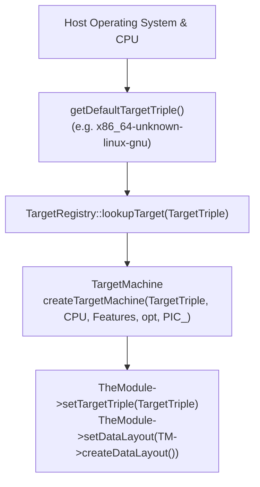

# Step 10.1: Configuring the Target Machine

To emit machine code for a specific CPU, LLVM must know the details of the host architecture: register conventions, pointer widths, ABI calling conventions, and instruction set extensions.  All of this configuration is managed through **`llvm::TargetMachine`**.

---

## Target Machine Configuration



> [!NOTE]
> **Understanding Target Triples**:
> A target triple is a canonical string specifying the processor architecture, vendor, operating system, and ABI/environment (e.g. `x86_64-unknown-linux-gnu` or `aarch64-apple-darwin`).  LLVM uses this string to determine instruction sets, register names, and object container formats (ELF, Mach-O, COFF).

> [!TIP]
> **Position-Independent Code (PIC)**:
> We configure `TheTargetMachine` with `llvm::Reloc::PIC_` (Position-Independent Code).  Position-independent code can be loaded at arbitrary virtual memory addresses without requiring base address fixups, making it compatible with modern shared libraries and Address Space Layout Randomisation (ASLR).

---

## Incremental Code Changes

Open `kaleidoscope.cpp` to configure ahead-of-time target emission.

### 1. Initialising Target Registries

Include the target registry and host parsing headers:

```cpp
#include "llvm/MC/TargetRegistry.h"
#include "llvm/Support/FileSystem.h"
#include "llvm/Support/TargetSelect.h"
#include "llvm/Support/raw_ostream.h"
#include "llvm/Target/TargetMachine.h"
#include "llvm/Target/TargetOptions.h"
#include "llvm/TargetParser/Host.h"
```

In `main()`, initialise all supported LLVM target info, assembly parsers, and machine code printers:

```cpp
  llvm::InitializeAllTargetInfos();
  llvm::InitializeAllTargets();
  llvm::InitializeAllTargetMCs();
  llvm::InitializeAllAsmParsers();
  llvm::InitializeAllAsmPrinters();
```

### 2. Setting the Target Triple

Query LLVM for the default host target triple and set it on the module:

```cpp
  llvm::Triple TargetTriple(llvm::sys::getDefaultTargetTriple());
  TheModule->setTargetTriple(TargetTriple);
```

### 3. Creating the TargetMachine

Look up the target architecture in LLVM's registry:

```cpp
  std::string Error;
  auto Target = llvm::TargetRegistry::lookupTarget(TargetTriple, Error);
  if (!Target) {
    llvm::errs() << Error;
    return 1;
  }
```

Construct the `TargetMachine` configured with Position-Independent Code (`PIC_`):

```cpp
  auto CPU = "generic";
  auto Features = "";
  llvm::TargetOptions opt;
  auto TheTargetMachine = Target->createTargetMachine(
      TargetTriple, CPU, Features, opt, llvm::Reloc::PIC_);
```

Finally, configure your module's data layout to match the target machine:

```cpp
  TheModule->setDataLayout(TheTargetMachine->createDataLayout());
```

In [Step 10.2](02-emitting-object-code.md), we will run LLVM's code emission passes to write a native `.o` object file to disk.
