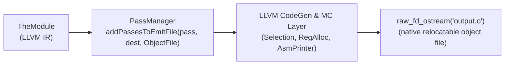

# Step 10.2: Emitting Object Code

Once `TargetMachine` is configured, emitting an object file requires only a few lines of code.

---

## The Object Emission Pipeline



> [!NOTE]
> **The LLVM Backend Pipeline**:
> The call to `addPassesToEmitFile` populates a pass manager with LLVM's complete code generation pipeline: instruction selection, register allocation, instruction scheduling, and direct machine code emission.  When `pass.run(*TheModule)` executes, LLVM translates your IR into binary machine instructions formatted for your operating system's object loader.

> [!TIP]
> **Emitting Human-Readable Assembly**:
> If you want to inspect assembly instructions rather than binary object bytes, change `llvm::CodeGenFileType::ObjectFile` to `llvm::CodeGenFileType::AssemblyFile` and write to `output.s`.  LLVM will output annotated assembly code ready for an assembler.

---

## Incremental Code Changes

Open `kaleidoscope.cpp` to write the object emission pipeline.

### 1. Opening the Output File

Create an output stream writing to a binary file named `output.o`:

```cpp
  std::error_code EC;
  llvm::raw_fd_ostream dest("output.o", EC, llvm::sys::fs::OF_None);
  if (EC) {
    llvm::errs() << "Could not open file: " << EC.message();
    return 1;
  }
```

### 2. Running the Object Emission Pass

Use `TargetMachine::addPassesToEmitFile` to configure the pass manager for object emission, run it on your module, and flush the file stream:

```cpp
  llvm::legacy::PassManager pass;
  auto FileType = llvm::CodeGenFileType::ObjectFile;

  if (TheTargetMachine->addPassesToEmitFile(pass, dest, nullptr, FileType)) {
    llvm::errs() << "TheTargetMachine can't emit a file of this type";
    return 1;
  }

  pass.run(*TheModule);
  dest.flush();

  fprintf(stderr, "Wrote output.o successfully!\n");
```

---

## Verifying Your Code

Before compiling, verify your complete `kaleidoscope.cpp` against the reference file.

<details>
<summary>Click here to compare against the reference kaleidoscope.cpp</summary>

```cpp
#include "llvm/ADT/APFloat.h"
#include "llvm/ADT/STLExtras.h"
#include "llvm/IR/BasicBlock.h"
#include "llvm/IR/Constants.h"
#include "llvm/IR/DerivedTypes.h"
#include "llvm/IR/Function.h"
#include "llvm/IR/IRBuilder.h"
#include "llvm/IR/Instructions.h"
#include "llvm/IR/LLVMContext.h"
#include "llvm/IR/LegacyPassManager.h"
#include "llvm/IR/Module.h"
#include "llvm/IR/Type.h"
#include "llvm/IR/Verifier.h"
#include "llvm/MC/TargetRegistry.h"
#include "llvm/Support/FileSystem.h"
#include "llvm/Support/TargetSelect.h"
#include "llvm/Support/raw_ostream.h"
#include "llvm/Target/TargetMachine.h"
#include "llvm/Target/TargetOptions.h"
#include "llvm/TargetParser/Host.h"

#include <cctype>
#include <cstdio>
#include <cstdlib>
#include <map>
#include <memory>
#include <string>
#include <utility>
#include <vector>

enum Token {
  tok_eof = -1,
  tok_def = -2,
  tok_extern = -3,
  tok_identifier = -4,
  tok_number = -5,
};

static std::string IdentifierStr;
static double NumVal;

static int gettok() {
  static int LastChar = ' ';

  while (isspace(LastChar))
    LastChar = getchar();

  if (isalpha(LastChar)) {
    IdentifierStr = LastChar;
    while (isalnum((LastChar = getchar())))
      IdentifierStr += LastChar;

    if (IdentifierStr == "def")
      return tok_def;
    if (IdentifierStr == "extern")
      return tok_extern;
    return tok_identifier;
  }

  if (isdigit(LastChar) || LastChar == '.') {
    std::string NumStr;
    do {
      NumStr += LastChar;
      LastChar = getchar();
    } while (isdigit(LastChar) || LastChar == '.');

    NumVal = strtod(NumStr.c_str(), nullptr);
    return tok_number;
  }

  if (LastChar == '#') {
    do
      LastChar = getchar();
    while (LastChar != EOF && LastChar != '\n' && LastChar != '\r');

    if (LastChar != EOF)
      return gettok();
  }

  if (LastChar == EOF)
    return tok_eof;

  int ThisChar = LastChar;
  LastChar = getchar();
  return ThisChar;
}

class ExprAST {
public:
  virtual ~ExprAST() = default;
  virtual llvm::Value *codegen() = 0;
};

class NumberExprAST : public ExprAST {
  double Val;

public:
  explicit NumberExprAST(double Val) : Val(Val) {}
  llvm::Value *codegen() override;
};

class VariableExprAST : public ExprAST {
  std::string Name;

public:
  explicit VariableExprAST(std::string Name) : Name(std::move(Name)) {}
  llvm::Value *codegen() override;
};

class BinaryExprAST : public ExprAST {
  char Op;
  std::unique_ptr<ExprAST> LHS, RHS;

public:
  BinaryExprAST(char Op, std::unique_ptr<ExprAST> LHS,
                std::unique_ptr<ExprAST> RHS)
      : Op(Op), LHS(std::move(LHS)), RHS(std::move(RHS)) {}
  llvm::Value *codegen() override;
};

class CallExprAST : public ExprAST {
  std::string Callee;
  std::vector<std::unique_ptr<ExprAST>> Args;

public:
  CallExprAST(std::string Callee, std::vector<std::unique_ptr<ExprAST>> Args)
      : Callee(std::move(Callee)), Args(std::move(Args)) {}
  llvm::Value *codegen() override;
};

class PrototypeAST {
  std::string Name;
  std::vector<std::string> Args;

public:
  PrototypeAST(const std::string &Name, std::vector<std::string> Args)
      : Name(Name), Args(std::move(Args)) {}
  llvm::Function *codegen();
  const std::string &getName() const { return Name; }
};

class FunctionAST {
  std::unique_ptr<PrototypeAST> Proto;
  std::unique_ptr<ExprAST> Body;

public:
  FunctionAST(std::unique_ptr<PrototypeAST> Proto,
              std::unique_ptr<ExprAST> Body)
      : Proto(std::move(Proto)), Body(std::move(Body)) {}
  llvm::Function *codegen();
};

static int CurTok;
static int getNextToken() { return CurTok = gettok(); }

static std::map<char, int> BinopPrecedence;

static int GetTokPrecedence() {
  if (!isascii(CurTok))
    return -1;

  int TokPrec = BinopPrecedence[CurTok];
  if (TokPrec <= 0)
    return -1;
  return TokPrec;
}

static std::unique_ptr<ExprAST> LogError(const char *Str) {
  fprintf(stderr, "Error: %s\n", Str);
  return nullptr;
}

static std::unique_ptr<PrototypeAST> LogErrorP(const char *Str) {
  LogError(Str);
  return nullptr;
}

static llvm::Value *LogErrorV(const char *Str) {
  LogError(Str);
  return nullptr;
}

static std::unique_ptr<ExprAST> ParseExpression();

static std::unique_ptr<ExprAST> ParseNumberExpr() {
  auto Result = std::make_unique<NumberExprAST>(NumVal);
  getNextToken();
  return Result;
}

static std::unique_ptr<ExprAST> ParseParenExpr() {
  getNextToken();
  auto V = ParseExpression();
  if (!V)
    return nullptr;

  if (CurTok != ')')
    return LogError("expected ')'");
  getNextToken();
  return V;
}

static std::unique_ptr<ExprAST> ParseIdentifierExpr() {
  std::string IdName = IdentifierStr;
  getNextToken();

  if (CurTok != '(')
    return std::make_unique<VariableExprAST>(IdName);

  getNextToken();
  std::vector<std::unique_ptr<ExprAST>> Args;
  if (CurTok != ')') {
    while (true) {
      if (auto Arg = ParseExpression())
        Args.push_back(std::move(Arg));
      else
        return nullptr;

      if (CurTok == ')')
        break;

      if (CurTok != ',')
        return LogError("expected ')' or ',' in argument list");
      getNextToken();
    }
  }

  getNextToken();
  return std::make_unique<CallExprAST>(IdName, std::move(Args));
}

static std::unique_ptr<ExprAST> ParsePrimary() {
  switch (CurTok) {
  case tok_identifier:
    return ParseIdentifierExpr();
  case tok_number:
    return ParseNumberExpr();
  case '(':
    return ParseParenExpr();
  default:
    return LogError("unknown token when expecting an expression");
  }
}

static std::unique_ptr<ExprAST> ParseBinOpRHS(int ExprPrec,
                                              std::unique_ptr<ExprAST> LHS) {
  while (true) {
    int TokPrec = GetTokPrecedence();

    if (TokPrec < ExprPrec)
      return LHS;

    int BinOp = CurTok;
    getNextToken();

    auto RHS = ParsePrimary();
    if (!RHS)
      return nullptr;

    int NextPrec = GetTokPrecedence();
    if (TokPrec < NextPrec) {
      RHS = ParseBinOpRHS(TokPrec + 1, std::move(RHS));
      if (!RHS)
        return nullptr;
    }

    LHS = std::make_unique<BinaryExprAST>(BinOp, std::move(LHS),
                                          std::move(RHS));
  }
}

static std::unique_ptr<ExprAST> ParseExpression() {
  auto LHS = ParsePrimary();
  if (!LHS)
    return nullptr;

  return ParseBinOpRHS(0, std::move(LHS));
}

static std::unique_ptr<PrototypeAST> ParsePrototype() {
  if (CurTok != tok_identifier)
    return LogErrorP("expected function name in prototype");

  std::string FnName = IdentifierStr;
  getNextToken();

  if (CurTok != '(')
    return LogErrorP("expected '(' in prototype");

  std::vector<std::string> ArgNames;
  while (getNextToken() == tok_identifier)
    ArgNames.push_back(IdentifierStr);
  if (CurTok != ')')
    return LogErrorP("expected ')' in prototype");

  getNextToken();
  return std::make_unique<PrototypeAST>(FnName, std::move(ArgNames));
}

static std::unique_ptr<FunctionAST> ParseDefinition() {
  getNextToken();
  auto Proto = ParsePrototype();
  if (!Proto)
    return nullptr;

  if (auto E = ParseExpression())
    return std::make_unique<FunctionAST>(std::move(Proto), std::move(E));
  return nullptr;
}

static std::unique_ptr<PrototypeAST> ParseExtern() {
  getNextToken();
  return ParsePrototype();
}

static std::unique_ptr<llvm::LLVMContext> TheContext;
static std::unique_ptr<llvm::Module> TheModule;
static std::unique_ptr<llvm::IRBuilder<>> Builder;
static std::map<std::string, llvm::Value *> NamedValues;

static void InitializeModule() {
  TheContext = std::make_unique<llvm::LLVMContext>();
  TheModule = std::make_unique<llvm::Module>("Kaleidoscope", *TheContext);
  Builder = std::make_unique<llvm::IRBuilder<>>(*TheContext);
}

llvm::Value *NumberExprAST::codegen() {
  return llvm::ConstantFP::get(*TheContext, llvm::APFloat(Val));
}

llvm::Value *VariableExprAST::codegen() {
  llvm::Value *V = NamedValues[Name];
  if (!V)
    return LogErrorV("unknown variable name");
  return V;
}

llvm::Value *BinaryExprAST::codegen() {
  llvm::Value *L = LHS->codegen();
  llvm::Value *R = RHS->codegen();
  if (!L || !R)
    return nullptr;

  switch (Op) {
  case '+':
    return Builder->CreateFAdd(L, R, "addtmp");
  case '-':
    return Builder->CreateFSub(L, R, "subtmp");
  case '*':
    return Builder->CreateFMul(L, R, "multmp");
  case '/':
    return Builder->CreateFDiv(L, R, "divtmp");
  case '<':
    L = Builder->CreateFCmpULT(L, R, "cmptmp");
    return Builder->CreateUIToFP(L, llvm::Type::getDoubleTy(*TheContext),
                                 "booltmp");
  default:
    return LogErrorV("invalid binary operator");
  }
}

llvm::Value *CallExprAST::codegen() {
  llvm::Function *CalleeF = TheModule->getFunction(Callee);
  if (!CalleeF)
    return LogErrorV("unknown function referenced");

  if (CalleeF->arg_size() != Args.size())
    return LogErrorV("incorrect number of arguments passed");

  std::vector<llvm::Value *> ArgsV;
  for (unsigned i = 0, e = Args.size(); i != e; ++i) {
    ArgsV.push_back(Args[i]->codegen());
    if (!ArgsV.back())
      return nullptr;
  }

  return Builder->CreateCall(CalleeF, ArgsV, "calltmp");
}

llvm::Function *PrototypeAST::codegen() {
  std::vector<llvm::Type *> Doubles(Args.size(),
                                    llvm::Type::getDoubleTy(*TheContext));
  llvm::FunctionType *FT = llvm::FunctionType::get(
      llvm::Type::getDoubleTy(*TheContext), Doubles, false);

  llvm::Function *F = llvm::Function::Create(
      FT, llvm::Function::ExternalLinkage, Name, TheModule.get());

  unsigned Idx = 0;
  for (auto &Arg : F->args())
    Arg.setName(Args[Idx++]);

  return F;
}

llvm::Function *FunctionAST::codegen() {
  auto *TheFunction = TheModule->getFunction(Proto->getName());
  if (!TheFunction)
    TheFunction = Proto->codegen();
  if (!TheFunction)
    return nullptr;

  llvm::BasicBlock *BB =
      llvm::BasicBlock::Create(*TheContext, "entry", TheFunction);
  Builder->SetInsertPoint(BB);

  NamedValues.clear();
  for (auto &Arg : TheFunction->args())
    NamedValues[std::string(Arg.getName())] = &Arg;

  if (llvm::Value *RetVal = Body->codegen()) {
    Builder->CreateRet(RetVal);
    llvm::verifyFunction(*TheFunction);
    return TheFunction;
  }

  TheFunction->eraseFromParent();
  return nullptr;
}

static void HandleDefinition() {
  if (auto FnAST = ParseDefinition()) {
    if (auto *FnIR = FnAST->codegen()) {
      fprintf(stderr, "Read function definition:\n");
      FnIR->print(llvm::errs());
      fprintf(stderr, "\n");
    }
  } else {
    getNextToken();
  }
}

static void HandleExtern() {
  if (auto ProtoAST = ParseExtern()) {
    if (auto *FnIR = ProtoAST->codegen()) {
      fprintf(stderr, "Read extern:\n");
      FnIR->print(llvm::errs());
      fprintf(stderr, "\n");
    }
  } else {
    getNextToken();
  }
}

static void MainLoop() {
  while (true) {
    fprintf(stderr, "ready> ");
    switch (CurTok) {
    case tok_eof:
      return;
    case ';':
      getNextToken();
      break;
    case tok_def:
      HandleDefinition();
      break;
    case tok_extern:
      HandleExtern();
      break;
    default:
      getNextToken();
      break;
    }
  }
}

int main() {
  BinopPrecedence['<'] = 10;
  BinopPrecedence['+'] = 20;
  BinopPrecedence['-'] = 20;
  BinopPrecedence['*'] = 40;
  BinopPrecedence['/'] = 40;

  InitializeModule();

  fprintf(stderr, "ready> ");
  getNextToken();
  MainLoop();

  llvm::InitializeAllTargetInfos();
  llvm::InitializeAllTargets();
  llvm::InitializeAllTargetMCs();
  llvm::InitializeAllAsmParsers();
  llvm::InitializeAllAsmPrinters();

  llvm::Triple TargetTriple(llvm::sys::getDefaultTargetTriple());
  TheModule->setTargetTriple(TargetTriple);

  std::string Error;
  auto Target = llvm::TargetRegistry::lookupTarget(TargetTriple, Error);
  if (!Target) {
    llvm::errs() << Error;
    return 1;
  }

  auto CPU = "generic";
  auto Features = "";
  llvm::TargetOptions opt;
  auto TheTargetMachine = Target->createTargetMachine(
      TargetTriple, CPU, Features, opt, llvm::Reloc::PIC_);

  TheModule->setDataLayout(TheTargetMachine->createDataLayout());

  std::error_code EC;
  llvm::raw_fd_ostream dest("output.o", EC, llvm::sys::fs::OF_None);
  if (EC) {
    llvm::errs() << "Could not open file: " << EC.message();
    return 1;
  }

  llvm::legacy::PassManager pass;
  auto FileType = llvm::CodeGenFileType::ObjectFile;
  if (TheTargetMachine->addPassesToEmitFile(pass, dest, nullptr, FileType)) {
    llvm::errs() << "TheTargetMachine can't emit a file of this type";
    return 1;
  }

  pass.run(*TheModule);
  dest.flush();

  fprintf(stderr, "Wrote output.o successfully!\n");
  return 0;
}
```
</details>

---

## Compiling and Running

Compile your compiler:

```bash
clang++ -Iinclude -Wall -Wextra kaleidoscope.cpp $(llvm-config --cxxflags --ldflags --system-libs --libs core target native codegen) -o kaleidoscope
```

Run `./kaleidoscope` and define a function:

```text
ready> def average(x y) (x + y) * 0.5;
Read function definition:
define double @average(double %x, double %y) {
entry:
  %addtmp = fadd double %x, %y
  %multmp = fmul double %addtmp, 5.000000e-01
  ret double %multmp
}
```

Press `Ctrl+D` to end input.  Your compiler runs the object emission pipeline:

```text
Wrote output.o successfully!
```

Check the generated object file:

```bash
file output.o
```

On Linux x86-64, the system reports:

```text
output.o: ELF 64-bit LSB relocatable, x86-64, version 1 (SYSV), not stripped
```

You have generated a real, relocatable object file containing machine code for your host processor.

In [Step 10.3](03-linking-standalone-binary.md), we will link `output.o` with a native C driver into a standalone binary.
