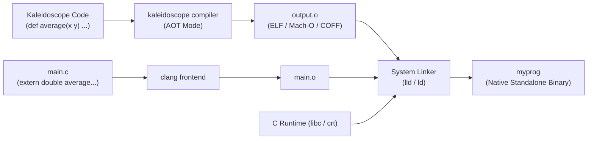

# Step 10.3: Linking Standalone Executables

Because LLVM emitted standard, ABI-compliant machine code into `output.o`, you can call your Kaleidoscope functions from any programming language that supports C calling conventions.

In this step, you will write a small C driver program, link it against `output.o`, and run a standalone executable completely independent of the LLVM compiler runtime.

---

## Standalone Compilation and Linking Pipeline



> [!NOTE]
> **Zero Compiler Runtime Overhead**:
> The compiled object file `output.o` contains pure machine instructions according to standard system ABI conventions.  It does not require LLVM libraries, an interpreter, or a virtual machine to execute.  Any language supporting C calling conventions can link against and invoke Kaleidoscope functions directly.

---

## 1. Writing the C Driver

Create a file named `main.c`:

```c
#include <stdio.h>

// Declare the external Kaleidoscope function:
extern double average(double a, double b);

int main() {
  double result = average(3.0, 4.0);
  printf("average(3.0, 4.0) = %f\n", result);
  return 0;
}
```

Notice how straightforward this is: `average` is simply a normal C function accepting two 64-bit floating-point numbers and returning a `double`.

---

## 2. Linking with Clang

Use `clang` to link `main.c` and `output.o` together:

```bash
clang main.c output.o -o myprog
```

The linker resolves the symbol `average` from `output.o` into `main.c`, configures the standard C runtime startup files, and produces an executable binary named `myprog`.

---

## 3. Running the Executable

Run your binary:

```bash
./myprog
```

Output:

```text
average(3.0, 4.0) = 3.500000
```

Congratulations!  You started in Section 1 with a fifteen-line character echo loop.  Over ten incremental sections, you have built:
1.  A hand-written scanner and lexer with keyword detection and comment handling.
2.  An Abstract Syntax Tree (AST) representing expressions, function calls, and control flow.
3.  A recursive-descent parser with operator precedence climbing.
4.  An LLVM Intermediate Representation (IR) code generator.
5.  An interactive native Just-In-Time (JIT) compiler using LLVM ORCv2.
6.  Conditional branches and SSA PHI nodes for recursive algorithms.
7.  Iterative `for` loops in SSA form.
8.  User-defined unary and binary operators with assignable precedence.
9.  Mutable local variables with stack `alloca` and automatic `mem2reg` promotion.
10.  An ahead-of-time static compiler that emits standard relocatable object files.

You have completed the core compiler pipeline (Milestone 3).

---

## Where to Go Next

If your focus was learning the foundational architecture of an ahead-of-time compiler, you have accomplished that goal.

If you want to dive deeper into systems programming, type systems, and the inner mechanics of LLVM, continue to **Part 2: Advanced Topics (Sections 11–16)**:
*   [Section 11: Integers and Type Systems](../11-integers-and-types/README.md) - Signless integer types, bitcasts, and integer arithmetic.
*   [Section 12: Global Variables and Strings](../12-globals-and-strings/README.md) - Constant pools, string literals, and global storage.
*   [Section 13: Pointers and Dynamic Memory](../13-pointers-and-heap/README.md) - Heap allocation with `malloc`/`free` and manual pointer dereferencing.
*   [Section 14: Aggregate Types and Structs](../14-structs-and-gep/README.md) - Named struct types, member access, and the `GetElementPtr` instruction.
*   [Section 15: Emitting DWARF Debug Information](../15-debug-info/README.md) - Line tables, debug scopes, and stepping through JIT code in GDB/LLDB.
*   [Section 16: Extending the Optimizer with Custom Passes](../16-custom-opt-pass/README.md) - Custom analysis passes and loop transformations using LLVM's modern PassManager.

