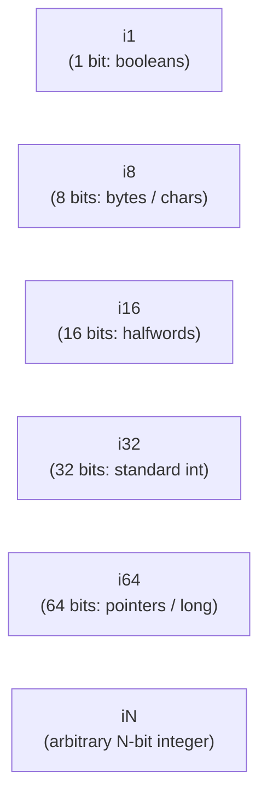

# Step 11.1: Integer Widths and Primitive Types

In hardware, processors do not treat integers and floating-point numbers identically.  They reside in separate register files (general-purpose registers vs. vector/floating-point registers) and use distinct arithmetic execution pipelines.

Furthermore, integers have explicit bit-widths.  An array of bytes requires 8-bit integers (`i8`), loop counters and lengths often use 32-bit integers (`i32`), and memory pointers on 64-bit machines require 64-bit integers (`i64`).

---

## Integer Width Architecture



> [!NOTE]
> **Arbitrary Bit-Widths in LLVM**:
> LLVM supports arbitrary integer bit-widths from 1 to $2^{23}-1$.  This enables precise representation of hardware descriptions, graphics shaders, packed bitfields, and specialised DSP architectures without premature padding.  The target backend automatically legalises odd widths (such as `i7` into an `i8` or `i32` register) for physical CPU execution.

---

## Incremental Code Changes

Open `kaleidoscope.cpp` to introduce integer types.

### 1. LLVM's Arbitrary-Precision Integer Types

In LLVM Intermediate Representation, integer types are written as `iN`, where `N` is an arbitrary bit-width:

* `i1`: A 1-bit integer, used for booleans and branch conditions.
* `i8`: An 8-bit byte (equivalent to C `char` or `uint8_t`).
* `i16`: A 16-bit halfword (equivalent to C `short`).
* `i32`: A 32-bit word (equivalent to standard C `int`).
* `i64`: A 64-bit doubleword (equivalent to C `long long` or `intptr_t`).

To retrieve these types from the LLVM context in C++:

```cpp
llvm::Type *I1Ty = llvm::Type::getInt1Ty(*TheContext);
llvm::Type *I8Ty = llvm::Type::getInt8Ty(*TheContext);
llvm::Type *I32Ty = llvm::Type::getInt32Ty(*TheContext);
llvm::Type *I64Ty = llvm::Type::getInt64Ty(*TheContext);
```

Or, through the `IRBuilder` convenience helpers:

```cpp
llvm::Type *I32Ty = Builder->getInt32Ty();
```

### 2. Emitting Integer Constants

Previously, you emitted floating-point constants using `llvm::ConstantFP::get`:

```cpp
// 64-bit floating point constant:
llvm::Value *F = llvm::ConstantFP::get(*TheContext, llvm::APFloat(42.0));
```

To emit an integer constant, use `llvm::ConstantInt::get` or the `IRBuilder` helper:

```cpp
// 32-bit integer constant:
llvm::Value *Val32 = Builder->getInt32(42);

// 64-bit integer constant:
llvm::Value *Val64 = Builder->getInt64(10000000000LL);

// Arbitrary-precision APInt constant:
llvm::Value *Custom = llvm::ConstantInt::get(
    *TheContext, llvm::APInt(32, 42, /*isSigned=*/true));
```

### 3. Creating `IntExprAST`

Now add an AST node representing integer literals.

#### Your Task
Try writing `IntExprAST` deriving from `ExprAST`:
* Store an `int64_t Val`.
* In `codegen()`, return a 32-bit integer constant via `Builder->getInt32()`.
* In `getType()`, return `Builder->getInt32Ty()`.

Once you have written your implementation, expand the reference solution below to verify:

<details>
<summary><b>Reference Solution: IntExprAST</b></summary>

```cpp
class IntExprAST : public ExprAST {
  int64_t Val;

public:
  IntExprAST(int64_t Val) : Val(Val) {}

  llvm::Value *codegen() override {
    return Builder->getInt32(static_cast<int32_t>(Val));
  }

  llvm::Type *getType() override {
    return Builder->getInt32Ty();
  }
};
```
</details>

---

In [Step 11.2](02-signless-integers.md), we will explore why LLVM integer registers are signless and how arithmetic operations handle signedness.
