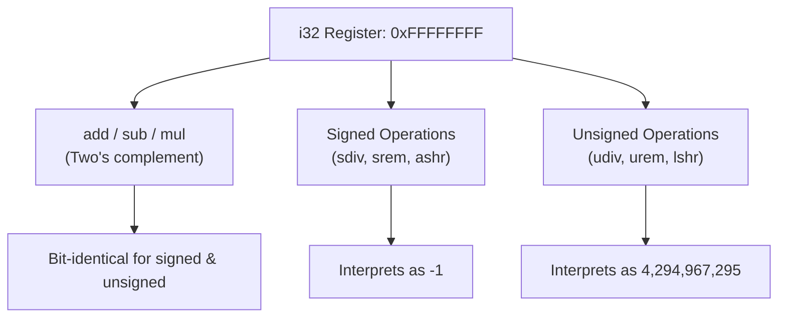

# Step 11.2: Signless Registers and Integer Arithmetic

One of the most surprising concepts for newcomers to LLVM is that **LLVM integer types have no signedness**.

There is no `u32` or `s32` in LLVM IR.  There is only `i32`.  An `i32` register is simply a bag of 32 bits.

Whether those 32 bits represent a signed two's-complement number or an unsigned number depends entirely on the **operation** performed on them.

---

## Signless Register Interpretation



> [!IMPORTANT]
> **Signless Registers vs. Signed Operations**:
> Do not search for unsigned integer types in LLVM IR.  Types such as `uint32_t` and `int32_t` in C or C++ map to the exact same LLVM IR type: `i32`.  The compiler frontend is responsible for emitting signed instructions (`sdiv`, `ashr`, `sitofp`) or unsigned instructions (`udiv`, `lshr`, `uitofp`) based on source-language semantics.

---

## Incremental Code Changes

Open `kaleidoscope.cpp` to implement integer arithmetic.

### 1. Operations Where Signedness Does Not Matter

In two's-complement arithmetic, addition, subtraction, and multiplication produce identical bit patterns whether the inputs are signed or unsigned.

For example, adding `0xFFFFFFFF` (-1 as signed, 4,294,967,295 as unsigned) and `0x00000001` (1) yields `0x00000000` (0) in both systems.

Therefore, LLVM has only one instruction for each of these operations:

```cpp
llvm::Value *Sum  = Builder->CreateAdd(L, R, "addtmp");
llvm::Value *Diff = Builder->CreateSub(L, R, "subtmp");
llvm::Value *Prod = Builder->CreateMul(L, R, "multmp");
```

### 2. Operations Where Signedness Matters: Division and Remainder

Division and remainder produce completely different results depending on signedness:

* `-4 / 2` is `-2`.
* `0xFFFFFFFC` (unsigned 4,294,967,292) `/ 2` is `2,147,483,646`.

Because physical processors use different machine instructions (`idiv` vs. `div` on x86), LLVM requires distinct instructions:

```cpp
// Signed division and remainder:
llvm::Value *SDiv = Builder->CreateSDiv(L, R, "sdivtmp");
llvm::Value *SRem = Builder->CreateSRem(L, R, "sremtmp");

// Unsigned division and remainder:
llvm::Value *UDiv = Builder->CreateUDiv(L, R, "udivtmp");
llvm::Value *URem = Builder->CreateURem(L, R, "uremtmp");
```

### 3. Bitwise and Shift Operations

LLVM provides full support for bitwise manipulations:

```cpp
llvm::Value *And = Builder->CreateAnd(L, R, "andtmp");
llvm::Value *Or  = Builder->CreateOr(L, R, "ortmp");
llvm::Value *Xor = Builder->CreateXor(L, R, "xortmp");
llvm::Value *Shl = Builder->CreateShl(L, R, "shltmp");
```

For right shifts, signedness matters again:
* **Arithmetic Shift Right (`ashr`)**: Preserves the sign bit, shifting in copies of the most significant bit.
* **Logical Shift Right (`lshr`)**: Treats the number as unsigned, shifting in zeroes.

```cpp
// Arithmetic shift right (for signed integers):
llvm::Value *AShr = Builder->CreateAShr(L, R, "ashrtmp");

// Logical shift right (for unsigned integers):
llvm::Value *LShr = Builder->CreateLShr(L, R, "lshrtmp");
```

### 4. Updating `BinaryExprAST::codegen`

#### Your Task
Extend `BinaryExprAST::codegen()` to check whether operands are integer types using `L->getType()->isIntegerTy()`.  If integer, emit `CreateAdd`, `CreateSub`, `CreateMul`, or `CreateSDiv`/`CreateUDiv`; otherwise, emit floating-point operations (`CreateFAdd`, `CreateFSub`, etc.).

Once you have drafted your dispatch logic, expand the reference solution below:

<details>
<summary><b>Reference Solution: BinaryExprAST Integer Dispatch</b></summary>

```cpp
  llvm::Value *codegen() override {
    llvm::Value *L = LHS->codegen();
    llvm::Value *R = RHS->codegen();
    if (!L || !R)
      return nullptr;

    bool IsInt = L->getType()->isIntegerTy();

    if (Op == "+")
      return IsInt ? Builder->CreateAdd(L, R, "addtmp")
                   : Builder->CreateFAdd(L, R, "faddtmp");
    if (Op == "-")
      return IsInt ? Builder->CreateSub(L, R, "subtmp")
                   : Builder->CreateFSub(L, R, "fsubtmp");
    if (Op == "*")
      return IsInt ? Builder->CreateMul(L, R, "multmp")
                   : Builder->CreateFMul(L, R, "fmultmp");
    if (Op == "/s")
      return Builder->CreateSDiv(L, R, "sdivtmp");
    if (Op == "/u")
      return Builder->CreateUDiv(L, R, "udivtmp");
    if (Op == "/")
      return IsInt ? Builder->CreateSDiv(L, R, "sdivtmp")
                   : Builder->CreateFDiv(L, R, "fdivtmp");

    fprintf(stderr, "Error: Unknown binary operator %s\n", Op.c_str());
    return nullptr;
  }
```
</details>

---

## 5. Emitted IR Example

Inspect the resulting LLVM IR for an integer math function:

```llvm
define i32 @demo_math(i32 %a, i32 %b) {
entry:
  %addtmp  = add i32 %a, %b
  %sdivtmp = sdiv i32 %a, %b
  %udivtmp = udiv i32 %a, %b
  %ashrtmp = ashr i32 %a, 2
  %lshrtmp = lshr i32 %a, 2
  ret i32 %addtmp
}
```

Notice how clean the IR is.  The types are all simply `i32`, while the instructions encode the signed or unsigned semantics.

---

In [Step 11.3](03-integer-comparisons.md), we will implement integer comparison operations using `icmp`.
