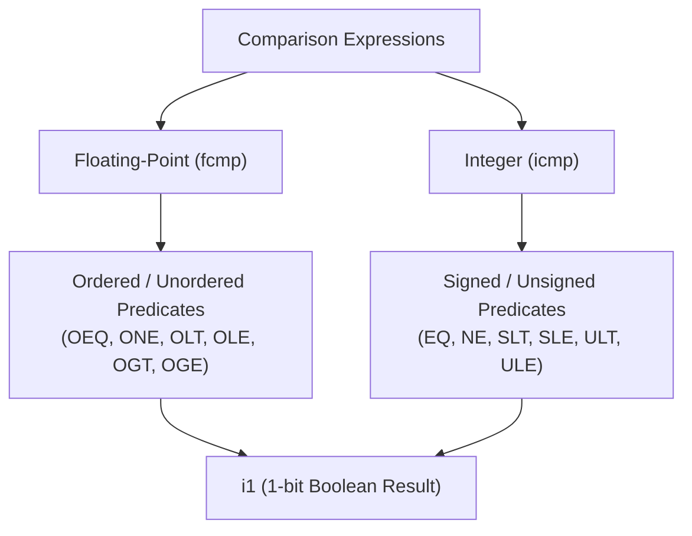

# Step 11.3: Integer Comparisons with 'icmp'

In Section 4, you compared floating-point values using `fcmp` (Floating-Point Comparison).  For integers, LLVM provides the **`icmp`** (Integer Comparison) instruction.

Like arithmetic division, integer comparison depends directly on signedness.

---

## Comparison Instruction Architecture



> [!NOTE]
> **Direct Boolean Compatibility**:
> Every `icmp` instruction produces an `i1` result (a 1-bit boolean).  In LLVM IR, `i1` is the exact type required by conditional branches (`CreateCondBr`) and conditional selections (`CreateSelect`).  Unlike floating-point comparisons where you converted `fcmp` results to `double`, integer comparison results can be fed directly to control flow without intermediate casts.

---

## Incremental Code Changes

Open `kaleidoscope.cpp` to implement integer comparisons.

### 1. The Signed vs. Unsigned Comparison Trap

Consider comparing `-1` (`0xFFFFFFFF`) and `1` (`0x00000001`):

* **Signed comparison**: `-1 < 1` is **true**.
* **Unsigned comparison**: `4,294,967,295 < 1` is **false**.

Because the hardware uses different CPU flags (`SF`, `OF` for signed vs. `CF` for unsigned), your compiler must specify the comparison predicate explicitly.

### 2. Integer Comparison Predicates

`llvm::CmpInst::Predicate` defines all integer comparison operations:

| Predicate | Meaning | C Equivalent |
| :--- | :--- | :--- |
| `ICMP_EQ` | Equal | `a == b` |
| `ICMP_NE` | Not Equal | `a != b` |
| `ICMP_SLT` | Signed Less Than | `(int32_t)a < (int32_t)b` |
| `ICMP_SLE` | Signed Less or Equal | `(int32_t)a <= (int32_t)b` |
| `ICMP_SGT` | Signed Greater Than | `(int32_t)a > (int32_t)b` |
| `ICMP_SGE` | Signed Greater or Equal | `(int32_t)a >= (int32_t)b` |
| `ICMP_ULT` | Unsigned Less Than | `(uint32_t)a < (uint32_t)b` |
| `ICMP_ULE` | Unsigned Less or Equal | `(uint32_t)a <= (uint32_t)b` |
| `ICMP_UGT` | Unsigned Greater Than | `(uint32_t)a > (uint32_t)b` |
| `ICMP_UGE` | Unsigned Greater or Equal | `(uint32_t)a >= (uint32_t)b` |

### 3. Emitting `icmp` with IRBuilder

`IRBuilder` provides dedicated helpers for every predicate:

```cpp
// Equality checks:
llvm::Value *Eq = Builder->CreateICmpEQ(L, R, "icmpeq");
llvm::Value *Ne = Builder->CreateICmpNE(L, R, "icmpne");

// Signed comparisons:
llvm::Value *SLT = Builder->CreateICmpSLT(L, R, "cmpslt");
llvm::Value *SGT = Builder->CreateICmpSGT(L, R, "cmpsgt");

// Unsigned comparisons:
llvm::Value *ULT = Builder->CreateICmpULT(L, R, "cmpult");
llvm::Value *UGT = Builder->CreateICmpUGT(L, R, "cmpugt");
```

### 4. Authoring Integer Comparisons

#### Your Task
Add integer comparison handling to `BinaryExprAST::codegen()`:
* Handle `<s` with `CreateICmpSLT`.
* Handle `<u` with `CreateICmpULT`.
* Handle `==` with `CreateICmpEQ` if integer, or `CreateFCmpOEQ` if floating point.

Expand the reference fold below to verify:

<details>
<summary><b>Reference Solution: Comparison Codegen</b></summary>

```cpp
    // Comparisons
    if (Op == "<s")
      return Builder->CreateICmpSLT(L, R, "cmpslt");
    if (Op == "<u")
      return Builder->CreateICmpULT(L, R, "cmpult");
    if (Op == "==")
      return IsInt ? Builder->CreateICmpEQ(L, R, "icmpeq")
                   : Builder->CreateFCmpOEQ(L, R, "fcmpeq");
```
</details>

---

## 5. Emitted IR Example

```llvm
define i1 @is_negative(i32 %x) {
entry:
  %cmp = icmp slt i32 %x, 0
  ret i1 %cmp
}
```

Notice that checking if a number is negative is simply a signed less-than comparison against zero.

---

In [Step 11.4](04-type-conversions.md), we will learn how to convert between integer widths and floating-point values using explicit casts.
