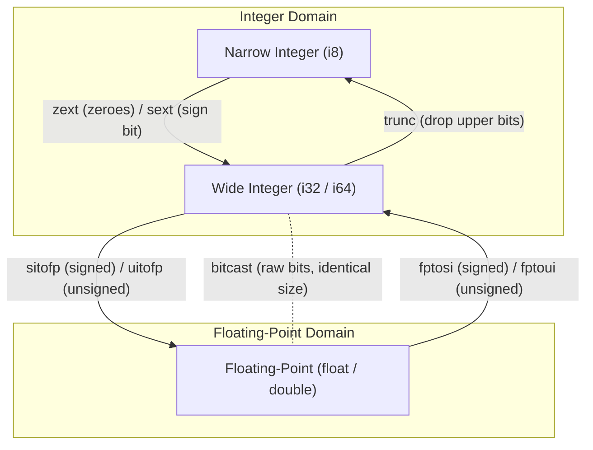

# Step 11.4: Type Conversions and Casts

In a multi-type language, programs frequently convert values between types: widening an 8-bit character to a 32-bit integer, converting an integer to a floating-point number, or casting between signed and unsigned interpretations.

LLVM enforces strict type safety in its Intermediate Representation: **implicit conversions do not exist in LLVM IR**.  Every type change must be represented by an explicit conversion instruction.

---

## Type Conversion Pathways



> [!NOTE]
> **Branchless Selection with `CreateSelect`**:
> In LLVM IR, the `select` instruction implements the ternary conditional operator (`cond ? trueval : falseval`).  Unlike conditional branches which require basic blocks, PHI nodes, and branch instructions, `select` lowers directly to hardware conditional move instructions (`cmov` on x86, `csel` on ARM64), avoiding branch misprediction penalties.

---

## Incremental Code Changes

Open `kaleidoscope.cpp` to implement type conversion expressions.

### 1. Integer Width Conversions

When converting between integer types of different bit-widths:

#### Narrowing: Truncation (`trunc`)
To convert a wider integer to a narrower integer (e.g. `i32` to `i8`), LLVM simply discards the leading bits:

```cpp
llvm::Value *ByteVal = Builder->CreateTrunc(Int32Val, Builder->getInt8Ty(), "trunc8");
```

#### Widening: Sign-Extension (`sext`) vs. Zero-Extension (`zext`)
When expanding a narrower integer to a wider integer (e.g. `i8` to `i32`), the missing bits must be filled:

* **`zext` (Zero Extension)**: Fills the upper bits with zeroes.  Used for unsigned numbers.
* **`sext` (Sign Extension)**: Copies the most significant bit (sign bit) across all upper bits.  Used for signed two's-complement numbers.

```cpp
// If ByteVal is 0xFF (-1 signed, 255 unsigned):
// zext produces 0x000000FF (255)
llvm::Value *UnsignedWide = Builder->CreateZExt(ByteVal, Builder->getInt32Ty(), "zext32");

// sext produces 0xFFFFFFFF (-1)
llvm::Value *SignedWide   = Builder->CreateSExt(ByteVal, Builder->getInt32Ty(), "sext32");
```

### 2. Integer and Floating-Point Conversions

Converting between the general-purpose integer domain and the floating-point domain requires hardware conversion instructions:

```cpp
// Signed integer to double:
llvm::Value *AsDouble = Builder->CreateSIToFP(IntVal, Builder->getDoubleTy(), "todbl");

// Unsigned integer to double:
llvm::Value *AsDoubleU = Builder->CreateUIToFP(IntVal, Builder->getDoubleTy(), "todbl_u");

// Double to signed integer (truncates towards zero):
llvm::Value *AsInt = Builder->CreateFPToSI(DblVal, Builder->getInt32Ty(), "toint");

// Double to unsigned integer:
llvm::Value *AsIntU = Builder->CreateFPToUI(DblVal, Builder->getInt32Ty(), "toint_u");
```

### 3. Bitcasting

When two types have identical bit sizes and you wish to reinterpret the underlying bits without altering them (for example, reinterpreting the raw 64-bit IEEE pattern of a `double` as an `i64`), use `CreateBitCast`:

```cpp
llvm::Value *RawBits = Builder->CreateBitCast(DblVal, Builder->getInt64Ty(), "rawbits");
```

### 4. Creating `CastExprAST`

#### Your Task
Define `CastExprAST` deriving from `ExprAST`:
* Store `std::string TargetType` and `std::unique_ptr<ExprAST> Operand`.
* In `codegen()`, evaluate `Operand->codegen()`.  If `TargetType == "double"`, emit `CreateSIToFP`.  If `TargetType == "int"`, emit `CreateFPToSI`.  If `TargetType == "bool"`, emit `CreateICmpNE` comparing against zero.

Check your implementation against the reference solution below:

<details>
<summary><b>Reference Solution: CastExprAST</b></summary>

```cpp
class CastExprAST : public ExprAST {
  std::string TargetType;
  std::unique_ptr<ExprAST> Operand;

public:
  CastExprAST(std::string TargetType, std::unique_ptr<ExprAST> Operand)
      : TargetType(std::move(TargetType)), Operand(std::move(Operand)) {}

  llvm::Value *codegen() override {
    llvm::Value *V = Operand->codegen();
    if (!V)
      return nullptr;

    if (TargetType == "double")
      return Builder->CreateSIToFP(V, Builder->getDoubleTy(), "todouble");
    if (TargetType == "int")
      return Builder->CreateFPToSI(V, Builder->getInt32Ty(), "toint");
    if (TargetType == "bool")
      return Builder->CreateICmpNE(V, Builder->getInt32(0), "tobool");

    fprintf(stderr, "Error: Unknown cast target type %s\n", TargetType.c_str());
    return nullptr;
  }

  llvm::Type *getType() override {
    if (TargetType == "double")
      return Builder->getDoubleTy();
    if (TargetType == "int")
      return Builder->getInt32Ty();
    return Builder->getInt1Ty();
  }
};
```
</details>

---

## Conversion Cheat Sheet

| Source | Destination | Signedness | LLVM Instruction | IRBuilder Method |
| :--- | :--- | :--- | :--- | :--- |
| `i32` | `i8` | Either | `trunc` | `CreateTrunc` |
| `i8` | `i32` | Unsigned | `zext` | `CreateZExt` |
| `i8` | `i32` | Signed | `sext` | `CreateSExt` |
| `i32` | `double` | Signed | `sitofp` | `CreateSIToFP` |
| `i32` | `double` | Unsigned | `uitofp` | `CreateUIToFP` |
| `double` | `i32` | Signed | `fptosi` | `CreateFPToSI` |
| `double` | `i32` | Unsigned | `fptoui` | `CreateFPToUI` |
| `i64` | `double` | Bit-level | `bitcast` | `CreateBitCast` |

---

## Full Working Example

The complete reference implementation for this section is available in [code/step35-integer-types.cpp](../code/step35-integer-types.cpp).

<details>
<summary><b>Expand to view complete code (step35-integer-types.cpp)</b></summary>

```cpp
#include "llvm/ADT/APFloat.h"
#include "llvm/ADT/APInt.h"
#include "llvm/IR/BasicBlock.h"
#include "llvm/IR/Constants.h"
#include "llvm/IR/DerivedTypes.h"
#include "llvm/IR/Function.h"
#include "llvm/IR/IRBuilder.h"
#include "llvm/IR/Instructions.h"
#include "llvm/IR/LLVMContext.h"
#include "llvm/IR/Module.h"
#include "llvm/IR/Type.h"
#include "llvm/IR/Verifier.h"
#include "llvm/Support/TargetSelect.h"
#include "llvm/Support/raw_ostream.h"

#include <cctype>
#include <cstdio>
#include <cstdlib>
#include <map>
#include <memory>
#include <string>
#include <utility>
#include <vector>

enum Token {
  tok_eof = -1,

  // Commands / Keywords
  tok_def = -100,
  tok_extern = -101,
  tok_type_int = -102,
  tok_type_double = -103,
  tok_type_bool = -104,

  // Primary
  tok_identifier = -200,
  tok_number = -201,
  tok_int_literal = -202,
};

static std::string IdentifierStr;
static double NumVal;
static int64_t IntVal;

static int gettok() {
  static int LastChar = ' ';
  while (isspace(LastChar))
    LastChar = getchar();

  if (isalpha(LastChar) || LastChar == '_') {
    IdentifierStr = LastChar;
    while (isalnum((LastChar = getchar())) || LastChar == '_')
      IdentifierStr += LastChar;

    if (IdentifierStr == "def")
      return tok_def;
    if (IdentifierStr == "extern")
      return tok_extern;
    if (IdentifierStr == "int")
      return tok_type_int;
    if (IdentifierStr == "double")
      return tok_type_double;
    if (IdentifierStr == "bool")
      return tok_type_bool;
    return tok_identifier;
  }

  if (isdigit(LastChar) || LastChar == '.') {
    std::string NumStr;
    bool HasDot = false;
    do {
      if (LastChar == '.')
        HasDot = true;
      NumStr += LastChar;
      LastChar = getchar();
    } while (isdigit(LastChar) || LastChar == '.');

    if (HasDot) {
      NumVal = strtod(NumStr.c_str(), nullptr);
      return tok_number;
    }
    IntVal = strtoll(NumStr.c_str(), nullptr, 10);
    return tok_int_literal;
  }

  if (LastChar == '#') {
    do
      LastChar = getchar();
    while (LastChar != EOF && LastChar != '\n' && LastChar != '\r');

    if (LastChar != EOF)
      return gettok();
  }

  if (LastChar == EOF)
    return tok_eof;

  int ThisChar = LastChar;
  LastChar = getchar();
  return ThisChar;
}

class ExprAST {
public:
  virtual ~ExprAST() = default;
  virtual llvm::Value *codegen() = 0;
  virtual llvm::Type *getType() = 0;
};

static std::unique_ptr<llvm::LLVMContext> TheContext;
static std::unique_ptr<llvm::Module> TheModule;
static std::unique_ptr<llvm::IRBuilder<>> Builder;
static std::map<std::string, llvm::Value *> NamedValues;

class IntExprAST : public ExprAST {
  int64_t Val;

public:
  IntExprAST(int64_t Val) : Val(Val) {}
  llvm::Value *codegen() override {
    return Builder->getInt32(static_cast<int32_t>(Val));
  }
  llvm::Type *getType() override { return Builder->getInt32Ty(); }
};

class DoubleExprAST : public ExprAST {
  double Val;

public:
  DoubleExprAST(double Val) : Val(Val) {}
  llvm::Value *codegen() override {
    return llvm::ConstantFP::get(*TheContext, llvm::APFloat(Val));
  }
  llvm::Type *getType() override { return Builder->getDoubleTy(); }
};

class VariableExprAST : public ExprAST {
  std::string Name;

public:
  VariableExprAST(const std::string &Name) : Name(Name) {}
  llvm::Value *codegen() override {
    llvm::Value *V = NamedValues[Name];
    if (!V) {
      fprintf(stderr, "Error: Unknown variable name %s\n", Name.c_str());
      return nullptr;
    }
    return V;
  }
  llvm::Type *getType() override {
    llvm::Value *V = NamedValues[Name];
    return V ? V->getType() : nullptr;
  }
};

class BinaryExprAST : public ExprAST {
  std::string Op;
  std::unique_ptr<ExprAST> LHS, RHS;

public:
  BinaryExprAST(std::string Op, std::unique_ptr<ExprAST> LHS,
                std::unique_ptr<ExprAST> RHS)
      : Op(std::move(Op)), LHS(std::move(LHS)), RHS(std::move(RHS)) {}

  llvm::Value *codegen() override {
    llvm::Value *L = LHS->codegen();
    llvm::Value *R = RHS->codegen();
    if (!L || !R)
      return nullptr;

    bool IsInt = L->getType()->isIntegerTy();

    if (Op == "+")
      return IsInt ? Builder->CreateAdd(L, R, "addtmp")
                   : Builder->CreateFAdd(L, R, "faddtmp");
    if (Op == "-")
      return IsInt ? Builder->CreateSub(L, R, "subtmp")
                   : Builder->CreateFSub(L, R, "fsubtmp");
    if (Op == "*")
      return IsInt ? Builder->CreateMul(L, R, "multmp")
                   : Builder->CreateFMul(L, R, "fmultmp");
    if (Op == "/s")
      return Builder->CreateSDiv(L, R, "sdivtmp");
    if (Op == "/u")
      return Builder->CreateUDiv(L, R, "udivtmp");
    if (Op == "/")
      return IsInt ? Builder->CreateSDiv(L, R, "sdivtmp")
                   : Builder->CreateFDiv(L, R, "fdivtmp");
    if (Op == "%s")
      return Builder->CreateSRem(L, R, "sremtmp");
    if (Op == "%u")
      return Builder->CreateURem(L, R, "uremtmp");
    if (Op == "&")
      return Builder->CreateAnd(L, R, "andtmp");
    if (Op == "|")
      return Builder->CreateOr(L, R, "ortmp");
    if (Op == "^")
      return Builder->CreateXor(L, R, "xortmp");
    if (Op == "<<")
      return Builder->CreateShl(L, R, "shltmp");
    if (Op == ">>s")
      return Builder->CreateAShr(L, R, "ashrtmp");
    if (Op == ">>u")
      return Builder->CreateLShr(L, R, "lshrtmp");

    // Comparisons
    if (Op == "<s")
      return Builder->CreateICmpSLT(L, R, "cmpslt");
    if (Op == "<u")
      return Builder->CreateICmpULT(L, R, "cmpult");
    if (Op == "==")
      return IsInt ? Builder->CreateICmpEQ(L, R, "icmpeq")
                   : Builder->CreateFCmpOEQ(L, R, "fcmpeq");

    fprintf(stderr, "Error: Unknown binary operator %s\n", Op.c_str());
    return nullptr;
  }

  llvm::Type *getType() override {
    if (Op == "<s" || Op == "<u" || Op == "==")
      return Builder->getInt1Ty();
    return LHS->getType();
  }
};

class CastExprAST : public ExprAST {
  std::string TargetType;
  std::unique_ptr<ExprAST> Operand;

public:
  CastExprAST(std::string TargetType, std::unique_ptr<ExprAST> Operand)
      : TargetType(std::move(TargetType)), Operand(std::move(Operand)) {}

  llvm::Value *codegen() override {
    llvm::Value *V = Operand->codegen();
    if (!V)
      return nullptr;

    if (TargetType == "double")
      return Builder->CreateSIToFP(V, Builder->getDoubleTy(), "todouble");
    if (TargetType == "int")
      return Builder->CreateFPToSI(V, Builder->getInt32Ty(), "toint");
    if (TargetType == "bool")
      return Builder->CreateICmpNE(V, Builder->getInt32(0), "tobool");

    fprintf(stderr, "Error: Unknown cast target type %s\n", TargetType.c_str());
    return nullptr;
  }

  llvm::Type *getType() override {
    if (TargetType == "double")
      return Builder->getDoubleTy();
    if (TargetType == "int")
      return Builder->getInt32Ty();
    return Builder->getInt1Ty();
  }
};

int main() {
  TheContext = std::make_unique<llvm::LLVMContext>();
  TheModule = std::make_unique<llvm::Module>("kaleidoscope_types", *TheContext);
  Builder = std::make_unique<llvm::IRBuilder<>>(*TheContext);

  // Define: int compute(int a, int b)
  llvm::Type *I32 = Builder->getInt32Ty();
  llvm::FunctionType *FT = llvm::FunctionType::get(I32, {I32, I32}, false);
  llvm::Function *F = llvm::Function::Create(
      FT, llvm::Function::ExternalLinkage, "compute", TheModule.get());

  auto Args = F->arg_begin();
  llvm::Value *ArgA = Args++;
  ArgA->setName("a");
  llvm::Value *ArgB = Args++;
  ArgB->setName("b");

  NamedValues["a"] = ArgA;
  NamedValues["b"] = ArgB;

  llvm::BasicBlock *BB = llvm::BasicBlock::Create(*TheContext, "entry", F);
  Builder->SetInsertPoint(BB);

  // AST: (a + b) * (a /s b)
  auto LHS = std::make_unique<BinaryExprAST>(
      "+", std::make_unique<VariableExprAST>("a"),
      std::make_unique<VariableExprAST>("b"));
  auto RHS = std::make_unique<BinaryExprAST>(
      "/s", std::make_unique<VariableExprAST>("a"),
      std::make_unique<VariableExprAST>("b"));
  auto Expr =
      std::make_unique<BinaryExprAST>("*", std::move(LHS), std::move(RHS));

  llvm::Value *RetVal = Expr->codegen();
  Builder->CreateRet(RetVal);

  llvm::verifyFunction(*F);
  TheModule->print(llvm::errs(), nullptr);
  return 0;
}
```
</details>

---

## Active Learning Challenge

<details>
<summary><b>Challenge: Implementing an Absolute Value Function</b></summary>

Write a C++ function using `IRBuilder` that generates an integer absolute value function `abs(i32 %x)`.

Hint: Check if `x < 0` using `CreateICmpSLT`.  If true, subtract `x` from `0` with `CreateSub`, and use `CreateSelect` to choose between the original value and the negated value!

<br>

**Solution**:
```cpp
llvm::Value *EmitAbs(llvm::IRBuilder<> &Builder, llvm::Value *X) {
  llvm::Value *IsNeg = Builder.CreateICmpSLT(X, Builder.getInt32(0), "isneg");
  llvm::Value *NegX  = Builder.CreateSub(Builder.getInt32(0), X, "negx");
  return Builder.CreateSelect(IsNeg, NegX, X, "abstmp");
}
```

Notice `CreateSelect`: in LLVM, `select` is the ternary operator `cond ? trueval : falseval`.  It generates conditional moves (`cmov`) without needing basic blocks or branches!

</details>

---

In [Section 12](../12-globals-and-strings/README.md), we will explore how LLVM represents global variables and constant strings.
