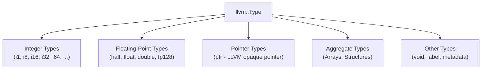

# Section 11: Primitive Types, Integers, and Casts

In Sections 1 through 10 (Kaleidoscope 101), every single value was an IEEE 754 64-bit floating-point number (`double`).  By restricting the language to one type, you bypassed type checking and type inference to focus purely on syntax, ASTs, SSA form, and code generation.

However, real computer systems do not run exclusively on floating-point arithmetic.  Operating systems, memory allocators, array indices, hardware registers, and bitmasks require **integers**.

Welcome to **Kaleidoscope 201: Systems Programming and Core LLVM**.

In this section, you will introduce primitive types to your compiler.  You will learn how LLVM models integer widths (`i1`, `i8`, `i32`, `i64`), understand why LLVM integer registers are signless while operations are signed or unsigned, and master LLVM's type conversion and truncation instructions.

---

## LLVM Type Architecture



> [!NOTE]
> **Strict Type Invariants in LLVM IR**:
> LLVM Intermediate Representation performs zero implicit conversions.  An `i32` cannot be added to an `i64`, nor can an `i32` be passed to a function expecting a `double`.  Every width expansion, narrowing, sign extension, or domain change requires an explicit conversion instruction.

---

## Steps in This Section

1.  [Step 11.1: Integer Widths and Primitive Types](01-integer-widths.md) - Define explicit types and emit integer constants.
2.  [Step 11.2: Signless Registers and Integer Arithmetic](02-signless-integers.md) - Generate integer math and understand the distinction between signed and unsigned operations.
3.  [Step 11.3: Integer Comparisons with 'icmp'](03-integer-comparisons.md) - Compare integers with `icmp slt`, `icmp ult`, and equality checks.
4.  [Step 11.4: Type Conversions and Casts](04-type-conversions.md) - Convert between integers and floating-point values with `sitofp`, `fptosi`, and bit truncation.

---

## Compiling Your Compiler

Compile against LLVM core libraries:

```bash
clang++ -Iinclude -Wall -Wextra kaleidoscope.cpp $(llvm-config --cxxflags --ldflags --system-libs --libs core) -o kaleidoscope
```

Reference code implementations for each step are stored in the [code/](../code/) directory.
