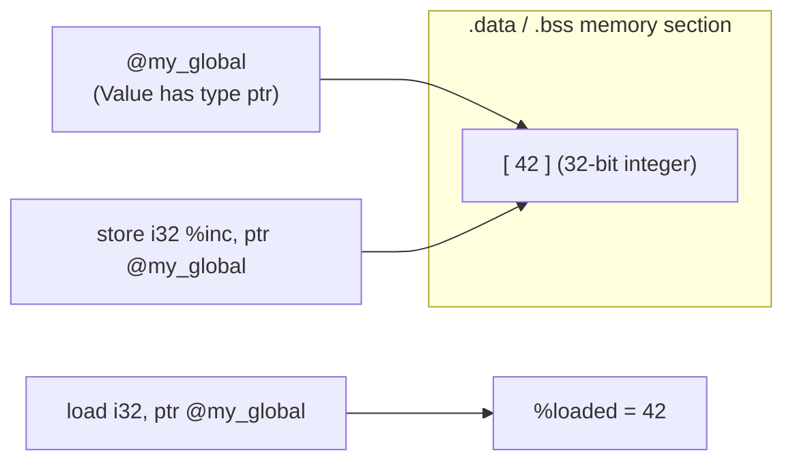

# Step 12.1: Emitting Global Variables

While stack variables allocated with `alloca` exist only during a function's execution, global variables exist for the entire lifetime of the program.  They reside in fixed memory segments (`.data`, `.bss`, or `.rodata`) determined by the operating system's executable loader.

---

## Global Storage Architecture



> [!WARNING]
> **Modern LLVM Opaque Pointers**:
> In LLVM 15 and later, typed pointers (such as `i32*` or `double*`) were replaced by unified opaque pointers (`ptr`).  Because `ptr` does not record the pointee type, memory instructions must explicitly specify the type being accessed.  Notice that `Builder->CreateLoad(Builder->getInt32Ty(), GlobalVar, "val")` takes `Builder->getInt32Ty()` as its mandatory first argument.

> [!NOTE]
> **Zero Initialisers and the .bss Section**:
> In LLVM, every non-external global variable must have a constant initialiser.  When a global variable is initialised to zero (e.g. `llvm::Constant::getNullValue(I32Ty)`), the linker places it in the `.bss` (Block Started by Symbol) segment.  The `.bss` segment occupies zero bytes in the on-disk binary file and is zeroed by the operating system kernel when loading the program.

---

## Incremental Code Changes

Open `kaleidoscope.cpp` to create and access global variables.

### 1. Global Variables are Always Pointers

In LLVM IR, **every global variable is represented by a pointer to its storage**:

```llvm
@my_global = global i32 42
```

Even though `@my_global` holds an `i32`, the compiler value representing `@my_global` has type `ptr`.

To read a global variable, you must emit a `load` instruction.  To modify a global variable, you must emit a `store` instruction:

```cpp
// Read from global:
llvm::Value *Val = Builder->CreateLoad(Builder->getInt32Ty(), GlobalVar, "val");

// Write to global:
Builder->CreateStore(NewVal, GlobalVar);
```

### 2. Constructing an `llvm::GlobalVariable`

To create a global variable, instantiate `llvm::GlobalVariable`:

```cpp
#include "llvm/IR/GlobalVariable.h"

auto *GlobalVar = new llvm::GlobalVariable(
    *TheModule,                             // Enclosing module
    Builder->getInt32Ty(),                  // Value type
    /*isConstant=*/false,                   // Is it mutable? (false = .data, true = .rodata)
    llvm::GlobalValue::ExternalLinkage,    // Linkage visibility
    Builder->getInt32(42),                  // Constant initialiser
    "my_global"                             // Symbol name
);
```

Notice the key parameters:
1.  **`isConstant`**: If `true`, the variable is read-only and placed in the `.rodata` section.  Attempts to store to it will trigger operating system segmentation faults.
2.  **`Linkage`**: Governs how the linker resolves the symbol:
    * `ExternalLinkage`: Globally visible to all object files (standard C global).
    * `InternalLinkage`: Visible only inside this module (equivalent to C `static`).
    * `PrivateLinkage`: Symbol is stripped from the symbol table by the linker.
3.  **Initialiser**: All non-external global variables **must** have a constant initialiser.

### 3. Authoring Global Load and Store Operations

#### Your Task
Try writing the code to load an integer from `GlobalVar`, add `1` to it using `Builder->CreateAdd`, and store the updated value back into `GlobalVar`.

Check your code against the reference solution below:

<details>
<summary><b>Reference Solution: Global Increment</b></summary>

```cpp
  llvm::Type *I32Ty = Builder->getInt32Ty();

  // Load from my_global, increment, store back:
  llvm::Value *Loaded = Builder->CreateLoad(I32Ty, GlobalVar, "loaded");
  llvm::Value *Inc = Builder->CreateAdd(Loaded, Builder->getInt32(1), "inc");
  Builder->CreateStore(Inc, GlobalVar);
```
</details>

---

## 4. Emitted IR Example

```llvm
@counter = internal global i32 0, align 4

define void @increment() {
entry:
  %0 = load i32, ptr @counter, align 4
  %inc = add i32 %0, 1
  store i32 %inc, ptr @counter, align 4
  ret void
}
```

Notice how `load` and `store` interact with `@counter` through opaque pointers (`ptr`).

---

In [Step 12.2](02-string-literals.md), we will learn how LLVM stores string literals in read-only constant pools.
