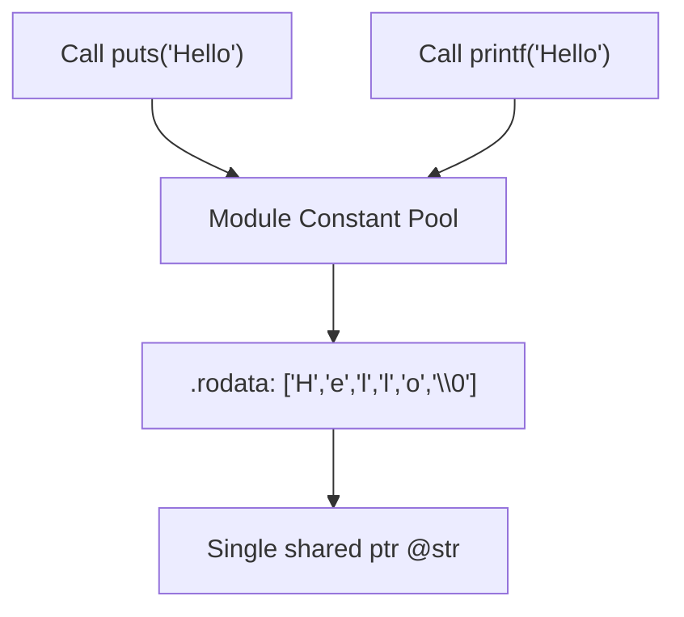

# Step 12.2: String Literals and Constant Pools

In low-level compilation, string literals like `"Hello, World!\n"` are not dynamic objects.  They are null-terminated arrays of constant bytes embedded into the executable's read-only memory section (`.rodata`).

In this step, you will learn how LLVM stores string literals in module constant pools.

---

## String Literal Architecture and Deduplication



> [!NOTE]
> **The `unnamed_addr` Attribute and Deduplication**:
> In LLVM IR, the `unnamed_addr` attribute signals that the compiler and linker only care about the contents of the memory buffer, not its exact address.  This allows LLVM's optimiser and the system linker to merge identical string constants across functions and translation units, reducing binary size.

---

## Incremental Code Changes

Open `kaleidoscope.cpp` to emit constant string literals.

### 1. How LLVM Models String Literals

In LLVM IR, a string literal is an array of 8-bit integers (`[N x i8]`):

```llvm
@str = private unnamed_addr constant [15 x i8] c"Hello, World!\0A\00", align 1
```

Notice the attributes:
* **`private`**: The symbol is local to this translation unit and will not pollute the global symbol table.
* **`unnamed_addr`**: Indicates that the address of the string is not significant, only its contents.  This allows LLVM's optimiser to merge identical string constants across the module (string deduplication) to save space.
* **`constant`**: Placed in read-only memory (`.rodata`).

### 2. Generating Strings with `IRBuilder`

Creating string constants manually with `ConstantDataArray::getString` and `GlobalVariable` requires several lines of boilerplate.  `IRBuilder` provides a modern helper:

```cpp
llvm::Value *StrPtr = Builder->CreateGlobalString("Hello, World!\n", "str");
```

This single line:
1.  Appends a null terminator (`\0`) automatically.
2.  Creates the private global constant array in the module.
3.  Returns an `llvm::Value*` with type `ptr` pointing directly to the first character of the string.

### 3. String Deduplication in Action

If you invoke `CreateGlobalString` multiple times with identical strings, LLVM automatically deduplicates them:

```cpp
llvm::Value *Str1 = Builder->CreateGlobalString("error", "str1");
llvm::Value *Str2 = Builder->CreateGlobalString("error", "str2");
```

In the emitted IR, both pointers reference the exact same global storage in `.rodata`, reducing memory overhead.

---

In [Step 12.3](03-calling-clib.md), we will pass string pointers to standard C library functions like `puts` and `printf`.
