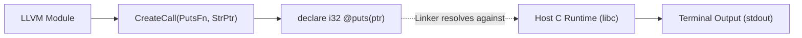

# Step 12.3: Calling the C Standard Library

With global string pointers available, your compiler can now interact with the rich ecosystem of standard C runtime library functions, including formatted printing and string inspection.

In this step, you will learn how to declare and call both standard and variadic C library functions in LLVM IR.

---

## External C Library Invocation



> [!NOTE]
> **Variadic Calling Conventions and the %al Register**:
> On the x86-64 System V ABI, variadic functions like `printf` require the caller to set the `%al` register to the number of vector and floating-point registers used for argument passing.  When you declare an LLVM `FunctionType` with `isVarArg=true`, LLVM's backend code generator automatically emits the necessary register preparation instructions before the function call.

---

## Incremental Code Changes

Open `kaleidoscope.cpp` to declare and invoke standard C library functions.

### 1. Calling `puts` (Fixed Parameter List)

The C standard library function `puts` has the prototype:

```c
int puts(const char *s);
```

In LLVM IR with opaque pointers, `const char *` is simply `ptr`.  To declare and call `puts`:

```cpp
// 1. Define function signature: int32_t(ptr)
llvm::FunctionType *PutsFT = llvm::FunctionType::get(
    Builder->getInt32Ty(), {Builder->getPtrTy()}, /*isVarArg=*/false);

// 2. Declare external function in module
llvm::FunctionCallee PutsFn = TheModule->getOrInsertFunction("puts", PutsFT);

// 3. Emit string literal and invoke puts
llvm::Value *StrPtr = Builder->CreateGlobalString("Hello from LLVM!\n", "str");
Builder->CreateCall(PutsFn, StrPtr);
```

### 2. Calling `printf` (Variadic Functions)

Functions like `printf` accept a variable number of arguments (`varargs`):

```c
int printf(const char *format, ...);
```

When defining a variadic function type in LLVM, set the third parameter `isVarArg` to `true`:

```cpp
// 1. Define variadic function signature: int32_t(ptr, ...)
llvm::FunctionType *PrintfFT = llvm::FunctionType::get(
    Builder->getInt32Ty(), {Builder->getPtrTy()}, /*isVarArg=*/true);

// 2. Declare external printf
llvm::FunctionCallee PrintfFn = TheModule->getOrInsertFunction("printf", PrintfFT);

// 3. Create format string and call printf with multiple arguments
llvm::Value *Fmt = Builder->CreateGlobalString("Result: %d, Float: %f\n", "fmt");
Builder->CreateCall(PrintfFn, {Fmt, Builder->getInt32(42), Builder->getDouble(3.14159)});
```

---

## 3. Emitted IR Example

```llvm
@str = private unnamed_addr constant [19 x i8] c"Hello from LLVM!\0A\00", align 1
@fmt = private unnamed_addr constant [24 x i8] c"Result: %d, Float: %f\0A\00", align 1

define i32 @main() {
entry:
  %0 = call i32 @puts(ptr @str)
  %1 = call i32 (ptr, ...) @printf(ptr @fmt, i32 42, double 3.141590e+00)
  ret i32 0
}

declare i32 @puts(ptr)
declare i32 @printf(ptr, ...)
```

---

## Full Working Example

The complete reference implementation for this section is available in [code/step36-globals-strings.cpp](../code/step36-globals-strings.cpp).

<details>
<summary><b>Expand to view complete code (step36-globals-strings.cpp)</b></summary>

```cpp
#include "llvm/IR/BasicBlock.h"
#include "llvm/IR/Constants.h"
#include "llvm/IR/DerivedTypes.h"
#include "llvm/IR/Function.h"
#include "llvm/IR/GlobalVariable.h"
#include "llvm/IR/IRBuilder.h"
#include "llvm/IR/Instructions.h"
#include "llvm/IR/LLVMContext.h"
#include "llvm/IR/Module.h"
#include "llvm/IR/Type.h"
#include "llvm/IR/Verifier.h"
#include "llvm/Support/raw_ostream.h"

#include <cstdio>
#include <memory>

int main() {
  auto Context = std::make_unique<llvm::LLVMContext>();
  auto Module = std::make_unique<llvm::Module>("globals_demo", *Context);
  auto Builder = std::make_unique<llvm::IRBuilder<>>(*Context);

  llvm::Type *I32Ty = llvm::Type::getInt32Ty(*Context);
  llvm::Type *PtrTy = llvm::PointerType::get(*Context, 0);

  // 1. Mutable global variable: int my_global = 42;
  auto *GlobalVar = new llvm::GlobalVariable(
      *Module, I32Ty, false, llvm::GlobalValue::ExternalLinkage,
      llvm::ConstantInt::get(I32Ty, 42), "my_global");

  // 2. Function calling puts with a global string literal:
  llvm::FunctionType *FT = llvm::FunctionType::get(I32Ty, {}, false);
  llvm::Function *F = llvm::Function::Create(
      FT, llvm::Function::ExternalLinkage, "print_message", Module.get());

  llvm::BasicBlock *BB = llvm::BasicBlock::Create(*Context, "entry", F);
  Builder->SetInsertPoint(BB);

  // Create global string in .rodata
  llvm::Value *StrPtr =
      Builder->CreateGlobalString("Hello, Systems LLVM!\n", "str");

  // Declare extern int puts(const char *);
  llvm::FunctionType *PutsFT = llvm::FunctionType::get(I32Ty, {PtrTy}, false);
  llvm::FunctionCallee PutsFn = Module->getOrInsertFunction("puts", PutsFT);

  Builder->CreateCall(PutsFn, StrPtr);

  // Load from my_global, increment, store back
  llvm::Value *Loaded = Builder->CreateLoad(I32Ty, GlobalVar, "loaded");
  llvm::Value *Inc = Builder->CreateAdd(Loaded, Builder->getInt32(1), "inc");
  Builder->CreateStore(Inc, GlobalVar);

  Builder->CreateRet(Inc);

  llvm::verifyFunction(*F);
  Module->print(llvm::errs(), nullptr);
  return 0;
}
```
</details>

---

## Active Learning Challenge

<details>
<summary><b>Challenge: Why Does printf Need Explicit VarArg Types?</b></summary>

Why does calling `printf` require specifying `(ptr, ...)` in the call instruction, whereas `puts` does not?

<br>

**Explanation**:
On the x86-64 System V ABI, variadic functions use a different calling convention than non-variadic functions: the caller must set the `%al` register to the number of vector and floating-point registers used.  By marking the function `isVarArg=true`, LLVM knows to generate the appropriate ABI setup instructions before jumping to `printf`.

</details>

---

In [Section 13](../13-pointers-and-heap/README.md), we will explore how LLVM represents pointers, indirection, and dynamic heap memory.
