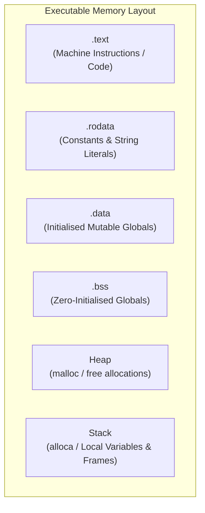

# Section 12: Global Variables and Constant Strings

In Section 11, you learned how LLVM represents primitive integer types, signless registers, and arithmetic conversions.  However, all memory accessed so far lived on the function call stack via `alloca`.

Real programs require **global state**:
* Mutable global variables accessible across multiple functions.
* Read-only constant lookup tables.
* String literals stored in the binary's read-only data section (`.rodata`).

Welcome to **Kaleidoscope 201: Systems Programming and Core LLVM**.

In this section, you will learn how to create and manage `llvm::GlobalVariable` objects, understand symbol linkage rules, emit string literals into constant pools, and call standard C library I/O functions like `puts` and `printf`.

---

## Memory Segments Architecture



> [!NOTE]
> **Static Lifetimes vs. Stack Frames**:
> Unlike stack variables created by `alloca` which vanish when their enclosing function returns, global variables reside in fixed memory segments.  Their addresses are resolved either at link time or by the operating system dynamic linker during program startup.

---

## Steps in This Section

1.  [Step 12.1: Emitting Global Variables](01-global-variables.md) - Allocate global variables in `.data` and `.bss`, and configure symbol linkage.
2.  [Step 12.2: String Literals and Constant Pools](02-string-literals.md) - Emit null-terminated string literals into `.rodata` with `CreateGlobalString`.
3.  [Step 12.3: Calling the C Standard Library](03-calling-clib.md) - Declare external functions with pointer arguments and call `puts` and `printf`.

---

## Compiling Your Compiler

Compile against LLVM core libraries:

```bash
clang++ -Iinclude -Wall -Wextra kaleidoscope.cpp $(llvm-config --cxxflags --ldflags --system-libs --libs core) -o kaleidoscope
```

Reference code implementations for each step are stored in the [code/](../code/) directory.
