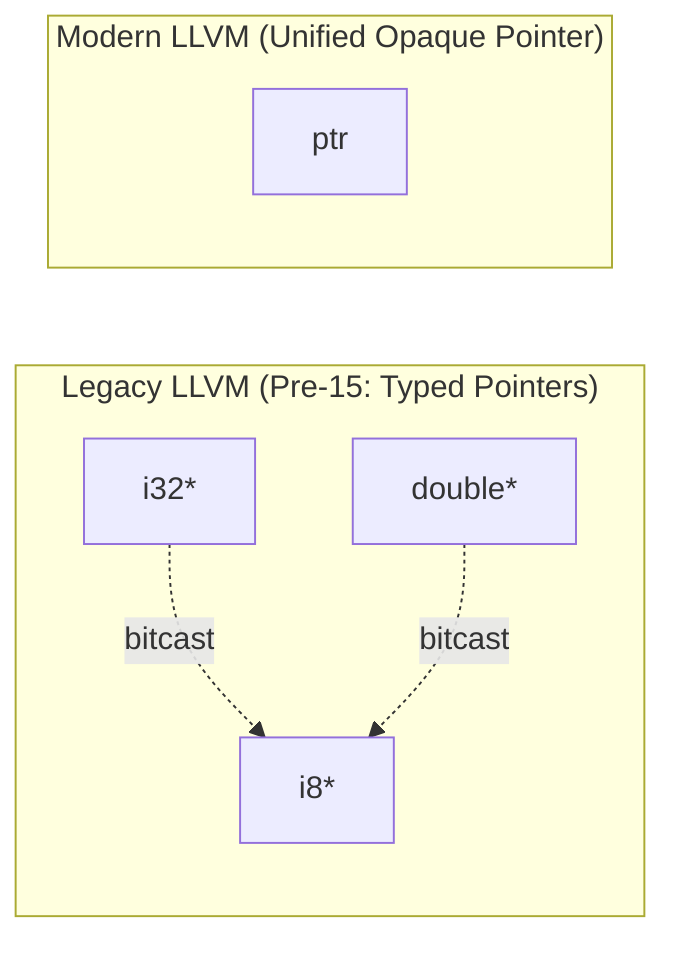

# Step 13.1: Understanding LLVM Opaque Pointers

If you read older LLVM tutorials or StackOverflow answers from before LLVM 15, you will encounter pointer types like `i32*`, `double*`, or `i8*`.

Since LLVM 15, LLVM has transitioned completely to **opaque pointers** (`ptr`).

Understanding why opaque pointers exist and how they work is vital for anyone writing code for modern LLVM.

---

## Evolution of LLVM Pointer Types



> [!NOTE]
> **Why LLVM Adopted Opaque Pointers**:
> Physical CPU architectures do not distinguish pointers by pointee type; a 64-bit memory address in a CPU register is simply an address.  By shifting pointee type knowledge from the pointer type itself to the memory access instructions (`load i32, ptr %p`), LLVM eliminated millions of redundant `bitcast` instructions and significantly streamlined compiler optimisation passes.

---

## Incremental Code Changes

Open `kaleidoscope.cpp` to work with modern LLVM pointer types.

### 1. The Problem with Typed Pointers

In early versions of LLVM, every pointer carried the type of the value it pointed to.  For example, `i32*` pointed to a 32-bit integer, and `i8*` pointed to a byte.

In practice, this caused immense friction for compilers:
1.  **Bitcast Bloat**: In languages like C, pointers are frequently cast (e.g. passing a `struct sockaddr_in*` to a function expecting `struct sockaddr*`, or passing any pointer to `memcpy(void*, ...)`).  Every single cast emitted an explicit `bitcast` instruction in the IR.
2.  **Type Mismatches in Optimisers**: Passes frequently had to unwrap layers of bitcasts to discover what memory was actually being referenced.
3.  **Hardware Reality**: On physical CPU architectures, a memory address is just a 64-bit integer.  The hardware does not care whether an address holds a float, an int, or an instruction.

### 2. How Opaque Pointers Work

With opaque pointers, **there is only one pointer type in all of LLVM**:

```llvm
ptr
```

To create this type in C++:

```cpp
llvm::Type *PtrTy = Builder->getPtrTy();
```

Because the pointer no longer specifies what it points to, the **instructions that access memory specify the type**:

```llvm
; Load a 32-bit integer from address %p:
%val_int = load i32, ptr %p

; Load an 8-bit character from the same address:
%val_byte = load i8, ptr %p

; Store a 64-bit float into address %p:
store double 3.14, ptr %p
```

In your C++ compiler code, notice that `CreateLoad` now requires passing the value type as its first parameter:

```cpp
// Builder->CreateLoad(TypeToLoad, PointerValue, Name)
llvm::Value *Val = Builder->CreateLoad(Builder->getInt32Ty(), PtrVal, "val");
```

---

In [Step 13.2](02-address-and-dereference.md), we will implement the address-of (`&`) and dereference (`*`) operators in our Abstract Syntax Tree.
