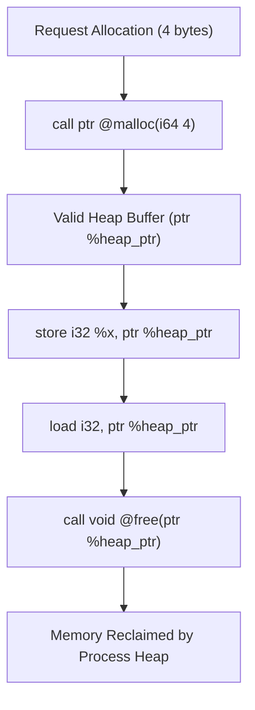

# Step 13.3: Heap Allocation with 'malloc' and 'free'

Stack allocation with `alloca` is fast, but stack frames have a fixed lifetime: they are automatically destroyed as soon as their enclosing function returns.

When a program needs data structures whose lifetimes extend beyond a single function call, or whose sizes cannot be known at compile time, it must allocate memory on the **heap**.

In this step, you will declare the standard C heap allocators `malloc` and `free` in your module and call them from compiled code.

---

## Heap Allocation Lifecycle



> [!IMPORTANT]
> **Manual Memory Management in LLVM IR**:
> LLVM Intermediate Representation does not provide a built-in garbage collector or automatic lifetime tracking.  Every byte allocated on the heap via `malloc` remains allocated until explicitly released via `free`.  If your high-level language supports heap allocations, your compiler must either emit matching calls to `free` (such as RAII destructors) or link an external garbage collector runtime.

---

## Incremental Code Changes

Open `kaleidoscope.cpp` to declare and invoke heap allocators.

### 1. Declaring `malloc` and `free`

In C, the prototypes are:

```c
void *malloc(size_t size);
void free(void *ptr);
```

On 64-bit systems, `size_t` is a 64-bit integer (`i64`), and `void*` is an opaque pointer (`ptr`).

Declare these signatures in your LLVM module:

```cpp
llvm::Type *PtrTy = Builder->getPtrTy();
llvm::Type *I64Ty = Builder->getInt64Ty();
llvm::Type *VoidTy = Builder->getVoidTy();

// Declare extern ptr @malloc(i64)
llvm::FunctionType *MallocFT = llvm::FunctionType::get(PtrTy, {I64Ty}, false);
llvm::FunctionCallee MallocFn = TheModule->getOrInsertFunction("malloc", MallocFT);

// Declare extern void @free(ptr)
llvm::FunctionType *FreeFT = llvm::FunctionType::get(VoidTy, {PtrTy}, false);
llvm::FunctionCallee FreeFn = TheModule->getOrInsertFunction("free", FreeFT);
```

### 2. Emitting Heap Allocations

To allocate heap memory, emit a call to `malloc`, passing the number of bytes:

```cpp
// Allocate space for one 32-bit integer (4 bytes):
llvm::Value *HeapPtr = Builder->CreateCall(
    MallocFn, Builder->getInt64(4), "heap_ptr");
```

Store data into the heap pointer, and read it back:

```cpp
// Store 42 into the allocated memory:
Builder->CreateStore(Builder->getInt32(42), HeapPtr);

// Read the value back:
llvm::Value *Val = Builder->CreateLoad(
    Builder->getInt32Ty(), HeapPtr, "val");
```

When finished with the heap memory, release it back to the operating system with `free`:

```cpp
Builder->CreateCall(FreeFn, HeapPtr);
```

---

## 3. Emitted IR Example

```llvm
define i32 @heap_example(i32 %x) {
entry:
  %heap_ptr = call ptr @malloc(i64 4)
  store i32 %x, ptr %heap_ptr, align 4
  %loaded = load i32, ptr %heap_ptr, align 4
  %res = add i32 %loaded, 10
  call void @free(ptr %heap_ptr)
  ret i32 %res
}

declare ptr @malloc(i64)
declare void @free(ptr)
```

Notice how clean the IR is.  Dynamic heap pointers interoperate directly with normal `load` and `store` instructions.

---

## Full Working Example

The complete reference implementation for this section is available in [code/step37-pointers-heap.cpp](../code/step37-pointers-heap.cpp).

<details>
<summary><b>Expand to view complete code (step37-pointers-heap.cpp)</b></summary>

```cpp
#include "llvm/IR/BasicBlock.h"
#include "llvm/IR/Constants.h"
#include "llvm/IR/DerivedTypes.h"
#include "llvm/IR/Function.h"
#include "llvm/IR/IRBuilder.h"
#include "llvm/IR/Instructions.h"
#include "llvm/IR/LLVMContext.h"
#include "llvm/IR/Module.h"
#include "llvm/IR/Type.h"
#include "llvm/IR/Verifier.h"
#include "llvm/Support/raw_ostream.h"

#include <cstdio>
#include <memory>

int main() {
  auto Context = std::make_unique<llvm::LLVMContext>();
  auto Module = std::make_unique<llvm::Module>("pointers_demo", *Context);
  auto Builder = std::make_unique<llvm::IRBuilder<>>(*Context);

  llvm::Type *I32Ty = Builder->getInt32Ty();
  llvm::Type *I64Ty = Builder->getInt64Ty();
  llvm::Type *PtrTy = Builder->getPtrTy();

  // Function: int32_t heap_demo(int32_t initial_val)
  llvm::FunctionType *FT = llvm::FunctionType::get(I32Ty, {I32Ty}, false);
  llvm::Function *F = llvm::Function::Create(
      FT, llvm::Function::ExternalLinkage, "heap_demo", Module.get());

  llvm::Value *InitVal = F->arg_begin();
  InitVal->setName("initial_val");

  llvm::BasicBlock *BB = llvm::BasicBlock::Create(*Context, "entry", F);
  Builder->SetInsertPoint(BB);

  // Declare extern void *malloc(size_t)
  llvm::FunctionType *MallocFT = llvm::FunctionType::get(PtrTy, {I64Ty}, false);
  llvm::FunctionCallee MallocFn =
      Module->getOrInsertFunction("malloc", MallocFT);

  // Declare extern void free(void *)
  llvm::FunctionType *FreeFT =
      llvm::FunctionType::get(Builder->getVoidTy(), {PtrTy}, false);
  llvm::FunctionCallee FreeFn = Module->getOrInsertFunction("free", FreeFT);

  // 1. Allocate 4 bytes on heap: int *p = (int*)malloc(sizeof(int));
  llvm::Value *Ptr =
      Builder->CreateCall(MallocFn, Builder->getInt64(4), "heap_ptr");

  // 2. Dereference write: *p = initial_val;
  Builder->CreateStore(InitVal, Ptr);

  // 3. Dereference read: int result = *p + 10;
  llvm::Value *Loaded = Builder->CreateLoad(I32Ty, Ptr, "loaded_val");
  llvm::Value *Result =
      Builder->CreateAdd(Loaded, Builder->getInt32(10), "result");

  // 4. Free heap memory: free(p);
  Builder->CreateCall(FreeFn, Ptr);

  // 5. Return result
  Builder->CreateRet(Result);

  llvm::verifyFunction(*F);
  Module->print(llvm::errs(), nullptr);
  return 0;
}
```
</details>

---

In [Section 14](../14-structs-and-gep/README.md), we will introduce aggregate struct types and master the `GetElementPtr` instruction for address arithmetic.
