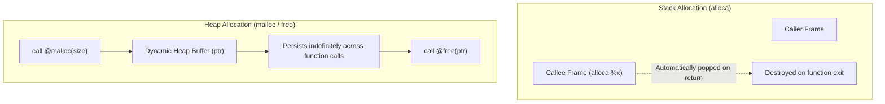

# Section 13: Pointers, Indirection, and Heap Memory

In Section 12, you worked with pointers to global variables and string constants.  Now, it is time to tackle the backbone of systems programming: **pointers, indirection, and dynamic memory allocation**.

Welcome to **Kaleidoscope 201: Systems Programming and Core LLVM**.

In this section, you will learn how modern LLVM represents pointers using unified opaque pointers (`ptr`), understand how address-of (`&`) and dereferencing (`*`) map directly to LLVM instructions, and integrate standard heap allocators (`malloc` and `free`) into your compiled code.

---

## Memory Lifetime Architecture



> [!NOTE]
> **Stack vs. Heap Lifetimes**:
> Stack allocation via `alloca` is essentially free at runtime: it simply adjusts the CPU stack pointer register (`%rsp`).  However, stack memory is invalidated as soon as the allocating function returns.  Heap allocation via `malloc` manages dynamic process memory that survives across arbitrary function calls until explicitly released with `free`.

---

## Steps in This Section

1.  [Step 13.1: Understanding LLVM Opaque Pointers](01-opaque-pointers.md) - Learn how modern LLVM models memory addresses with `ptr`.
2.  [Step 13.2: Address-Of and Dereferencing](02-address-and-dereference.md) - Implement C-style pointer operators `&` and `*` in LLVM IR.
3.  [Step 13.3: Heap Allocation with 'malloc' and 'free'](03-heap-malloc-free.md) - Allocate and release dynamic heap buffers at runtime.

---

## Compiling Your Compiler

Compile against LLVM core libraries:

```bash
clang++ -Iinclude -Wall -Wextra kaleidoscope.cpp $(llvm-config --cxxflags --ldflags --system-libs --libs core) -o kaleidoscope
```

Reference code implementations for each step are stored in the [code/](../code/) directory.
