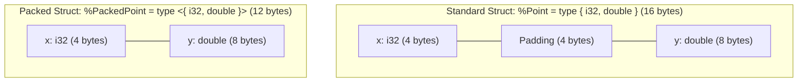

# Step 14.1: Struct Types and ABI DataLayout

In high-level languages, a `struct` groups multiple heterogeneous fields into a single contiguous block of memory.

In LLVM IR, composite record types are represented by **`llvm::StructType`**.

---

## Memory Padding and Alignment



> [!NOTE]
> **Always Consult DataLayout**:
> Never calculate struct member offsets by adding byte sizes manually in frontend compiler code.  Target architectures have varying ABI rules for field alignments and tail padding.  Always query `Module->getDataLayout()` to obtain target-accurate struct sizing and member offsets.

---

## Incremental Code Changes

Open `kaleidoscope.cpp` to define struct types and query target layouts.

### 1. Creating a Named Struct Type

To define a struct type, provide the element types to `llvm::StructType::create`:

```cpp
#include "llvm/IR/DerivedTypes.h"

// Define: struct Point { int32_t x; double y; };
llvm::Type *I32Ty = Builder->getInt32Ty();
llvm::Type *DoubleTy = Builder->getDoubleTy();

llvm::StructType *PointTy =
    llvm::StructType::create(*TheContext, {I32Ty, DoubleTy}, "Point");
```

In LLVM IR, this definition appears at module scope as:

```llvm
%Point = type { i32, double }
```

### 2. Hardware Alignment and Padding

How many bytes does `%Point = type { i32, double }` occupy in memory?

* `i32` is 4 bytes.
* `double` is 8 bytes.

Naive math suggests $4 + 8 = 12$ bytes.  However, on standard modern architectures (x86-64 and ARM64), 64-bit floating-point numbers **must be aligned to 8-byte memory boundaries** for efficient hardware access.

To ensure `y` is 8-byte aligned, the compiler must insert **4 bytes of invisible padding** between `x` and `y`.  Therefore, the actual allocated size of `Point` is **16 bytes**.

### 3. Querying `DataLayout`

Never hardcode struct sizes or offsets in a compiler.  Always ask LLVM's **`DataLayout`**:

```cpp
#include "llvm/IR/DataLayout.h"

const llvm::DataLayout &DL = TheModule->getDataLayout();

uint64_t StructSize = DL.getTypeAllocSize(PointTy);
llvm::Align StructAlign = DL.getABITypeAlign(PointTy);

fprintf(stderr, "Size: %lu bytes, Alignment: %u bytes\n",
        StructSize, (unsigned)StructAlign.value());
// Prints: Size: 16 bytes, Alignment: 8 bytes
```

`DataLayout` computes exact sizes, field offsets, and alignments according to the target platform's Application Binary Interface (ABI).

### 4. Packed Structs

If you require a struct without padding (for example, parsing a binary file header or network packet), create a **packed struct**:

```cpp
llvm::StructType *PackedTy = llvm::StructType::create(
    *TheContext, {I32Ty, DoubleTy}, "PackedPoint", /*isPacked=*/true);
```

In IR, packed structs are wrapped with `<{ ... }>`:

```llvm
%PackedPoint = type <{ i32, double }>
```

Packed structs have a size of exactly 12 bytes, but may incur significant performance penalties on hardware due to unaligned memory accesses.

---

In [Step 14.2](02-understanding-gep.md), we will learn how `getelementptr` computes field addresses without touching memory.
