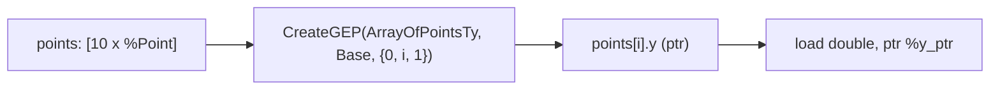

# Step 14.3: Arrays and Member Access in Practice

Now that you understand the dual-index mechanics of `getelementptr`, you can combine structs, arrays, and memory operations into complete data pipelines.

---

## Hierarchical Indexing Architecture



> [!NOTE]
> **Decayed Pointers vs. Array Allocations**:
> Notice the difference between indexing a stack array allocation `[10 x i32]` and indexing a decayed pointer argument `ptr %arr`.  When indexing an allocated array `[10 x i32]`, two indices are required (`{0, i}`) because the pointer points to the array itself.  When indexing a decayed pointer `ptr %arr` where the element type is specified as `i32`, only a single index (`i`) is needed.

---

## Incremental Code Changes

Open `kaleidoscope.cpp` to create arrays and perform member access.

### 1. Array Types in LLVM

To define a fixed-size array type in LLVM, use `llvm::ArrayType::get`:

```cpp
// Define an array of 10 integers: [10 x i32]
llvm::ArrayType *Array10Ty = llvm::ArrayType::get(Builder->getInt32Ty(), 10);
```

To allocate this array on the stack:

```cpp
llvm::AllocaInst *ArrayAlloca = Builder->CreateAlloca(Array10Ty, nullptr, "my_array");
```

### 2. Indexing an Array with GEP

To compute a pointer to element `i` of your stack-allocated array (`&my_array[i]`):

```cpp
// my_array has type [10 x i32]
// Index 0: index through the pointer (to the first [10 x i32] array)
// Index i: index into the array (to the i-th i32 element)
llvm::Value *ElemPtr = Builder->CreateGEP(
    Array10Ty, ArrayAlloca, {Builder->getInt32(0), IndexVal}, "elem_ptr");
```

Once you have `ElemPtr`, write to it with `store`, or read from it with `load`:

```cpp
// Store 100 into my_array[i]:
Builder->CreateStore(Builder->getInt32(100), ElemPtr);

// Load value from my_array[i]:
llvm::Value *Val = Builder->CreateLoad(Builder->getInt32Ty(), ElemPtr, "elem_val");
```

---

## 3. Emitted IR Example

```llvm
%Point = type { i32, double }

define double @get_point_y(ptr %p) {
entry:
  %y_ptr = getelementptr inbounds %Point, ptr %p, i32 0, i32 1
  %y_val = load double, ptr %y_ptr, align 8
  ret double %y_val
}

define void @fill_array(ptr %arr, i32 %idx, i32 %val) {
entry:
  %elem_ptr = getelementptr inbounds i32, ptr %arr, i32 %idx
  store i32 %val, ptr %elem_ptr, align 4
  ret void
}
```

Notice the second function: when indexing a raw pointer `ptr %arr` (decayed array pointer), GEP only needs **one index** because the element type is specified directly as `i32`.

---

## Full Working Example

The complete reference implementation for this section is available in [code/step38-structs-gep.cpp](../code/step38-structs-gep.cpp).

<details>
<summary><b>Expand to view complete code (step38-structs-gep.cpp)</b></summary>

```cpp
#include "llvm/IR/BasicBlock.h"
#include "llvm/IR/Constants.h"
#include "llvm/IR/DataLayout.h"
#include "llvm/IR/DerivedTypes.h"
#include "llvm/IR/Function.h"
#include "llvm/IR/IRBuilder.h"
#include "llvm/IR/Instructions.h"
#include "llvm/IR/LLVMContext.h"
#include "llvm/IR/Module.h"
#include "llvm/IR/Type.h"
#include "llvm/IR/Verifier.h"
#include "llvm/Support/raw_ostream.h"

#include <cstdio>
#include <memory>

int main() {
  auto Context = std::make_unique<llvm::LLVMContext>();
  auto Module = std::make_unique<llvm::Module>("struct_gep_demo", *Context);
  auto Builder = std::make_unique<llvm::IRBuilder<>>(*Context);

  llvm::Type *I32Ty = llvm::Type::getInt32Ty(*Context);
  llvm::Type *DoubleTy = llvm::Type::getDoubleTy(*Context);
  llvm::Type *PtrTy = llvm::PointerType::get(*Context, 0);

  // Define struct Point { int32_t x; double y; };
  llvm::StructType *PointTy =
      llvm::StructType::create(*Context, {I32Ty, DoubleTy}, "Point");

  // Inspect DataLayout sizing and alignment
  const llvm::DataLayout &DL = Module->getDataLayout();
  uint64_t StructSize = DL.getTypeAllocSize(PointTy);
  llvm::Align StructAlign = DL.getABITypeAlign(PointTy);
  fprintf(stderr, "Struct Point size: %lu bytes, align: %u bytes\n", StructSize,
          (unsigned)StructAlign.value());

  // Function: double get_point_y(Point *p)
  llvm::FunctionType *FT = llvm::FunctionType::get(DoubleTy, {PtrTy}, false);
  llvm::Function *F = llvm::Function::Create(
      FT, llvm::Function::ExternalLinkage, "get_point_y", Module.get());

  llvm::Value *PtrArg = F->arg_begin();
  PtrArg->setName("p");

  llvm::BasicBlock *BB = llvm::BasicBlock::Create(*Context, "entry", F);
  Builder->SetInsertPoint(BB);

  // Compute GEP to field 1 (y): gep Point, ptr %p, i32 0, i32 1
  llvm::Value *YPtr = Builder->CreateStructGEP(PointTy, PtrArg, 1, "y_ptr");
  llvm::Value *YVal = Builder->CreateLoad(DoubleTy, YPtr, "y_val");

  Builder->CreateRet(YVal);

  llvm::verifyFunction(*F);
  Module->print(llvm::errs(), nullptr);
  return 0;
}
```
</details>

---

## Active Learning Challenge

<details>
<summary><b>Challenge: Array of Structs</b></summary>

Suppose you have an array of structs: `struct Point points[10]`.  How do you compute the pointer to `points[i].y` in LLVM IR?

<br>

**Solution**:
```cpp
// 1. Array type: [10 x %Point]
// Indices needed:
// 0: Through the pointer to points
// i: Index into the array to select points[i]
// 1: Index into the struct to select field .y
llvm::Value *YPtr = Builder->CreateGEP(
    ArrayOfPointsTy, PointsAlloca,
    {Builder->getInt32(0), IndexVal, Builder->getInt32(1)},
    "y_ptr");
```

GEP chains indices hierarchically: pointer $\to$ array element $\to$ struct member.

</details>

---

In [Section 15](../15-debug-info/README.md), we will teach our compiler how to emit DWARF debug information for source-level debugging in GDB and LLDB.
