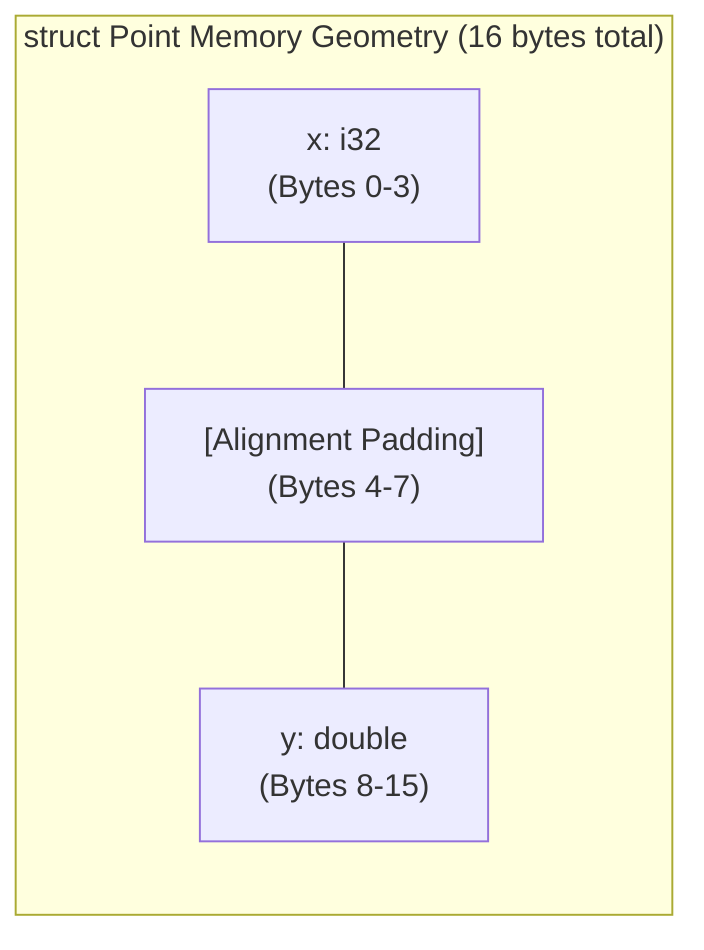

# Section 14: Aggregate Structs, Arrays, and GetElementPtr

In Section 13, you learned how LLVM models pointers and allocates memory on the stack and heap.  However, real programs rarely allocate solitary integers or doubles in isolation.  They organise data into **records, structs, and arrays**.

Welcome to **Kaleidoscope 201: Systems Programming and Core LLVM**.

In this section, you will learn how LLVM represents composite data structures using `llvm::StructType` and `llvm::ArrayType`.  You will discover how LLVM's `DataLayout` calculates ABI alignment and padding, and you will master **`GetElementPtr` (GEP)**: the single most important, and most frequently misunderstood, instruction in the LLVM instruction set.

---

## Struct Layout and Memory Alignment



> [!IMPORTANT]
> **The Golden Rule of GEP**:
> The `getelementptr` instruction NEVER accesses memory.  It performs no loads and no stores.  GEP is an address arithmetic instruction that computes a target pointer from a base pointer and type offsets.

---

## Steps in This Section

1.  [Step 14.1: Struct Types and ABI DataLayout](01-struct-types-layout.md) - Define struct types, inspect memory sizing, and understand hardware padding.
2.  [Step 14.2: Demystifying GetElementPtr](02-understanding-gep.md) - Understand how GEP calculates pointer addresses without accessing memory.
3.  [Step 14.3: Arrays and Member Access in Practice](03-arrays-indexing.md) - Access struct fields and index array elements using GEP.

---

## Compiling Your Compiler

Compile against LLVM core libraries:

```bash
clang++ -Iinclude -Wall -Wextra kaleidoscope.cpp $(llvm-config --cxxflags --ldflags --system-libs --libs core) -o kaleidoscope
```

Reference code implementations for each step are stored in the [code/](../code/) directory.
