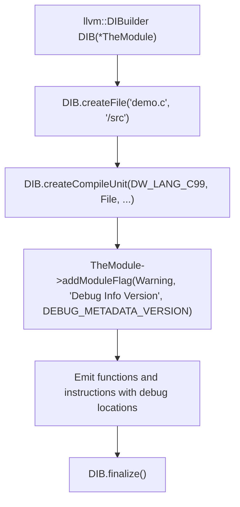

# Step 15.1: Initialising DIBuilder and Compile Units

DWARF is the industry-standard debug data format used on Linux, macOS, and BSD platforms.  It encodes source file paths, line tables, variable scopes, and type definitions directly into special ELF/Mach-O sections (`.debug_info`, `.debug_line`, `.debug_loc`).

In LLVM, generating DWARF metadata is managed by **`llvm::DIBuilder`**.

---

## DIBuilder Initialisation Pipeline



> [!IMPORTANT]
> **Always Finalise the DIBuilder**:
> You must invoke `DIB.finalize()` after emitting all functions and before verifying the module or writing object files.  Calling `finalize()` resolves forward-referenced type nodes, constructs complete lexical scopes, and writes root compile unit anchors (`!llvm.dbg.cu`) into the module.  Omitting `finalize()` causes LLVM verifier assertions or missing debug tables.

---

## Incremental Code Changes

Open `kaleidoscope.cpp` to initialise the debug information builder.

### 1. Creating the `DIBuilder`

Include the debug info builder header:

```cpp
#include "llvm/IR/DIBuilder.h"
```

Instantiate the builder on your module:

```cpp
llvm::DIBuilder DIB(*TheModule);
```

### 2. Defining File and Compile Unit Metadata

A debugger must first know the source file being compiled and the language conventions to use:

```cpp
// 1. Define source file path
llvm::DIFile *File = DIB.createFile("fib.ks", "/home/user/project");

// 2. Define the Compile Unit (top-level debug root)
llvm::DICompileUnit *CU = DIB.createCompileUnit(
    llvm::dwarf::DW_LANG_C99,           // Language convention
    File,                               // Source file
    "Kaleidoscope Compiler",            // Producer name
    /*isOptimized=*/false,              // Compiler optimisation flag
    /*Flags=*/"",                       // Command-line flags string
    /*RuntimeVersion=*/0                // Runtime version
);
```

### 3. Setting Module Debug Version Flags

Modern debuggers and linkers require an explicit metadata flag in the module specifying the DWARF version format.  Add this to your module initialisation:

```cpp
TheModule->addModuleFlag(
    llvm::Module::Warning, "Debug Info Version", llvm::DEBUG_METADATA_VERSION);
```

### 4. Finalising the Debug Metadata

Once all functions and instructions have been emitted, you **must** finalise the debug metadata before writing object code or JIT compiling:

```cpp
DIB.finalize();
```

`finalize()` resolves forward references, computes lexical scopes, and writes the root compile unit nodes (`!llvm.dbg.cu`) into the module.

---

In [Step 15.2](02-subprograms-locations.md), we will create subprograms and attach line numbers to instructions.
