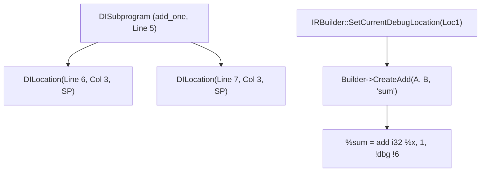

# Step 15.2: Subprograms and Instruction Locations

With the compile unit and source file configured, you can now attach debug metadata to individual functions and instructions.

---

## Debug Location Attachment



> [!NOTE]
> **Source Columns and Sub-Expressions**:
> `llvm::DILocation::get(*TheContext, Line, Column, Scope)` records both line and column coordinates.  Modern debuggers and IDEs use column coordinates to place precise breakpoints inside multi-operator expressions and highlight exact evaluation sites.

---

## Incremental Code Changes

Open `kaleidoscope.cpp` to create subprograms and set instruction debug locations.

### 1. Creating `DISubprogram` for Functions

In DWARF terminology, a function is a **Subprogram**.

Create the debug subroutine type and the subprogram metadata node, then attach it to the `llvm::Function`:

```cpp
// 1. Create subroutine type signature (e.g. returning int, taking int)
llvm::DISubroutineType *DIType = DIB.createSubroutineType(
    DIB.getOrCreateTypeArray({
        DIB.createBasicType("int", 32, llvm::dwarf::DW_ATE_signed)
    }));

// 2. Create the DISubprogram node
llvm::DISubprogram *SP = DIB.createFunction(
    File,                               // Enclosing file scope
    "add_one",                          // Function name in source
    "add_one",                          // Linkage / mangled name
    File,                               // Declared file
    5,                                  // Source line number
    DIType,                             // Type signature
    5,                                  // Scope line number
    llvm::DINode::FlagPrototyped,
    llvm::DISubprogram::SPFlagDefinition
);

// 3. Attach subprogram to the LLVM Function
TheFunction->setSubprogram(SP);
```

### 2. Attaching Source Locations to Instructions

To tell a debugger which line of source code an instruction corresponds to, configure the `IRBuilder`'s current debug location before creating the instruction:

```cpp
// Set source location to line 6, column 3 inside subprogram SP:
Builder->SetCurrentDebugLocation(
    llvm::DILocation::get(*TheContext, 6, 3, SP));

// Instructions emitted now will automatically carry this debug location:
llvm::Value *Sum = Builder->CreateAdd(A, B, "sum");
```

Whenever the debugger steps to `Sum`, it will highlight line 6 in the developer's source editor!

---

## 3. Emitted IR with Debug Attachments

Inspect the emitted LLVM IR:

```llvm
define i32 @add_one(i32 %x) !dbg !2 {
entry:
  %sum = add i32 %x, 1, !dbg !6
  ret i32 %sum, !dbg !7
}

!0 = distinct !DICompileUnit(language: DW_LANG_C99, file: !1, producer: "Kaleidoscope Compiler", ...)
!1 = !DIFile(filename: "fib.ks", directory: "/project")
!2 = distinct !DISubprogram(name: "add_one", scope: !1, file: !1, line: 5, unit: !0, ...)
!6 = !DILocation(line: 6, column: 3, scope: !2)
!7 = !DILocation(line: 7, column: 3, scope: !2)
```

Every instruction contains an attached `!dbg` tag pointing to metadata containing its exact line and column numbers.

---

## Full Working Example

The complete reference implementation for this section is available in [code/step39-debug-info.cpp](../code/step39-debug-info.cpp).

<details>
<summary><b>Expand to view complete code (step39-debug-info.cpp)</b></summary>

```cpp
#include "llvm/IR/DIBuilder.h"
#include "llvm/IR/Function.h"
#include "llvm/IR/IRBuilder.h"
#include "llvm/IR/LLVMContext.h"
#include "llvm/IR/Module.h"
#include "llvm/IR/Verifier.h"
#include "llvm/Support/raw_ostream.h"

#include <memory>

int main() {
  auto Context = std::make_unique<llvm::LLVMContext>();
  auto Module = std::make_unique<llvm::Module>("debug_demo", *Context);
  auto Builder = std::make_unique<llvm::IRBuilder<>>(*Context);

  llvm::DIBuilder DIB(*Module);

  // 1. DIFile and DICompileUnit
  llvm::DIFile *File = DIB.createFile("demo.c", "/src");
  llvm::DICompileUnit *CU = DIB.createCompileUnit(
      llvm::dwarf::DW_LANG_C99, File, "Kaleidoscope201", false, "", 0);

  // 2. Function prototype
  llvm::Type *I32Ty = llvm::Type::getInt32Ty(*Context);
  llvm::FunctionType *FT = llvm::FunctionType::get(I32Ty, {I32Ty}, false);
  llvm::Function *F = llvm::Function::Create(
      FT, llvm::Function::ExternalLinkage, "add_one", Module.get());

  // 3. DISubprogram
  llvm::DISubroutineType *DIType =
      DIB.createSubroutineType(DIB.getOrCreateTypeArray(
          {DIB.createBasicType("int", 32, llvm::dwarf::DW_ATE_signed)}));
  llvm::DISubprogram *SP = DIB.createFunction(
      File, "add_one", "add_one", File, 5, DIType, 5,
      llvm::DINode::FlagPrototyped, llvm::DISubprogram::SPFlagDefinition);
  F->setSubprogram(SP);

  llvm::BasicBlock *BB = llvm::BasicBlock::Create(*Context, "entry", F);
  Builder->SetInsertPoint(BB);

  // Set line number 6 on instruction
  Builder->SetCurrentDebugLocation(llvm::DILocation::get(*Context, 6, 3, SP));
  llvm::Value *Arg = F->arg_begin();
  llvm::Value *Add = Builder->CreateAdd(Arg, Builder->getInt32(1), "add");

  // Set line number 7 on return
  Builder->SetCurrentDebugLocation(llvm::DILocation::get(*Context, 7, 3, SP));
  Builder->CreateRet(Add);

  // Finalise DWARF metadata
  DIB.finalize();

  llvm::verifyFunction(*F);
  Module->print(llvm::errs(), nullptr);
  return 0;
}
```
</details>

---

In [Step 15.3](03-debugging-with-lldb.md), we will step through our compiled functions in LLDB.
