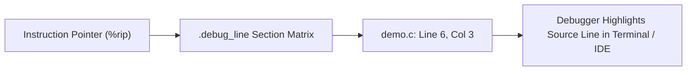

# Step 15.3: Stepping Through Code with LLDB

With DWARF metadata emitted into your object files, developers can debug your compiled language just like C, C++, or Rust.

In this step, you will compile a function with debug information, link it into an executable, and step through it line-by-line in `lldb`.

---

## Debugger Address Mapping Architecture



> [!TIP]
> **DWARF Line Tables and Breakpoints**:
> The `.debug_line` section encodes a state machine matrix mapping machine code byte addresses to source file paths, line numbers, and column offsets.  When you set a breakpoint on a function or source line in LLDB, the debugger consults this table to insert a software trap (`int3` on x86-64) at the exact machine instruction corresponding to that line.

---

## 1. Emitting Object Code with Debug Symbols

Compile your compiler and emit `output.o`:

```bash
clang++ -Iinclude -Wall -Wextra kaleidoscope.cpp $(llvm-config --cxxflags --ldflags --system-libs --libs core target native codegen) -o kaleidoscope
./kaleidoscope < input.ks
```

Verify that the ELF object file contains DWARF debug sections:

```bash
readelf -S output.o | grep debug
```

You will see `.debug_info`, `.debug_abbrev`, and `.debug_line` sections present in the binary.

---

## 2. Linking and Launching the Debugger

Link `output.o` with your C driver program, passing `-g` to preserve symbols:

```bash
clang -g main.c output.o -o debug_app
```

Now launch `lldb`:

```bash
lldb ./debug_app
```

---

## 3. Setting Breakpoints and Stepping

Inside the `lldb` prompt, set a breakpoint on your compiled function and run the application:

```text
(lldb) breakpoint set -n add_one
Breakpoint 1: where = debug_app`add_one + 14 at demo.c:6:3
(lldb) run
Process launched: './debug_app'
Process stopped
* thread #1, name = 'debug_app', stop reason = breakpoint 1.1
    frame #0: 0x000055555555518e debug_app`add_one(x=10) at demo.c:6:3
-> 6       int sum = x + 1;
   7       return sum;
(lldb) step
-> 7       return sum;
(lldb) continue
Process resumed
average = 11.000000
```

Notice that the debugger stopped at the exact line number (`demo.c:6:3`) you specified in `Builder->SetCurrentDebugLocation`!

---

In [Section 16](../16-custom-opt-pass/README.md), we will write custom compiler optimization passes using LLVM's modern PassManager.
