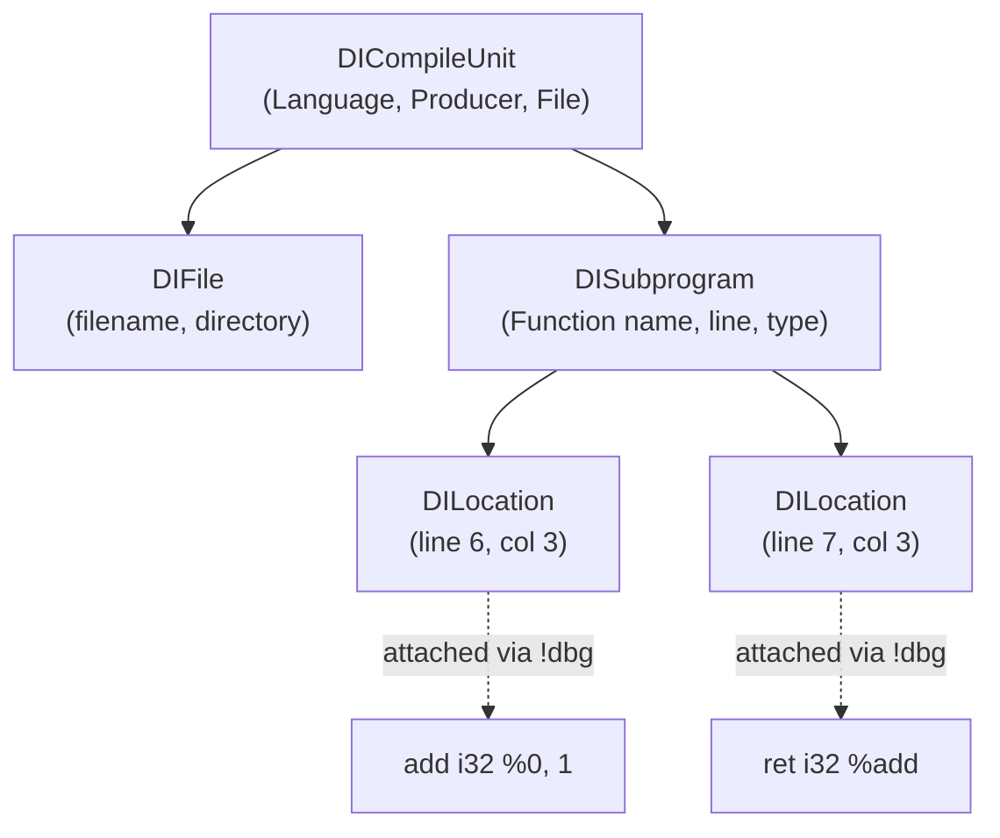

# Section 15: Source-Level Debug Information (DWARF)

When a program crashes or computes an unexpected result, developers do not inspect raw machine bytes or assembly instructions.  They fire up a debugger like **`lldb`** or **`gdb`**, set breakpoints on source code lines, and step through execution.

How does a debugger translate binary memory addresses back to the file names and line numbers written by the programmer?

The answer is **DWARF Debug Information**.

Welcome to **Kaleidoscope 201: Systems Programming and Core LLVM**.

In this section, you will learn how to use LLVM's **`DIBuilder`** to emit standard DWARF metadata.  You will attach source line locations to instructions, define subprogram metadata, and step through your compiled functions inside a native debugger.

---

## DWARF Metadata Architecture



> [!NOTE]
> **Separation of Code and Debug Metadata**:
> In LLVM IR, debug information is represented as auxiliary metadata nodes (`!dbg`) rather than inline executable instructions.  Optimiser passes can reorder, duplicate, or delete instructions while updating their attached `DILocation` tags, preserving source-level debuggability even in optimised code.

---

## Steps in This Section

1.  [Step 15.1: Initialising DIBuilder and Compile Units](01-dibuilder-setup.md) - Set up debug files, compile units, and DWARF standards.
2.  [Step 15.2: Subprograms and Instruction Locations](02-subprograms-locations.md) - Attach line numbers and lexical scopes to generated instructions.
3.  [Step 15.3: Stepping Through Code with LLDB](03-debugging-with-lldb.md) - Compile to object code and step through source lines in a real debugger.

---

## Compiling Your Compiler

Compile against LLVM core libraries:

```bash
clang++ -Iinclude -Wall -Wextra kaleidoscope.cpp $(llvm-config --cxxflags --ldflags --system-libs --libs core) -o kaleidoscope
```

Reference code implementations for each step are stored in the [code/](../code/) directory.
