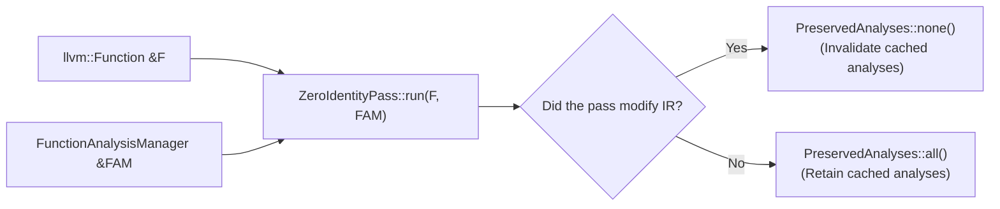

# Step 16.1: The Modern LLVM Pass Pipeline

In LLVM, an optimization pass is an isolated component that inspects or transforms Intermediate Representation.

Since LLVM 13, LLVM has completely standardized on the **New Pass Manager (NPM)**.  Understanding this architecture is essential for anyone working on core LLVM.

---

## Pass Execution and Analysis Management



> [!TIP]
> **Out-of-Tree Pass Plugins**:
> LLVM supports loading custom passes dynamically into `opt` or `clang` as shared objects via the `-load-pass-plugin` flag.  Out-of-tree plugins expose the entrypoint `extern "C" ::llvm::PassPluginLibraryInfo llvmGetPassPluginInfo()` to register passes into the standard `PassBuilder` pipeline callbacks.

---

## Incremental Code Changes

Open `kaleidoscope.cpp` to create a modern LLVM pass.

### 1. Defining a Function Pass with `PassInfoMixin`

To create an optimization pass that operates on individual functions, inherit from `llvm::PassInfoMixin<T>` using the Curiously Recurring Template Pattern (CRTP):

```cpp
#include "llvm/IR/PassManager.h"
#include "llvm/Passes/PassBuilder.h"

class ZeroIdentityPass : public llvm::PassInfoMixin<ZeroIdentityPass> {
public:
  llvm::PreservedAnalyses run(llvm::Function &F,
                              llvm::FunctionAnalysisManager &FAM) {
    bool Modified = false;

    // Transformation logic goes here...

    return Modified ? llvm::PreservedAnalyses::none()
                    : llvm::PreservedAnalyses::all();
  }
};
```

### 2. Understanding `PreservedAnalyses`

Notice the return type: **`llvm::PreservedAnalyses`**.

In a compiler pipeline, passes often compute expensive mathematical structures, such as the **Dominator Tree** or **Loop Information**.

* If your pass only reads IR without modifying anything, return `PreservedAnalyses::all()`.  LLVM will reuse the existing analyses for future passes without recomputing them.
* If your pass adds, removes, or rewrites instructions, return `PreservedAnalyses::none()`.  LLVM will safely invalidate outdated analyses and recompute them when needed.

### 3. Running the Pass Pipeline

To run your pass on a function:

```cpp
// 1. Initialise analysis managers
llvm::FunctionAnalysisManager FAM;
llvm::PassBuilder PB;
PB.registerFunctionAnalyses(FAM);

// 2. Build the pass pipeline
llvm::FunctionPassManager FPM;
FPM.addPass(ZeroIdentityPass());

// 3. Execute the pipeline
FPM.run(TheFunction, FAM);
```

---

In [Step 16.2](02-inspecting-modifying-ir.md), we will traverse instructions and eliminate arithmetic identities.
