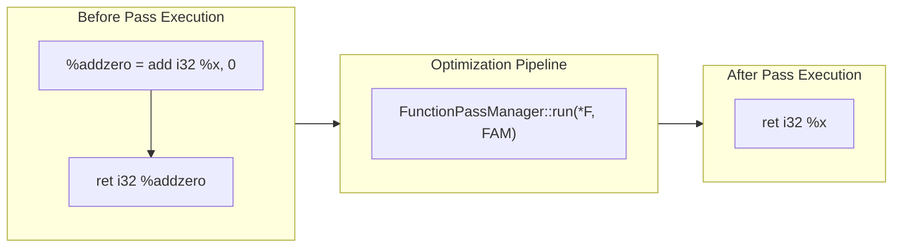

# Step 16.3: Running Your Pass and Verifying Optimisations

Now that your pass safely matches, rewrites, and erases arithmetic identities, we will wire it into a complete pass pipeline and observe the transformed IR.

---

## Pass Pipeline Execution



> [!NOTE]
> **Peephole Simplification and InstCombine**:
> The `ZeroIdentityPass` you built is a classic example of algebraic peephole optimisation.  In production LLVM, hundreds of algebraic simplifications, bitwise identities, and strength reductions are unified into the core `InstCombine` (Instruction Combining) pass.

---

## 1. Complete Pass Implementation

Here is the complete `ZeroIdentityPass`:

```cpp
#include "llvm/IR/BasicBlock.h"
#include "llvm/IR/Constants.h"
#include "llvm/IR/Function.h"
#include "llvm/IR/Instructions.h"
#include "llvm/IR/PassManager.h"
#include "llvm/Passes/PassBuilder.h"

class ZeroIdentityPass : public llvm::PassInfoMixin<ZeroIdentityPass> {
public:
  llvm::PreservedAnalyses run(llvm::Function &F,
                              llvm::FunctionAnalysisManager &) {
    bool Modified = false;

    for (auto &BB : F) {
      for (auto Inst = BB.begin(), E = BB.end(); Inst != E; ) {
        llvm::Instruction &I = *Inst++;

        // Match: %res = add i32 %x, 0
        if (I.getOpcode() == llvm::Instruction::Add) {
          if (auto *CI = llvm::dyn_cast<llvm::ConstantInt>(I.getOperand(1))) {
            if (CI->isZero()) {
              I.replaceAllUsesWith(I.getOperand(0));
              I.eraseFromParent();
              Modified = true;
            }
          }
        }
      }
    }

    return Modified ? llvm::PreservedAnalyses::none()
                    : llvm::PreservedAnalyses::all();
  }
};
```

---

## 2. Compile and Verify

Compile your program against LLVM's `core` and `passes` components:

```bash
clang++ -Iinclude -Wall -Wextra kaleidoscope.cpp $(llvm-config --cxxflags --ldflags --system-libs --libs core passes) -o kaleidoscope
```

Run your binary to see the transformation:

```llvm
=== Before Pass ===
define i32 @identity_test(i32 %x) {
entry:
  %addzero = add i32 %x, 0
  ret i32 %addzero
}

=== After Pass (x + 0 eliminated) ===
define i32 @identity_test(i32 %x) {
entry:
  ret i32 %x
}
```

The dead arithmetic operation was completely eliminated.  The function now returns `%x` directly in a single machine instruction.

---

## Full Working Example

The complete reference implementation for this section is available in [code/step40-custom-pass.cpp](../code/step40-custom-pass.cpp).

<details>
<summary><b>Expand to view complete code (step40-custom-pass.cpp)</b></summary>

```cpp
#include "llvm/IR/BasicBlock.h"
#include "llvm/IR/Constants.h"
#include "llvm/IR/DerivedTypes.h"
#include "llvm/IR/Function.h"
#include "llvm/IR/IRBuilder.h"
#include "llvm/IR/Instructions.h"
#include "llvm/IR/LLVMContext.h"
#include "llvm/IR/Module.h"
#include "llvm/IR/PassManager.h"
#include "llvm/IR/Type.h"
#include "llvm/IR/Verifier.h"
#include "llvm/Passes/PassBuilder.h"
#include "llvm/Support/raw_ostream.h"

#include <memory>

class ZeroIdentityPass : public llvm::PassInfoMixin<ZeroIdentityPass> {
public:
  llvm::PreservedAnalyses run(llvm::Function &F,
                              llvm::FunctionAnalysisManager &) {
    bool Modified = false;
    for (auto &BB : F) {
      for (auto Inst = BB.begin(), E = BB.end(); Inst != E;) {
        llvm::Instruction &I = *Inst++;
        if (I.getOpcode() == llvm::Instruction::Add) {
          if (auto *CI = llvm::dyn_cast<llvm::ConstantInt>(I.getOperand(1))) {
            if (CI->isZero()) {
              I.replaceAllUsesWith(I.getOperand(0));
              I.eraseFromParent();
              Modified = true;
            }
          }
        }
      }
    }
    return Modified ? llvm::PreservedAnalyses::none()
                    : llvm::PreservedAnalyses::all();
  }
};

int main() {
  auto Context = std::make_unique<llvm::LLVMContext>();
  auto Module = std::make_unique<llvm::Module>("pass_demo", *Context);
  auto Builder = std::make_unique<llvm::IRBuilder<>>(*Context);

  llvm::Type *I32Ty = llvm::Type::getInt32Ty(*Context);
  llvm::FunctionType *FT = llvm::FunctionType::get(I32Ty, {I32Ty}, false);
  llvm::Function *F = llvm::Function::Create(
      FT, llvm::Function::ExternalLinkage, "identity_test", Module.get());

  llvm::BasicBlock *BB = llvm::BasicBlock::Create(*Context, "entry", F);
  Builder->SetInsertPoint(BB);

  llvm::Value *Arg = F->arg_begin();
  llvm::Value *AddZero =
      Builder->CreateAdd(Arg, Builder->getInt32(0), "addzero");
  Builder->CreateRet(AddZero);

  fprintf(stderr, "=== Before Pass ===\n");
  Module->print(llvm::errs(), nullptr);

  // Run custom pass
  llvm::FunctionAnalysisManager FAM;
  llvm::PassBuilder PB;
  PB.registerFunctionAnalyses(FAM);

  llvm::FunctionPassManager FPM;
  FPM.addPass(ZeroIdentityPass());
  FPM.run(*F, FAM);

  fprintf(stderr, "\n=== After Pass (x + 0 eliminated) ===\n");
  Module->print(llvm::errs(), nullptr);
  return 0;
}
```
</details>

---

## Active Learning Challenge

<details>
<summary><b>Challenge: Multiplying by 1 and Multiplying by 0</b></summary>

Extend your pass to simplify multiplication operations:
1.  **Multiply by 1**: $x \times 1 \to x$.
2.  **Multiply by 0**: $x \times 0 \to 0$.

Hint: Use `I.getOpcode() == llvm::Instruction::Mul`.  For multiplying by 0, replace all uses with `CI` (the zero constant), then erase `I`.

<br>

**Solution**:
```cpp
if (I.getOpcode() == llvm::Instruction::Mul) {
  if (auto *CI = llvm::dyn_cast<llvm::ConstantInt>(I.getOperand(1))) {
    if (CI->isOne()) {
      // x * 1 -> x
      I.replaceAllUsesWith(I.getOperand(0));
      I.eraseFromParent();
      Modified = true;
    } else if (CI->isZero()) {
      // x * 0 -> 0
      I.replaceAllUsesWith(CI);
      I.eraseFromParent();
      Modified = true;
    }
  }
}
```

</details>

---

## Tutorial Series Complete

Congratulations!  Across Kaleidoscope 101 and 201, you have progressed from an initial fifteen-line character scanner all the way to:
* Lexing, parsing, and building Abstract Syntax Trees.
* Recursive descent parsing with operator precedence climbing.
* Emitting clean Static Single Assignment (SSA) form with basic blocks and PHI nodes.
* Native Just-In-Time (JIT) compilation using modern ORCv2.
* Static ahead-of-time (AOT) object file emission.
* Primitive integer types, bitwise math, and sign-agnostic registers.
* Global variables, linkage visibility, and string literal constant pools.
* Unified opaque pointers (`ptr`), heap memory management, and `GetElementPtr` address math.
* DWARF source-level debug information for GDB and LLDB.
* Developing custom compiler transformation passes in the modern PassManager.

You now possess the foundational knowledge required to contribute to core LLVM or engineer production-grade compiler frontends.
